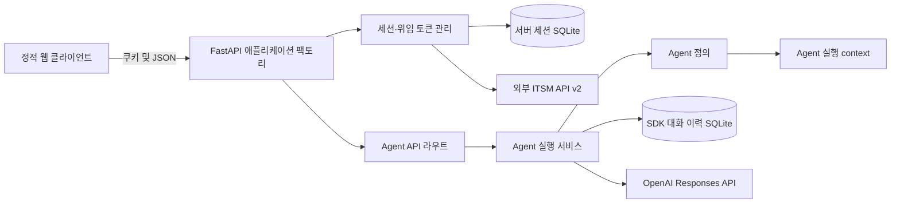
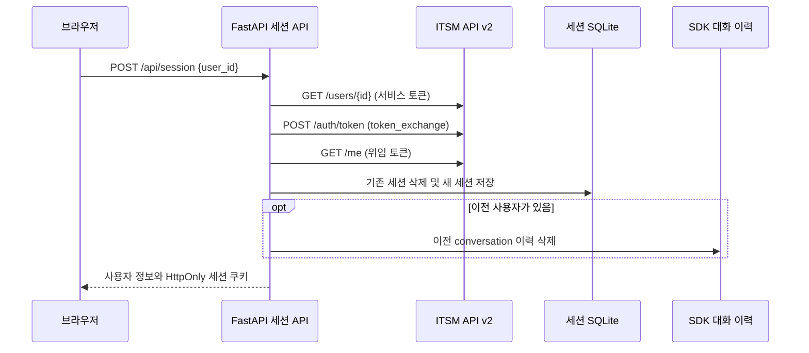
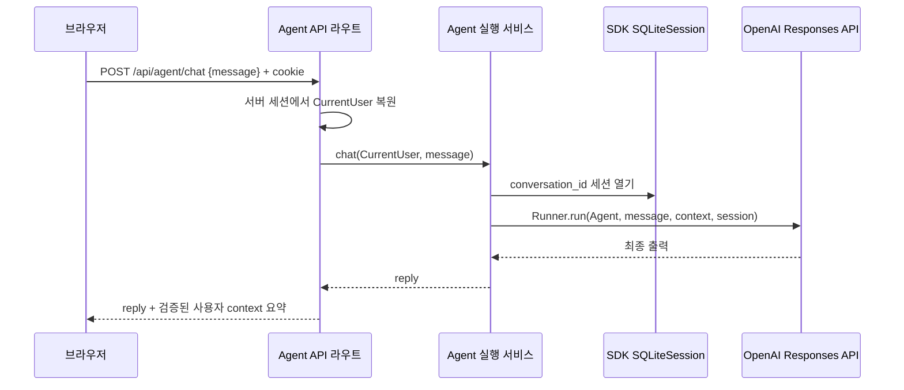
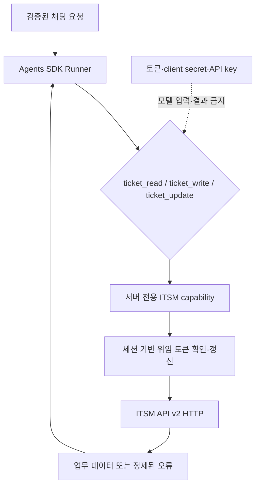

# ITSM Assistant 아키텍처

## Architecture Analysis

### System Overview

ITSM Assistant는 브라우저 정적 클라이언트, 단일 FastAPI 프로세스, 두 SQLite 저장소, 외부 ITSM API와 OpenAI Responses API로 구성된다. FastAPI 앱이 사용자 세션과 Agent 실행을 조율하며 ITSM 업무 데이터는 로컬에 복제하지 않는다.

### Architectural Style

배포 단위가 하나인 계층형 모놀리스다. `create_app()`이 설정, ITSM HTTP 클라이언트와 AgentService를 조립하고 `app.state`에 보관한다. FastAPI 라우트가 HTTP 경계, `session.py`와 `AgentService`가 애플리케이션 서비스, `ItsmAuthClient`가 외부 API 어댑터, `db.py`와 Agents SDK `SQLiteSession`이 영속성 어댑터 역할을 한다.

### Component Relationships

텍스트 대체: 브라우저는 FastAPI의 세션·Agent API를 호출한다. 세션 서비스는 SQLite와 ITSM API를 사용하고, Agent 서비스는 Agent 정의·실행 context·SDK 대화 저장소와 OpenAI API를 사용한다.

### Data Flow

1. 브라우저는 사용자 ID를 한 번 세션 전환 API에 보낸다.
2. 서버가 ITSM 디렉터리에서 사용자를 확인하고 사용자 위임 토큰을 교환한 뒤 `/me` 결과와 토큰을 서버 세션 SQLite에 저장한다.
3. 이후 보호 API는 HttpOnly 쿠키의 임의 세션 ID로 현재 사용자를 복원한다.
4. 채팅은 검증된 사용자 메타데이터로 `AgentUserContext`를 만들고 conversation ID 기반 SDK `SQLiteSession`과 함께 `Runner.run()`을 호출한다.
5. 현재는 모델 응답만 반환한다. 티켓 도구를 추가하려면 같은 Runner context에서 모델에 비밀을 노출하지 않는 서버 capability로 ITSM API를 호출해야 한다.

### Key Design Decisions

- 앱 팩토리와 생성자 주입으로 테스트에서 DB, 모델, ITSM transport를 교체한다.
- 모델 이름과 reasoning effort를 고정하고 실패 시 대체 모델로 재시도하지 않는다.
- Agents SDK Runner와 SQLiteSession을 직접 사용해 자체 Agent loop·대화 저장 구현을 피한다.
- 사용자 위임 토큰은 쿠키나 Agent context에 공개하지 않고 서버 세션 행에 보관한다.
- SDK 외부 트레이싱을 끄고, OpenAI 오류에 대한 전용 상태·코드 매핑을 둔다.
- ITSM 내부 코드를 가져오지 않고 문서화된 HTTP 계약만 사용한다.

### Improvement Opportunities

- `AgentUserContext`에 원문 토큰 대신 요청 범위의 ITSM ticket capability를 주입해 갱신과 HTTP 호출을 서버에 가둔다.
- 인증·디렉터리 클라이언트에 티켓 계약을 추가하거나 같은 생명주기를 공유하는 티켓 어댑터로 분리한다.
- 원본 `detail`, problem 객체, 요청 헤더나 예외 문자열을 모델·로그·사용자 응답에 전달하지 않는 허용 목록 오류 타입을 둔다.
- 등록 멱등 상태는 conversation/request 경계에 보존하고 결과 불명확 시 같은 키를 재사용한다.
- 수정은 상세 조회 version과 `If-Match`를 한 use case로 묶고 412에서 최신 조회 안내만 반환한다.
- 테스트, lint, coverage와 CI 증거를 명시적으로 자동화한다.

## Interaction Diagrams

### 사용자 전환과 위임 세션

텍스트 대체: 사용자 전환 요청은 디렉터리 확인, 위임 토큰 교환, `/me` 검증, 서버 세션 저장, 이전 대화 삭제 순으로 처리된다.

### 현재 Agent 채팅

텍스트 대체: 채팅 라우트가 서버 세션 사용자를 검증하고 AgentService가 동일 conversation의 SDK 이력과 함께 Runner를 실행한 뒤 답변을 반환한다.

### 티켓 도구 확장 지점

텍스트 대체: 세 function tool은 서버 전용 capability를 통해 세션 토큰을 확인·갱신하고 ITSM API v2를 호출하며, 모델에는 업무 결과나 정제된 오류만 돌아간다. 비밀값은 tool 인자·결과에 들어가지 않는다.

## 배포 및 운영 경계

- ASGI 진입점: `uvicorn app.main:create_app --factory`
- 앱 생명주기: ITSM AsyncClient를 앱 단위로 공유하고 종료 시 닫는다.
- 런타임 데이터: `AGENT_DATA_DIR` 아래 서버 세션 DB와 SDK 이력 DB.
- 외부 의존성: ITSM API와 OpenAI API. 정적 파일은 같은 FastAPI 프로세스가 제공한다.
- 별도 큐, 캐시, 워커, 컨테이너 또는 클라우드 인프라 정의는 저장소에 없다.
