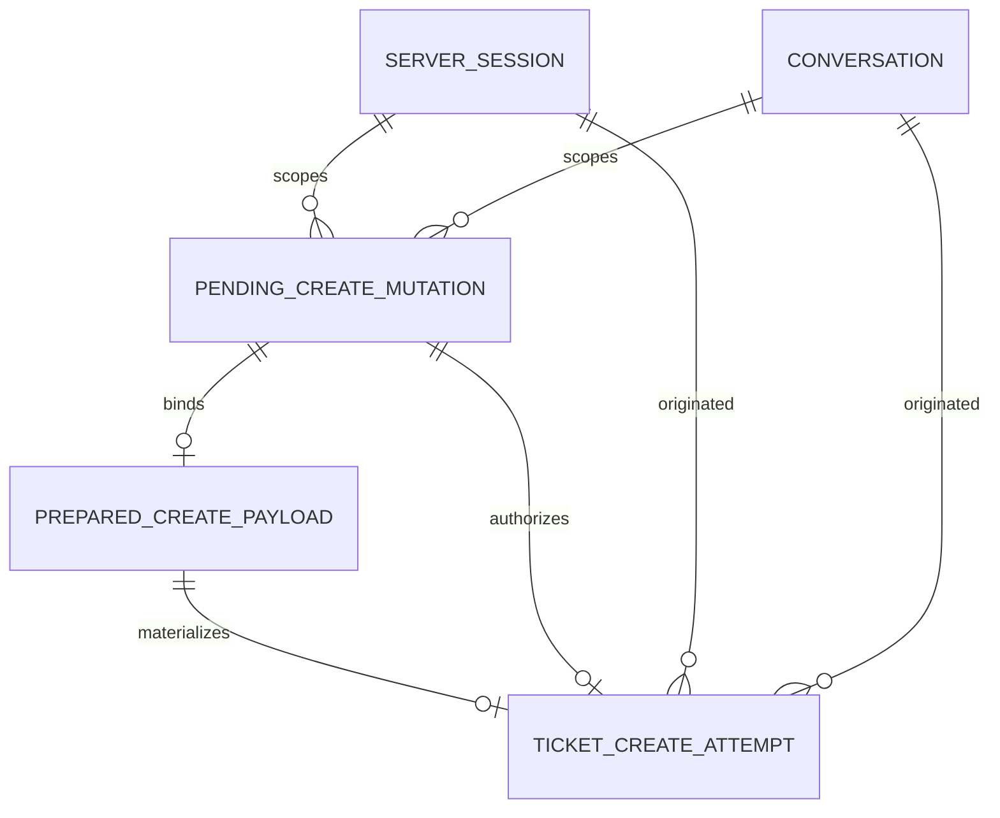

# U2 Ticket Write — Entities

## Sources

- `inception/units-generation/unit-of-work.md` — U2 boundaries, ownership, and storage namespace
- `inception/units-generation/unit-of-work-story-map.md` — U2 acceptance-criteria allocation
- `inception/user-stories/stories.md` — US2.1, shared US4.1, and US5.1 behaviour
- `inception/requirements-analysis/requirements.md` — FR3, FR5, FR6.3, and applicable NFRs
- `inception/domain-design/components.md` — `TicketOperations`, `ItsmGateway`, and lifecycle ownership
- `inception/contract-design/contract-summary.md` — C-01, C-03A, C-04, C-06, and C-07 V1 contracts
- `construction/u1-ticket-read-skeleton/functional-design/functional-design-questions.md` — confirmed 15-minute, latest-per-operation confirmation policy

## Authoritative Entity Model

The YAML block is the source of truth. U2 adds one durable entity and consumes U1-owned confirmation state without changing U1's schema.

```yaml
schema_version: 1
unit: u2-ticket-write

entities:
  - name: PreparedCreatePayloadV1
    owner: U2.TicketOperations.create_extension
    description: Revocable authoritative pre-confirm copy of the exact reviewed create bytes, keyed to the U1 pending mutation identity.
    additional_properties: false
    identity: mutation_id
    attributes:
      - {name: mutation_id, logical_type: opaque_string, required: true, unique: true, references: PendingCreateMutationV1.mutation_id, allowed_values: null, default: null, min: null, max: null, constraints: [immutable, authorization_requires_matching_u1_pending_row]}
      - {name: user_id, logical_type: integer, required: true, unique: false, references: current_server_user, allowed_values: null, default: null, min: null, max: null, constraints: [server_derived, immutable]}
      - {name: session_id, logical_type: opaque_string, required: true, unique: false, references: ServerSession, allowed_values: null, default: null, min: null, max: null, constraints: [immutable]}
      - {name: conversation_id, logical_type: opaque_string, required: true, unique: false, references: Conversation, allowed_values: null, default: null, min: null, max: null, constraints: [immutable]}
      - {name: normalized_payload_hash, logical_type: sha256, required: true, unique: false, references: NormalizedTicketCreateV1, allowed_values: null, default: null, min: null, max: null, constraints: [immutable, must_equal_u1_pending_binding]}
      - {name: canonical_request_bytes, logical_type: immutable_bytes, required: true, unique: false, references: CanonicalRequestBytesV1, allowed_values: null, default: null, min: 1, max: null, constraints: [server_only, no_credentials]}
      - {name: serialization_version, logical_type: positive_integer, required: true, unique: false, references: CanonicalRequestBytesV1, allowed_values: [1], default: 1, min: 1, max: 1, constraints: [immutable]}
      - {name: request_bytes_hash, logical_type: sha256, required: true, unique: false, references: canonical_request_bytes, allowed_values: null, default: null, min: null, max: null, constraints: [immutable, revalidated_at_confirmation]}
      - {name: expires_at, logical_type: utc_datetime, required: true, unique: false, references: PendingCreateMutationV1.expires_at, allowed_values: null, default: review_time_plus_15_minutes, min: null, max: null, constraints: [same_boundary_as_pending_review]}
    entity_constraints:
      - This row is persisted in U2 namespace before the matching U1 pending row is published; the payload alone never authorizes a POST.
      - A U1 pending create row is published only after this row commits with the same mutation_id, actor bindings, and normalized_payload_hash.
      - Confirmation recomputes request_bytes_hash and normalized_payload_hash from these stored bytes and requires exact equality with this row and the U1 pending binding.
      - A newer create review receives a new mutation_id; its payload commits before U1 atomically replaces the older pending row.
      - Cancellation, replacement, expiry, logout, user switch, conversation clear, or session expiry retires this row; an orphan left by interruption is non-executable and may be removed after expires_at.
      - Credential, Authorization, idempotency key, client secret, OpenAI API key, raw exception, and raw upstream response are forbidden.
    relationships:
      - {to: PendingCreateMutationV1, cardinality: one_to_one, direction: PreparedCreatePayloadV1_matches_PendingCreateMutationV1, required: true_for_execution}

  - name: TicketCreateAttemptV1
    owner: U2.TicketOperations.create_extension
    description: Durable record of one explicitly confirmed ticket-create intention and every allowed attempt to reconcile its outcome.
    additional_properties: false
    identity: create_attempt_id
    attributes:
      - {name: create_attempt_id, logical_type: opaque_string, required: true, unique: true, references: PendingCreateMutationV1.mutation_id, allowed_values: null, default: confirmed_mutation_id, min: null, max: null, constraints: [non_secret, stable_reconciliation_reference]}
      - {name: user_id, logical_type: integer, required: true, unique: false, references: current_server_user, allowed_values: null, default: null, min: null, max: null, constraints: [server_derived, immutable]}
      - {name: originating_session_id, logical_type: opaque_string, required: true, unique: false, references: ServerSession, allowed_values: null, default: null, min: null, max: null, constraints: [audit_binding, immutable]}
      - {name: originating_conversation_id, logical_type: opaque_string, required: true, unique: false, references: Conversation, allowed_values: null, default: null, min: null, max: null, constraints: [audit_binding, immutable]}
      - {name: normalized_payload_hash, logical_type: sha256, required: true, unique: false, references: NormalizedTicketCreateV1, allowed_values: null, default: null, min: null, max: null, constraints: [immutable]}
      - {name: canonical_request_bytes, logical_type: immutable_bytes, required: true, unique: false, references: CanonicalRequestBytesV1, allowed_values: null, default: null, min: 1, max: null, constraints: [server_only, byte_identical_replay_source, no_credentials]}
      - {name: serialization_version, logical_type: positive_integer, required: true, unique: false, references: CanonicalRequestBytesV1, allowed_values: [1], default: 1, min: 1, max: 1, constraints: [immutable]}
      - {name: request_bytes_hash, logical_type: sha256, required: true, unique: false, references: canonical_request_bytes, allowed_values: null, default: null, min: null, max: null, constraints: [recomputed_before_each_send]}
      - {name: idempotency_key, logical_type: secret_like_opaque_string, required: true, unique: true, references: null, allowed_values: null, default: os_csprng_minimum_128_bits, min: null, max: null, constraints: [server_only, never_logged_or_model_visible, immutable]}
      - {name: attempt_count, logical_type: integer, required: true, unique: false, references: null, allowed_values: null, default: 0, min: 0, max: 2, constraints: [counts_every_ticket_POST_including_refresh_recall_and_reconciliation]}
      - {name: status, logical_type: enum, required: true, unique: false, references: null, allowed_values: [prepared, in_flight, ambiguous, completed, terminal_failure], default: prepared, min: null, max: null, constraints: [durable_state_machine]}
      - {name: last_outcome, logical_type: nullable_safe_outcome, required: false, unique: false, references: SafeErrorV1_or_allowlisted_transport_outcome, allowed_values: null, default: null, min: null, max: null, constraints: [no_raw_detail_headers_or_secrets]}
      - {name: result_ticket_id, logical_type: nullable_opaque_string, required: false, unique: false, references: external_ITSM_ticket, allowed_values: null, default: null, min: null, max: null, constraints: [required_only_for_completed]}
      - {name: created_at, logical_type: utc_datetime, required: true, unique: false, references: null, allowed_values: null, default: confirmation_server_time, min: null, max: null, constraints: [immutable]}
      - {name: retained_until, logical_type: utc_datetime, required: true, unique: false, references: null, allowed_values: null, default: created_at_plus_24_hours, min: null, max: null, constraints: [minimum_24_hours, cleanup_not_before_boundary]}
    entity_constraints:
      - CreateConfirmationHandoffV1 moves the matching prepared payload into this entity while consuming the U1 pending row in one atomic transaction in the existing Server Session SQLite database.
      - create_attempt_id equals the consumed mutation identity so a repeated confirm can find the same durable outcome without minting another key.
      - Exactly one idempotency_key and one canonical byte sequence exist for the entity's lifetime.
      - The bytes hash is recomputed and compared before every outbound attempt; mismatch fails closed without sending.
      - Every POST increments attempt_count and commits status in_flight before network I/O; an in_flight row observed after restart is treated as ambiguous, never as unsent.
      - completed requires a result_ticket_id and evidence of either a created response or an Idempotent-Replayed response.
      - ambiguous is never converted to completed without authoritative created or replayed evidence.
      - terminal_failure means no further automatic POST is permitted; a new body requires a new review and new entity.
      - User switch, logout, conversation clear, and session expiry never delete this entity before retained_until.
      - Credential, Authorization, client secret, OpenAI API key, raw exception, raw problem detail, and unrestricted headers are forbidden.
    relationships:
      - {to: PendingCreateMutationV1, cardinality: one_to_one, direction: TicketCreateAttemptV1_from_PendingCreateMutationV1, required: true}
      - {to: PreparedCreatePayloadV1, cardinality: one_to_one, direction: TicketCreateAttemptV1_materializes_PreparedCreatePayloadV1, required: true}
      - {to: ServerSession, cardinality: many_to_one_historical, direction: TicketCreateAttemptV1_to_originating_ServerSession, required: true}
      - {to: Conversation, cardinality: many_to_one_historical, direction: TicketCreateAttemptV1_to_originating_Conversation, required: true}

consumed_entities:
  - name: PendingCreateMutationV1
    owner: U1.TicketOperations
    identity: mutation_id
    refinements:
      operation: create
      ticket_id: null
      base_version: null
    bindings: [user_id, session_id, conversation_id, operation, normalized_payload_hash]
    lifetime: latest_create_review_per_actor_scope_until_consumed_cancelled_invalidated_or_15_minutes
    storage_namespace: ticket_tools_state_v1
    modification_by_u2: forbidden

functional_ports:
  - name: CreateConfirmationHandoffV1
    owner: U2.TicketOperations.create_extension
    transaction_participants: [U1.PendingMutationRepositoryV1_adapter, U2.PreparedCreatePayloadRepositoryV1, U2.TicketCreateAttemptRepositoryV1]
    database: existing_server_session_SQLite_database
    input: [pending_ref, CurrentTurnEvidenceV1, current_server_actor_scope]
    output: [prepared_attempt_reference, already_prepared_same_intent, rejected]
    atomic_operation:
      - begin one write transaction before reading mutable confirmation state
      - verify exact current-turn decision and U1 pending user, session, conversation, operation, expiry, and normalized payload hash bindings
      - load PreparedCreatePayloadV1 by the same mutation_id and verify actor bindings, serialization version, canonical bytes hash, and normalized payload hash
      - mark the U1 pending row confirmed and consume it once through its repository transaction participant
      - insert TicketCreateAttemptV1 with create_attempt_id equal to mutation_id, one new idempotency key, and the exact stored canonical bytes
      - retire the prepared payload and commit all state transitions together
    duplicate_semantics:
      - A uniqueness collision is accepted only when the existing attempt has the same mutation_id, actor bindings, payload hash, serialization version, and request-bytes hash and the U1 row is consumed.
      - An accepted duplicate returns the existing attempt reference and never creates a new idempotency key.
      - Any mismatch, cancellation, invalidation, expiry, or unconsumed conflicting state rejects without POST.
    crash_semantics:
      - A crash before commit leaves the U1 pending row and prepared payload executable only under their original bindings and leaves no attempt.
      - A crash after commit leaves one consumed pending row and one prepared attempt available for counted execution or reconciliation.
      - There is no committed state with a consumed U1 row and no matching attempt, or with an executable attempt from an unconsumed row.
    concurrency_semantics:
      - Competing confirms serialize at the write transaction; one creates the attempt and later identical callers receive only the existing reference.
    ownership_boundary:
      - The U1 repository adapter owns changes to the U1 row and participates in the transaction; U2 never issues direct writes to ticket_tools_state_v1.
      - The bridge adds no U1 migration and changes no U1 table shape.

value_objects:
  - name: TicketWriteDraftV1
    description: Model-visible draft accepted only for prepare or revise.
    additional_properties: false
    required: [title, description, service, impact_level, urgency, impact_note, occurred_at]
    optional: [component, model, classification]
    constraints:
      - title length is 1 through 200 and description length is 1 through 5000.
      - impact_note length is 1 through 1000.
      - service, component, and model are selectors containing exactly one ID or name.
      - impact_level is one of extensive, significant, moderate, or minor.
      - urgency is one of critical, high, medium, or low.
      - classification is standard or restricted and defaults to standard.
      - occurred_at is either a timezone-qualified timestamp or the explicit now variant.

  - name: ResolvedCatalogV1
    description: Server-resolved active catalog identities used to form the create body.
    additional_properties: false
    required: [service_id]
    optional: [component_id, model]
    constraints:
      - Each supplied selector resolves to exactly one active normalized match.
      - component_id belongs to service_id.
      - Retired or deprecated items are rejected rather than substituted.

  - name: NormalizedTicketCreateV1
    description: Fully validated logical ticket-create body before byte serialization.
    additional_properties: false
    required: [title, description, service_id, impact_level, urgency, impact_note, occurred_at, classification]
    optional: [component_id, model]
    field_order: [title, description, service_id, component_id, model, impact_level, urgency, impact_note, occurred_at, classification]
    constraints:
      - Missing optional selectors are omitted rather than guessed.
      - classification default standard is materialized before hashing.
      - occurred_at is frozen as a canonical UTC RFC3339 value during prepare or revise.
      - Server-generated ticket fields are forbidden.

  - name: CanonicalRequestBytesV1
    description: Deterministic UTF-8 JSON representation used for every POST of one attempt entity.
    additional_properties: false
    required: [serialization_version, body_bytes, sha256]
    constraints:
      - Version 1 uses the declared field order, compact JSON, UTF-8, and no insignificant whitespace.
      - Optional absent fields remain omitted; the explicit classification default is included.
      - The exact stored bytes, not a reconstructed object, are sent on every attempt.
      - Credentials and transport headers are absent.

  - name: SafeMutationReviewV1
    description: Human-readable complete create summary bound to the normalized payload hash.
    additional_properties: false
    required: [operation, normalized_payload_hash, fields, choices]
    constraints:
      - operation is create and choices are the server-owned labels 확인, 수정, 취소.
      - Every canonical body field appears once; ITSM-origin catalog labels are marked untrusted.
      - It contains no credential, idempotency key, or raw transport data.

  - name: CreateCompletionEvidenceV1
    description: Internal create-specific evidence mapped deterministically into the shared SafeMutationResultV1 and TicketMutationToolResultV1 envelopes.
    additional_properties: false
    required: [operation, ticket_id, idempotent_replayed]
    optional: [request_id]
    constraints:
      - operation is create.
      - ticket_id is present only after created or Idempotent-Replayed evidence.
      - External text remains allowlisted untrusted data.
      - Public output uses SafeMutationResultV1 with required operation and ticket_id, optional idempotent_replayed and request_id, inside TicketMutationToolResultV1.data; this internal type never changes shared V1 required fields.

  - name: TicketWritePluginV1
    description: U2-owned registry contribution for the existing Agent and presentation layer.
    required: [contract_version, tool_name, function_tool_factory, presentation_mappers]
    constraints:
      - contract_version is 1 and tool_name is ticket_write.
      - Registration occurs through U1 RegistryV1 without editing the common registry implementation.
      - Mapper keys are limited to ticket_input, ticket_review, ticket_success, ticket_auth_error, ticket_rate_limited, ticket_ambiguous, and ticket_unavailable.
```

## Entity Summary

| Model | Ownership | Purpose | Lifetime |
|---|---|---|---|
| `PreparedCreatePayloadV1` | U2 | Preserve the exact reviewed canonical bytes until a later confirmation turn | Same binding and 15-minute boundary as its matching pending review; orphan rows are non-executable |
| `TicketCreateAttemptV1` | U2 | Preserve one confirmed create intention, immutable request bytes, one key, attempts, and outcome | At least 24 hours after confirmation; longer only under an explicit cleanup policy |
| `PendingCreateMutationV1` | U1, consumed by U2 | Hold revocable pre-execution confirmation binding | Latest create review per user/session/conversation, up to 15 minutes |
| `NormalizedTicketCreateV1` | U2 value object | Freeze a validated create body before confirmation and hashing | One prepare or revise cycle |
| `CanonicalRequestBytesV1` | U2 value object | Guarantee byte-identical replay | Same lifetime as its create-attempt row |
| `SafeMutationReviewV1` | Shared envelope, U2 mapper | Present all create fields and explicit next commands | One pending confirmation |

## Derived Relationship View



Text fallback: a server session and conversation scope a revocable U1 pending review. Its mutation identity points to one U2 pre-confirm payload containing the authoritative reviewed bytes. The atomic handoff consumes both revocable records and creates at most one durable attempt, which retains the originating identities after revocable state is cleared.

## Logical Storage Boundary

- U2 owns additive namespace `ticket_tools_create_v1` and the `prepared_create_payloads` and `ticket_create_attempts` tables in the existing Server Session SQLite database.
- U2 does not alter U1-owned `ticket_tools_state_v1` or `ticket_tools_history_v1` migrations.
- `CreateConfirmationHandoffV1` is the sole cross-namespace transaction boundary: the U1 repository adapter changes the U1 row, while U2 repositories change only U2 tables under the same transaction.
- Pre-confirm payload cleanup follows the U1 review lifecycle; an orphan payload has no execution authority and is safe to remove after its mirrored expiry.
- Cleanup may remove rows only at or after `retained_until`; active reconciliation must complete or reach terminal failure before deletion.
