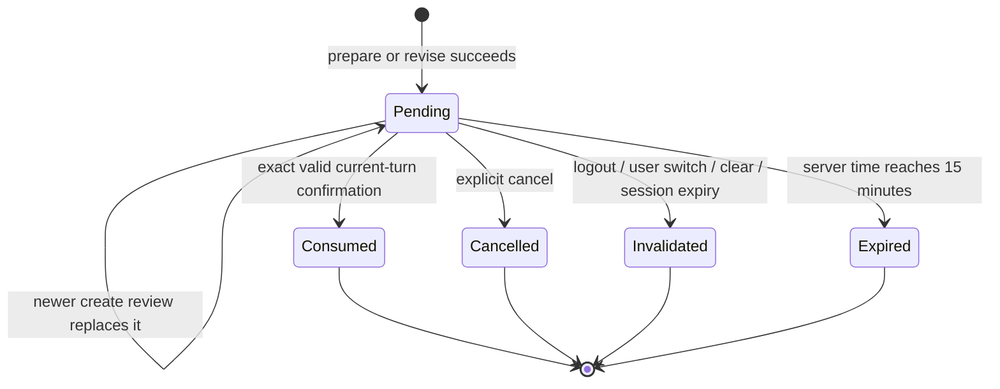
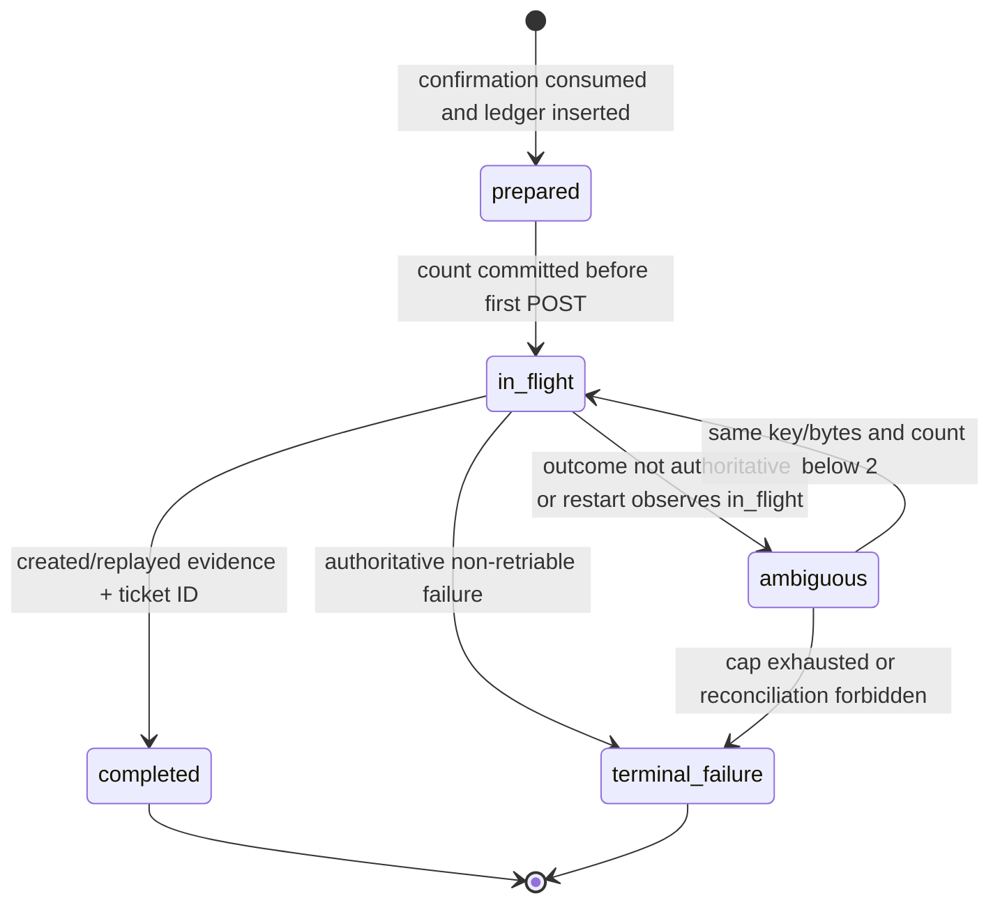
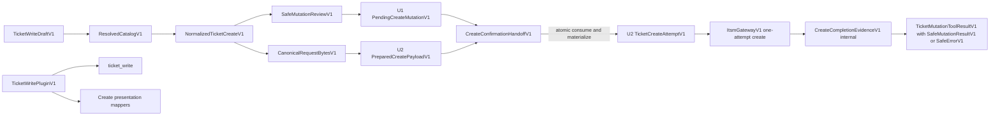

# U2 Ticket Write — Functional Specification

## Sources

- `inception/units-generation/unit-of-work.md` — U2 scope, ownership, and delivery boundary
- `inception/units-generation/unit-of-work-story-map.md` — U2 acceptance-criteria allocation
- `inception/user-stories/stories.md` — US2.1 and shared US4.1/US5.1 interaction outcomes
- `inception/requirements-analysis/requirements.md` — create, identity, safety, reliability, and presentation requirements
- `inception/domain-design/components.md` — component responsibilities and trust boundaries
- `inception/contract-design/contract-summary.md` — C-01, C-03A, C-04, C-06, and C-07 V1 contracts
- `construction/u1-ticket-read-skeleton/functional-design/functional-design-questions.md` — approved 15-minute and latest-per-operation confirmation policy
- `construction/u2-ticket-write/functional-design/entities.md` — U2 authoritative entity model
- `construction/u2-ticket-write/functional-design/rules.md` — U2 authoritative business rules

## Scope and Boundaries

U2 adds ticket creation to the existing U1 agent/runtime skeleton. It owns the `ticket_write` FunctionTool contribution, create validation and catalog resolution, the complete review flow, confirmation-to-ledger handoff, idempotent POST orchestration, durable ambiguity handling, and create-specific presentation mappers.

U2 extends, but does not replace or modify, U1-owned server session, pending-confirmation repository, history repository, Runner serialization, gateway foundation, common registry implementation, or lifecycle coordinator. It does not implement U3 update semantics, edit U1 migrations, or claim whole-application release readiness assigned to U4.

| Actor or component | U2 responsibility | Boundary |
|---|---|---|
| Authenticated user | Supplies create fields, reviews the normalized summary, and sends an explicit current-turn choice | Identity and delegated capability come only from the server session |
| Agent and Runner | Route prepare/revise intent and serialize the turn | Model output cannot confirm a mutation |
| `ticket_write` FunctionTool | Accept a create draft and return typed safe state | No credentials, idempotency key, raw cursor, or raw upstream details cross the tool contract |
| `TicketOperations` create extension | Validate, resolve catalog, normalize, manage review, invoke the confirmation handoff, and orchestrate attempts | Owns operation policy; gateway owns no retry or confirmation policy |
| U1 pending-confirmation repository | Persist the latest create review and participate in atomic handoff through its owned adapter | U2 never writes `ticket_tools_state_v1` directly and does not change its schema |
| U2 prepared-payload repository | Persist `PreparedCreatePayloadV1` canonical bytes before publishing the matching review | Revocable and non-authorizing without the exact current U1 pending row |
| `CreateConfirmationHandoffV1` | Atomically revalidate and consume U1 pending state, retire U2 pre-confirm state, and create one U2 attempt | Sole cross-namespace write transaction; U1 adapter owns U1 row transitions |
| U2 create-attempt repository | Persist `TicketCreateAttemptV1` in additive `ticket_tools_create_v1` | Durable for at least 24 hours across revocable lifecycle cleanup |
| `ItsmGatewayV1` create method | Execute exactly one POST with supplied delegated capability, key, and immutable bytes | No hidden retry, refresh, sleep, or reconciliation |
| U1 RegistryV1 and presentation layer | Load U2 tool factory and create mapper keys | U2 contributes registrations without editing the common registry |

## Functional Workflows

### FD-U2-01 — Prepare or Revise a Create Review

1. The Runner accepts a create or revise intent while preserving the raw current user turn separately from model-produced tool arguments.
2. `ticket_write` accepts only `TicketWriteDraftV1` fields. Unknown fields, missing required values, invalid lengths, invalid enumerations, or ambiguous time input fail before network access.
3. `TicketOperations` resolves service, optional component, and optional model through the active catalog. Every supplied selector must have exactly one active normalized match, and a component must belong to the resolved service.
4. `occurred_at` is canonicalized to UTC. The explicit now variant captures the injected server clock once; confirmation never recaptures it.
5. The operation materializes the default classification, omits absent optionals, builds `NormalizedTicketCreateV1`, serializes version 1 canonical UTF-8 bytes, and calculates both the normalized-payload hash and request-bytes hash.
6. U2 first commits `PreparedCreatePayloadV1` under a new mutation identity with those exact bytes, version, hashes, actor bindings, and 15-minute expiry. This row alone has no execution authority and contains no credential or idempotency key.
7. Only after that commit does U1 publish the matching pending review. The latest create review in the same user/session/conversation scope atomically replaces the previous U1 review; superseded U2 payloads are retired and any interrupted orphan remains non-executable.
8. The response displays every canonical field and the exact choices 확인, 수정, 취소. No ticket POST occurs.

### FD-U2-02 — Explicit Confirmation and Atomic Handoff

1. Before allowing execution, the Runner compares the raw current user turn to the exact tokens 확인 or `confirm`; trimming and case normalization may be applied only as specified by the shared confirmation contract.
2. `CreateConfirmationHandoffV1` begins one write transaction and asks the U1 repository participant to validate pending-state age, user, session, conversation, operation, and normalized-payload hash. Quoted, embedded, historical, model-generated, or external text cannot satisfy the check.
3. The bridge loads U2 `PreparedCreatePayloadV1` by the same mutation identity, verifies all actor bindings, recomputes the request-bytes and normalized-payload hashes from its authoritative stored bytes, and rejects any mismatch.
4. Within the same transaction, the U1-owned participant marks and consumes its row once; the U2 participants insert one `TicketCreateAttemptV1` using the exact stored bytes and retire the pre-confirm payload. U2 never writes the U1 table directly.
5. The attempt contains the consumed mutation identity, actor bindings, normalized payload hash, versioned canonical bytes and their hash, one operating-system-CSPRNG idempotency key, attempt count zero, created time, and a retention boundary no earlier than 24 hours.
6. A transactional failure rolls back every transition and results in zero POST attempts. Concurrent confirms serialize; an exact duplicate may return only the already-committed same-binding attempt, while a mismatch rejects and never mints another key.
7. A crash before commit leaves the original review and payload subject to their bindings; a crash after commit leaves one consumed review and one prepared attempt. No committed state contains consumption without its attempt or an executable attempt from an unconsumed review.

### FD-U2-03 — Execute the First Ticket POST

1. `TicketOperations` loads the prepared attempt, confirms that the current server session authorizes the same user, and obtains the delegated credential only at the gateway boundary.
2. It recomputes the hash of the stored canonical bytes and compares serialization version, byte hash, and immutable key bindings.
3. Before network I/O, the repository atomically increments `attempt_count` and commits status `in_flight`. A failed commit prevents the POST.
4. The gateway receives the exact stored bytes, original idempotency key, delegated capability, and per-attempt timeout, then performs exactly one HTTP attempt.
5. A valid created response or valid `Idempotent-Replayed` response containing a ticket ID commits `completed`. Internal `CreateCompletionEvidenceV1` maps deterministically to shared `SafeMutationResultV1` with required `operation: create` and `ticket_id`, plus optional `idempotent_replayed` and `request_id`, inside `TicketMutationToolResultV1.data`.
6. The operation returns only the exact shared typed result or safe error; raw headers, bodies, exceptions, problem details, credentials, canonical bytes, and the idempotency key remain internal.

### FD-U2-04 — Reconcile Ambiguity or Restart

1. A timeout, transport interruption, qualifying server failure without authoritative result, or an `in_flight` row observed after restart is classified as ambiguous.
2. The durable row remains the reconciliation authority even when the originating session, conversation, or pending review has been cleared.
3. If `attempt_count` is less than two and the defined reconciliation policy permits a follow-up, the operation verifies the same stored key, bytes, version, and hash; it then repeats the pre-send `in_flight` transition and invokes the gateway once.
4. The follow-up uses byte-identical content and the original key. A valid created or replayed response with a ticket ID completes the row.
5. When the shared cap of two POSTs is exhausted, or safe automatic reconciliation is not permitted, the row stays ambiguous or becomes terminal according to the typed outcome. Presentation states that the result is unknown and gives safe manual reconciliation guidance; it never claims the ticket was or was not created.
6. A 429 response returns immediately with optional validated retry-after seconds and performs no automatic sleep or retry.

### FD-U2-05 — Cancel and Lifecycle Isolation

1. `취소`, an explicit cancel intent, or a field-changing turn invalidates the current pending create review, retires its prepared payload, and performs zero POST attempts.
2. Logout, user switch, conversation clear, and session expiry invalidate revocable pending create state and retire matching prepared payloads before another actor or conversation can use them.
3. Those lifecycle actions do not delete a durable create-attempt row before its retention boundary. Unresolved rows remain available to the server-owned reconciliation path without exposing their key or bytes to the user or model.
4. A new or changed body always requires a new complete review and a new mutation identity. It never reuses the earlier key.

### FD-U2-06 — Registration, Presentation, and History

1. U2 contributes `TicketWritePluginV1` to U1 `RegistryV1`, registering contract version 1, tool name `ticket_write`, its FunctionTool factory, and the create mapper keys.
2. Presentation has text-first mappings for input correction, complete review, success, authentication failure, rate limiting, ambiguity, and upstream unavailability. Rich rendering is optional and equivalent.
3. External catalog labels and response text are escaped and marked as untrusted data. They cannot become instructions or alter control state.
4. History records only safe operation outcome data. It excludes credentials, idempotency keys, canonical request bytes, raw exceptions, unrestricted headers, and raw upstream bodies.

## Primary Interaction Sequence

```mermaid
sequenceDiagram
    actor User
    participant Runner
    participant Write as ticket_write / TicketOperations
    participant Payload as U2 Prepared Payload Repository
    participant Pending as U1 Pending Repository
    participant Bridge as CreateConfirmationHandoffV1
    participant Ledger as U2 Attempt Repository
    participant Gateway as ItsmGatewayV1

    User->>Runner: Create draft
    Runner->>Write: prepare(draft, server context)
    Write->>Write: validate, resolve catalog, normalize, freeze time and bytes
    Write->>Payload: persist exact bytes, hashes, bindings, expiry
    Payload-->>Write: mutation identity ready
    Write->>Pending: publish/replace matching review
    Pending-->>Write: pending mutation binding
    Write-->>Runner: complete safe review
    Runner-->>User: fields + 확인 / 수정 / 취소
    User->>Runner: exact current-turn 확인
    Runner->>Write: confirm(raw turn, server context)
    Write->>Bridge: confirm(pending ref, current-turn evidence)
    Bridge->>Pending: verify, mark confirmed, consume once
    Bridge->>Payload: rehash authoritative bytes and retire
    Bridge->>Ledger: insert same-mutation prepared attempt
    Note over Pending,Ledger: one cross-namespace SQLite transaction; each adapter owns its rows
    Write->>Ledger: commit attempt_count + 1 and in_flight
    Write->>Gateway: one POST, original key, exact stored bytes
    alt created or Idempotent-Replayed with ticket ID
        Gateway-->>Write: authoritative success evidence
        Write->>Ledger: completed + ticket ID
        Write-->>Runner: TicketMutationToolResultV1 with SafeMutationResultV1 data
        Runner-->>User: accessible success
    else no authoritative outcome
        Gateway-->>Write: typed ambiguous outcome
        Write->>Ledger: ambiguous
        Write-->>Runner: safe ambiguity state
        Runner-->>User: result unknown + reconciliation guidance
    end
```

Text fallback: before a non-executing review is published, U2 preserves the exact reviewed bytes in revocable pre-confirm storage keyed to the U1 mutation. A later exact current-turn confirmation uses the handoff port to rehash those bytes, consume U1 state, retire U2 pre-confirm state, and create one durable attempt in a single transaction. The ledger is then marked in flight before one gateway POST. Only created or replayed evidence with a ticket ID produces the shared mutation success shape; an unproven outcome remains ambiguous.

## State Models

### Pending Create Review

The U1-owned `PendingCreateMutationV1` state is refined for operation `create`:



Text fallback: only the newest create review in the actor scope is pending. It can be atomically consumed once, explicitly cancelled, lifecycle-invalidated, replaced, or expired after 15 minutes. Every terminal transition except consumed performs zero POSTs.

### Durable Create Attempt



Text fallback: a prepared durable row becomes in flight only after its attempt count is committed. It completes solely on authoritative created or replayed evidence, becomes ambiguous when the send outcome is uncertain, or reaches a terminal safe failure. Ambiguity may re-enter in flight once only when the total count remains below two and the same key and bytes are intact.

## Gateway Outcome Decisions

| Gateway observation | Durable transition | Additional automatic POST | User-visible result |
|---|---|---:|---|
| Valid created response with ticket ID | `completed` | No | Success with ticket ID |
| Valid `Idempotent-Replayed` response with ticket ID | `completed` | No | Success with ticket ID and replay indicator |
| Typed 401 token-expired and no refresh used, total count below two | Preserve non-success, refresh through existing identity path, then pre-count same-key recall | At most one | Final recalled outcome; otherwise authentication required or ambiguous |
| Typed 401 after refresh or without refresh capability | `terminal_failure` unless send outcome is uncertain | No | Authentication required; never success |
| 429 | Safe non-success state; retain durable evidence | No sleep and no retry | Rate limited, with validated retry-after seconds when present |
| Definitive validation, permission, or other non-retriable 4xx | `terminal_failure` | No | Allowlisted safe error |
| Timeout, connection loss, or response loss after send | `ambiguous` | At most one same-key, byte-identical reconciliation within total cap | Result unknown until authoritative evidence |
| 500/502/503/504 without authoritative body | `ambiguous` | At most one same-key, byte-identical reconciliation within total cap | Ambiguous or final safe unavailable state |
| Malformed success-like response or missing ticket ID | `ambiguous` or `terminal_failure` according to send certainty | Only within shared cap and reconciliation policy | Never success; safe unavailable or ambiguity guidance |
| Byte/hash/key mismatch before send | `terminal_failure` | No | Safe internal-consistency failure; zero outbound calls |

The attempt counter includes the first POST, credential-refresh recall, restart reconciliation, and every gateway create invocation. No path can exceed two total POSTs.

## Derived Entity Relationships



Text fallback: a validated draft resolves catalog data, becomes a normalized body, and produces canonical bytes preserved in U2 before U1 publishes the review. The handoff joins that exact payload and pending review, atomically consumes revocable state, and materializes one durable attempt. That attempt alone supplies a one-attempt gateway call; internal completion evidence maps into the unchanged shared mutation result. Separately, the U2 plugin registers the tool and its presentation mappings with U1 infrastructure.

## Derived Rule Application

| Decision point | Governing rules | Required result |
|---|---|---|
| Draft admission | BR2.1–BR2.5 | Deterministic normalized body or safe field correction with zero POSTs |
| Review creation | BR3.1–BR3.3 | Complete latest create review, actor bindings, 15-minute expiry, no POST |
| Confirmation | BR3.4–BR3.6 | Exact current-turn authorization and atomic durable handoff, or zero POST |
| Pre-send | BR4.1, BR4.2, BR4.4, BR4.6 | Durable immutable evidence and counted `in_flight` state before network |
| Outcome and reconciliation | BR4.3, BR4.5, BR4.7–BR4.10 | No more than two one-attempt calls; ambiguity never becomes fabricated success |
| Trust boundaries | BR5.1–BR5.3 | Delegated server authority and allowlisted, non-instructional external data |
| Integration and UX | BR5.4–BR5.6 | Text-equivalent presentation, additive registration, deterministic verification |

## Acceptance and Verification Scenarios

| Scenario | Expected observation | Acceptance criteria |
|---|---|---|
| Valid create draft using explicit now | Server clock is captured once, catalog identities resolve, full review appears, and POST count is zero | AC2.1.1, AC2.1.2, AC2.1.3 |
| Invalid length, enumeration, timezone, retired catalog item, or mismatched component | Safe field correction preserves allowed draft values and POST count remains zero | AC2.1.1, AC2.1.2 |
| New review supersedes old review | Old exact confirmation fails closed; only the newest bound payload may proceed | AC2.1.4 |
| Quoted, embedded, historical, model-generated, or external confirmation text | Confirmation is rejected and POST count remains zero | AC2.1.3, AC4.1.2 |
| Prepare crashes after U2 payload commit but before U1 pending publish | Orphan payload cannot authorize execution and expires safely; no review or POST is exposed | AC2.1.3, AC2.1.4 |
| Exact confirmation followed by storage failure | U1 consumption, U2 payload retirement, and attempt insertion all roll back; no POST occurs | AC2.1.3, AC2.1.5 |
| Two concurrent exact confirmations | One transaction creates one key and attempt; the duplicate receives only the same attempt reference and cannot cause an uncounted call | AC2.1.3, AC2.1.5, AC4.1.4 |
| First send times out and reconciliation returns replayed ticket ID | Both POSTs use identical key and bytes; attempt count is two; one success is shown | AC2.1.5, AC2.1.6, AC4.1.3 |
| First send remains ambiguous and cap is exhausted | No third POST occurs and UI reports result unknown without claiming absence or success | AC2.1.5, AC2.1.6, AC4.1.6 |
| 429 with and without valid Retry-After | No sleep or automatic retry; only a validated seconds value is exposed | AC2.1.6, AC4.1.6 |
| Logout, switch, clear, or session expiry before confirmation | Pending review is unusable and no POST occurs | AC4.1.4, AC4.1.5 |
| Same lifecycle events after an ambiguous send | Revocable state is cleared but durable attempt remains through at least 24 hours | AC4.1.5 |
| Malicious catalog label or upstream detail resembles an instruction | It is escaped as data, cannot confirm or change policy, and raw detail is not exposed | AC4.1.2, AC4.1.6 |
| Network-blocked deterministic test suite | Injected clock, randomness, catalog, gateway outcomes, restart, and lifecycle tests pass without live calls | AC5.1.2, AC5.1.4 |
| Registry and accessible mapper verification | `ticket_write` and all create mapper keys resolve via RegistryV1 with equivalent plain-text states | AC5.1.4 |

## Completion Conditions

Functional design is satisfied when every U2 acceptance criterion maps to at least one authoritative business rule, every workflow has a fail-closed no-send path, the durable ledger precedes network I/O, immutable idempotency evidence survives lifecycle changes, and success is impossible without created or replayed ticket evidence.
