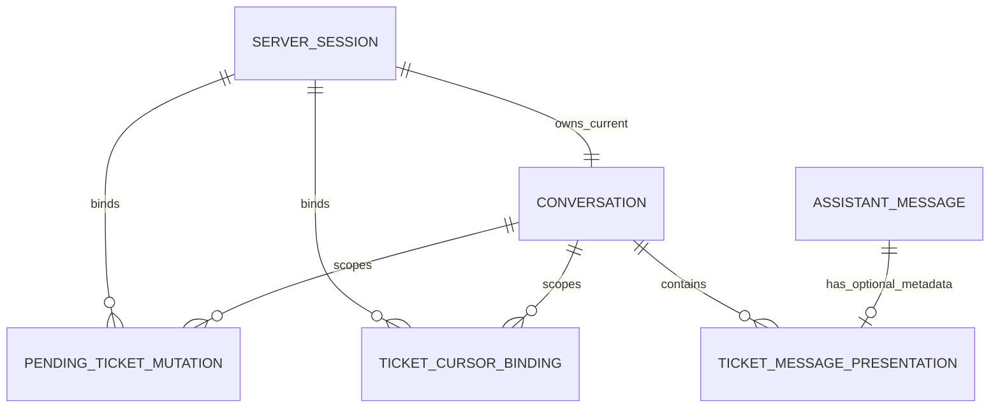

# U1 Ticket Read Skeleton — Entities

## Sources

- `inception/user-stories/stories.md` — US1.1, US1.2, US4.1, US5.1
- `inception/domain-design/components.md` — IdentitySession, TicketOperations, AgentConversation, and lifecycle ownership boundaries
- `inception/units-generation/unit-of-work.md` — U1 boundaries and cross-Unit ownership
- `inception/contract-design/contract-summary.md` — exact shared V1 types in C-01, C-02, C-03, C-03A, C-06, C-07
- `construction/u1-ticket-read-skeleton/functional-design/functional-design-questions.md` — approved confirmation and server-session lifetime policies

## Authoritative Entity Model

The YAML block is the source of truth. `additional_properties: false` means an implementation cannot add a field to a V1 record without the versioned contract change defined upstream.

```yaml
schema_version: 1
unit: u1-ticket-read-skeleton

entities:
  - name: ServerSession
    description: Existing authenticated server-session record extended with an independent absolute expiry owned by the IdentitySession boundary.
    additional_properties: false
    identity: session_id
    attributes:
      - {name: session_id, logical_type: opaque_string, required: true, unique: true, references: null, allowed_values: null, default: null, min: null, max: null, constraints: [cookie_carries_identifier_only]}
      - {name: user_id, logical_type: integer, required: true, unique: false, references: current_server_user, allowed_values: null, default: null, min: null, max: null, constraints: [server_derived]}
      - {name: username, logical_type: string, required: true, unique: false, references: current_server_user, allowed_values: null, default: null, min: 1, max: null, constraints: [server_derived, existing_physical_field]}
      - {name: display_name, logical_type: string, required: true, unique: false, references: current_server_user, allowed_values: null, default: null, min: 1, max: null, constraints: [server_derived, existing_physical_field]}
      - {name: role, logical_type: string, required: true, unique: false, references: current_server_user, allowed_values: null, default: null, min: 1, max: null, constraints: [server_derived, existing_physical_field]}
      - {name: role_label, logical_type: string, required: true, unique: false, references: current_server_user, allowed_values: null, default: null, min: 1, max: null, constraints: [server_derived, existing_physical_field]}
      - {name: team, logical_type: nullable_string, required: false, unique: false, references: current_server_user, allowed_values: null, default: null, min: null, max: null, constraints: [server_derived, existing_physical_field]}
      - {name: permissions, logical_type: set_of_strings, required: true, unique: false, references: current_server_user, allowed_values: null, default: null, min: 0, max: null, constraints: [server_derived, existing_physical_field]}
      - {name: conversation_id, logical_type: opaque_string, required: true, unique: false, references: Conversation, allowed_values: null, default: null, min: null, max: null, constraints: [server_derived, existing_physical_field]}
      - {name: delegated_credential, logical_type: secret_opaque_string, required: true, unique: false, references: current_server_user, allowed_values: null, default: null, min: null, max: null, constraints: [server_only, existing_physical_field_itsm_token, excluded_from_model_log_error]}
      - {name: credential_expires_at, logical_type: utc_datetime, required: true, unique: false, references: delegated_credential, allowed_values: null, default: null, min: null, max: null, constraints: [existing_physical_field_itsm_token_expires_at, credential_lifetime_not_session_lifetime]}
      - {name: refresh_credential, logical_type: server_only_refresh_capability, required: true, unique: false, references: current_server_user, allowed_values: null, default: existing_token_exchange_path, min: null, max: null, constraints: [logical_existing_field, not_persisted_as_secret_column, excluded_from_model_log_error]}
      - {name: created_at, logical_type: utc_datetime, required: true, unique: false, references: null, allowed_values: null, default: login_server_time, min: null, max: null, constraints: [immutable, existing_physical_field]}
      - {name: session_expires_at, logical_type: utc_datetime, required: true, unique: false, references: null, allowed_values: null, default: created_at_plus_8_hours, min: null, max: null, constraints: [immutable, independent_of_delegated_token_expiry]}
    entity_constraints:
      - Login captures one UTC server timestamp and writes created_at plus session_expires_at equal to exactly created_at plus 8 hours in the same transaction.
      - Protected activity and delegated-token refresh never extend or rewrite session_expires_at.
      - Current server time at or after session_expires_at means expired; equality belongs to the expired side of the boundary.
      - The additive U1 session migration backfills a missing session_expires_at as created_at plus 8 hours without changing created_at.
      - The migration preserves every existing physical session column and value byte-for-byte: id, user_id, username, display_name, role, role_label, team, permissions, conversation_id, itsm_token, itsm_token_expires_at, and created_at; only session_expires_at is added and backfilled.
      - The logical delegated_credential and credential_expires_at names preserve the upstream ServerSession contract and map to the existing physical itsm_token and itsm_token_expires_at columns without rename or rewrite; refresh_credential remains the existing server-only token-exchange capability and is not a new stored secret column.
      - A legacy row whose created_at is missing or cannot be parsed is backfilled as already expired at migration time and is eligible for fail-closed cleanup on the next protected request.
      - Restart reads the persisted session_expires_at and never reconstructs a new lifetime from process start or credential expiry.
      - Any cleanup that touches conversation history is serialized with Runner by the same application conversation lock and revalidates this persisted row after acquiring the lock.
      - Credential values remain server-only and are excluded from all model, log, error, and presentation boundaries.
    relationships:
      - {to: Conversation, cardinality: one_to_one, direction: ServerSession_to_Conversation, required: true}

  - name: PendingTicketMutationV1
    description: Revocable reviewed state consumed by later create and update workflows.
    additional_properties: false
    identity: mutation_id
    attributes:
      - {name: mutation_id, logical_type: opaque_string, required: true, unique: true, references: null, allowed_values: null, default: null, min: null, max: null, constraints: [non_secret]}
      - {name: operation, logical_type: enum, required: true, unique: false, references: null, allowed_values: [create, update], default: null, min: null, max: null, constraints: [discriminator]}
      - {name: user_id, logical_type: integer, required: true, unique: false, references: current_server_user, allowed_values: null, default: null, min: null, max: null, constraints: [server_derived]}
      - {name: session_id, logical_type: opaque_string, required: true, unique: false, references: current_server_session, allowed_values: null, default: null, min: null, max: null, constraints: [server_derived]}
      - {name: conversation_id, logical_type: opaque_string, required: true, unique: false, references: current_conversation, allowed_values: null, default: null, min: null, max: null, constraints: [server_derived]}
      - {name: normalized_payload_hash, logical_type: sha256, required: true, unique: false, references: null, allowed_values: null, default: null, min: null, max: null, constraints: [hash_only_no_raw_payload]}
      - {name: ticket_id, logical_type: opaque_string_or_null, required: false, unique: false, references: external_ticket, allowed_values: null, default: null, min: null, max: null, constraints: [create_requires_null, update_requires_non_null]}
      - {name: base_version, logical_type: integer_or_null, required: false, unique: false, references: external_ticket_version, allowed_values: null, default: null, min: 1_when_non_null, max: null, constraints: [create_requires_null, update_requires_non_null]}
      - {name: status, logical_type: enum, required: true, unique: false, references: null, allowed_values: [pending, confirmed, cancelled, invalidated, expired, consumed], default: pending, min: null, max: null, constraints: [terminal_state_not_reactivated]}
      - {name: expires_at, logical_type: utc_datetime, required: true, unique: false, references: null, allowed_values: null, default: review_time_plus_15_minutes, min: null, max: null, constraints: [earlier_binding_invalidation_still_applies]}
    entity_constraints:
      - At most one pending row exists per user_id, session_id, conversation_id, and operation.
      - A new create review atomically changes the old pending or confirmed create row to invalidated before the new row becomes pending.
      - Update prepare uses replace_update_pending with expected_old_mutation_id null and succeeds only when no pending update exists in the same actor scope.
      - Update revise uses replace_update_pending with the exact expected old mutation ID; the old row must match user, session, conversation, operation update, and pending status before that exact row is invalidated and the new row is inserted in one ticket_tools_state_v1 transaction.
      - Any unexpired confirmed update in the same actor scope blocks prepare and revise. Recovery must resume exact consume_once for that confirmed mutation, or wait for exact expiry or lifecycle invalidation; a new pending update can never coexist with consumable confirmed update authority.
      - Update replacement validation or insertion failure changes neither the expected old row nor the proposed new row; broad-selector invalidation and writes to U3 storage are forbidden.
      - A create variant requires ticket_id null and base_version null.
      - An update variant requires a non-empty ticket_id and base_version of at least 1.
      - A row is unusable at expires_at or after any actor, conversation, operation, payload, target, version, logout, or clear boundary changes.
      - Confirmation and consumption are separate repository operations: confirm moves an exactly bound pending row to confirmed, while consume_once moves an exactly bound confirmed row to consumed and returns evidence once.
      - A consumed row is never reactivated and a repeated consume_once call returns rejected without recreating evidence or authorizing transport.
      - Raw payload, credential, confirmation text, and ITSM response body are forbidden.
    relationships:
      - {to: ServerSession, cardinality: many_to_one, direction: PendingTicketMutationV1_to_ServerSession, required: true}
      - {to: Conversation, cardinality: many_to_one, direction: PendingTicketMutationV1_to_Conversation, required: true}

  - name: TicketCursorBinding
    description: Server-held continuation state bound to the exact actor, conversation, and normalized query.
    additional_properties: false
    identity: continuation_ref
    attributes:
      - {name: continuation_ref, logical_type: unpredictable_opaque_reference, required: true, unique: true, references: null, allowed_values: null, default: null, min: null, max: null, constraints: [model_visible, not_authority, os_csprng, minimum_128_bits_randomness]}
      - {name: user_id, logical_type: integer, required: true, unique: false, references: current_server_user, allowed_values: null, default: null, min: null, max: null, constraints: [server_derived]}
      - {name: session_id, logical_type: opaque_string, required: true, unique: false, references: current_server_session, allowed_values: null, default: null, min: null, max: null, constraints: [server_derived]}
      - {name: conversation_id, logical_type: opaque_string, required: true, unique: false, references: current_conversation, allowed_values: null, default: null, min: null, max: null, constraints: [server_derived]}
      - {name: query_serialization_version, logical_type: positive_integer, required: true, unique: false, references: CanonicalTicketQueryV1, allowed_values: null, default: 1, min: 1, max: null, constraints: []}
      - {name: canonical_normalized_query_json, logical_type: canonical_document, required: true, unique: false, references: CanonicalTicketQueryV1, allowed_values: null, default: null, min: null, max: null, constraints: [server_only]}
      - {name: normalized_query_hash, logical_type: sha256, required: true, unique: false, references: CanonicalTicketQueryV1, allowed_values: null, default: null, min: null, max: null, constraints: [recomputed_on_issue_and_resolve]}
      - {name: upstream_cursor, logical_type: opaque_string, required: true, unique: false, references: external_page_cursor, allowed_values: null, default: null, min: null, max: null, constraints: [never_model_or_browser_visible]}
      - {name: created_at, logical_type: utc_datetime, required: true, unique: false, references: null, allowed_values: null, default: current_server_time, min: null, max: null, constraints: []}
      - {name: expires_at, logical_type: utc_datetime, required: true, unique: false, references: null, allowed_values: null, default: session_bound, min: null, max: null, constraints: []}
    entity_constraints:
      - Reference generation uses an injectable cryptographic-random source whose production adapter is the operating-system CSPRNG.
      - Reference values are never sequential or timestamp-only; a deterministic test issues 100000 references with zero collisions and rejects sequential or timestamp-only generators.
      - Resolution requires exact user, session, conversation, serialization version, canonical query, and recomputed hash agreement.
      - Resolution is once-only and returns the exact validated query represented by the stored canonical document.
      - Unknown, expired, tampered, mismatched, or invalidated references fail closed without revealing stored values.
      - State is deleted idempotently on access or cleanup after session expiry, user change, conversation clear, logout, or upstream invalid cursor.
    relationships:
      - {to: ServerSession, cardinality: many_to_one, direction: TicketCursorBinding_to_ServerSession, required: true}
      - {to: Conversation, cardinality: many_to_one, direction: TicketCursorBinding_to_Conversation, required: true}

  - name: TicketMessagePresentation
    description: Optional typed presentation metadata correlated with one existing persisted assistant message.
    additional_properties: false
    identity: [conversation_id, assistant_sequence]
    attributes:
      - {name: conversation_id, logical_type: opaque_string, required: true, unique: composite, references: Conversation, allowed_values: null, default: null, min: null, max: null, constraints: []}
      - {name: assistant_sequence, logical_type: integer, required: true, unique: composite, references: AssistantMessage, allowed_values: null, default: null, min: 0, max: null, constraints: [derived_after_runner_completion]}
      - {name: assistant_text_sha256, logical_type: sha256, required: true, unique: false, references: AssistantMessage, allowed_values: null, default: null, min: null, max: null, constraints: [hash_of_exact_persisted_text]}
      - {name: presentation_version, logical_type: positive_integer, required: true, unique: false, references: TicketPresentationV1, allowed_values: [1], default: 1, min: 1, max: 1, constraints: []}
      - {name: canonical_presentation_json, logical_type: canonical_document, required: true, unique: false, references: TicketPresentationV1, allowed_values: null, default: null, min: null, max: null, constraints: [no_secrets, no_raw_tool_trace, no_raw_problem_detail]}
      - {name: created_at, logical_type: utc_datetime, required: true, unique: false, references: null, allowed_values: null, default: current_server_time, min: null, max: null, constraints: []}
    entity_constraints:
      - Correlation is generated from the persisted assistant item after Runner completion under one application lock per conversation.
      - Exact correlation is verified and one companion row is inserted or replaced atomically under that lock.
      - Presentation is exposed only after commit readback succeeds; failure returns the existing text reply without presentation.
      - Missing, malformed, unsupported, mismatched, or orphaned metadata is never returned.
      - Metadata is cleared before corresponding conversation history is cleared and has exactly the same retention lifetime.
      - User switch, logout, conversation clear, and session expiry acquire the same conversation lock as Runner, revalidate expected user-session-conversation scope after lock acquisition, and hold the lock through metadata/history cleanup, revocable-state cleanup, and the terminal lifecycle commit.
      - Expiry cleanup and Runner/presentation commit for the same conversation never mutate this metadata or SDK history concurrently; the conversation lock spans the final post-Runner expiry recheck and response decision.
    relationships:
      - {to: Conversation, cardinality: many_to_one, direction: TicketMessagePresentation_to_Conversation, required: true}
      - {to: AssistantMessage, cardinality: zero_or_one_to_one, direction: TicketMessagePresentation_to_AssistantMessage, required: true}

value_objects:
  TicketRequestCapability:
    description: Non-serializable request-scoped authority created from the server session.
    additional_properties: false
    attributes:
      - {name: user_id, logical_type: integer, required: true, constraints: [server_derived]}
      - {name: session_id, logical_type: opaque_string, required: true, constraints: [server_derived]}
      - {name: conversation_id, logical_type: opaque_string, required: true, constraints: [server_derived]}
      - {name: session_expires_at, logical_type: utc_datetime, required: true, constraints: [server_derived, server_only]}
    operational_constraints:
      - Capability creation requires a persisted server-session expiry later than the current server time.
      - An expired session triggers idempotent pending-mutation and cursor cleanup and session deletion before capability construction, Runner execution, or ITSM access.
      - Cleanup failure denies capability construction and leaves Runner and ITSM call counts at zero.
      - Capability expiry detection may request cleanup, but history deletion occurs only after the shared conversation lock is held; a post-Runner expiry check can revoke the result before any response or presentation is published.
      - Delegated credential value is accessible only through the outbound gateway and never exposed to a consumer.
      - The operation has a refresh budget of one that model or tool input cannot alter.
      - The capability is not serializable, loggable, or model-visible.

  CredentialRefreshReservationV1:
    description: Server-only proof that U2 durably consumed the one-shot refresh reservation for one create attempt before invoking U1.
    additional_properties: false
    required: [create_attempt_id, refresh_reservation_id, refresh_used_at]
    attributes:
      - {name: create_attempt_id, logical_type: opaque_string, required: true, constraints: [U2_durable_create_attempt_binding]}
      - {name: refresh_reservation_id, logical_type: authenticated_opaque_string, required: true, constraints: [one_shot, durably_consumed_before_port_call, server_verifiable_actor_binding]}
      - {name: refresh_used_at, logical_type: utc_datetime, required: true, constraints: [server_derived]}
    operational_constraints:
      - CredentialRefreshPortV1 accepts this value only with the current TicketRequestCapability and a positive remaining deadline.
      - U2 constructs refresh_reservation_id from its durable reservation claim as a server-authenticated opaque envelope over create_attempt_id, user_id, session_id, conversation_id, refresh_used_at, and a unique nonce; only the opaque string remains in the V1 field.
      - U1 verifies envelope authenticity and exact capability/create-attempt actor binding with the application reservation verifier; it does not read or write U2 storage and never trusts caller-supplied decoded fields.
      - U2's durable create-attempt repository is the replay authority: it permits exactly one claimed invocation for the reservation across restart and rejects another call before U1. U1 additionally rejects an invalid, mismatched, or expired envelope before token exchange.
      - One accepted port call performs at most one token exchange with no internal retry.
      - Success atomically replaces the delegated credential in the existing server session before returning a new request-scoped capability bound to the same user, session, and conversation.
      - Failure or crash before credential commit leaves the reservation consumed and forbids a second exchange for that create attempt.
      - A crash after commit but before return is recovered by restoring the committed credential from the existing session; reservation reset, replay, or a second exchange is forbidden.
      - Credential, authorization, idempotency key, canonical request bytes, and raw exchange response never cross this value or port boundary.

  CurrentTurnEvidenceV1:
    description: Server-only evidence captured from the raw current HTTP chat message before Runner execution.
    additional_properties: false
    required: [turn_id, user_id, session_id, conversation_id, raw_message_sha256, decision]
    attributes:
      - {name: turn_id, logical_type: opaque_string, required: true, constraints: [request_scoped]}
      - {name: user_id, logical_type: integer, required: true, constraints: [server_derived]}
      - {name: session_id, logical_type: opaque_string, required: true, constraints: [server_derived]}
      - {name: conversation_id, logical_type: opaque_string, required: true, constraints: [server_derived]}
      - {name: raw_message_sha256, logical_type: sha256, required: true, constraints: [hash_only_no_raw_message]}
      - {name: decision, logical_type: enum, required: true, allowed_values: [explicit_confirm, explicit_cancel, revise_or_ambiguous], constraints: [server_derived]}
    operational_constraints:
      - Normalize the current raw message with Unicode NFKC, outer-whitespace trimming, and case folding.
      - Only the exact normalized values 확인 or confirm produce explicit_confirm; only 취소 or cancel produce explicit_cancel; every other value is revise_or_ambiguous.
      - Tool arguments and model output have no authority to create or alter this evidence.
      - The evidence is scoped to one HTTP chat request and is never serializable, model-visible, or credential-bearing.

  ConsumedMutationEvidenceV1:
    description: Minimal one-time proof that an exactly bound pending mutation was confirmed and consumed by U1.
    additional_properties: false
    required: [mutation_id, confirmed_at]
    attributes:
      - {name: mutation_id, logical_type: opaque_string, required: true, constraints: [references_consumed_pending_mutation]}
      - {name: confirmed_at, logical_type: utc_datetime, required: true, constraints: [captured_by_U1_confirmation_repository]}
    operational_constraints:
      - Returned only by consume_once after exact user, session, conversation, operation, payload, target, and version binding succeeds.
      - The same mutation can yield this evidence at most once; retries after consumption return rejected.
      - The evidence contains no credential, authorization value, idempotency key, canonical request bytes, or raw confirmation text.
      - The evidence alone does not authorize POST or PATCH; the consuming Unit must satisfy its own execution preconditions.

  CanonicalTicketQueryV1:
    description: Exact normalized first-page query reconstructed for continuation.
    required: [query_serialization_version, canonical_normalized_query_json, normalized_query_hash]
    canonical_fields_in_order: [q, status, priority, service_id, component_id, model, assignment_group_id, assignee, requester, classification, is_major, created_from, created_to, updated_from, sort, limit]
    constraints:
      - Omitted optional fields stay omitted; repeated values use stable validated order.
      - Timestamps use UTC RFC3339; sort and limit defaults are materialized.
      - Canonical JSON uses fixed key order and no insignificant whitespace; its exact bytes are hashed with SHA-256.

  SafeTicketSummaryV1:
    description: Exact allowlisted list-item projection.
    additional_properties: false
    required: [id, title, status, priority, service, created_at, updated_at]
    attributes:
      - {name: id, logical_type: string, required: true, trust: external_identifier}
      - {name: title, logical_type: string, required: true, trust: itsm_untrusted}
      - {name: status, logical_type: enum, required: true, allowed_values: [received, assigned, investigating, pending, monitoring, resolved, closed, cancelled]}
      - {name: priority, logical_type: enum, required: true, allowed_values: [P1, P2, P3, P4]}
      - {name: service, logical_type: string, required: true, trust: itsm_untrusted}
      - {name: created_at, logical_type: utc_datetime, required: true}
      - {name: updated_at, logical_type: utc_datetime, required: true}
    forbidden: [description, assignee, authorization, raw_headers, raw_problem_detail]

  SafeTicketDetailV1:
    description: Exact allowlisted detail projection used by ordinary user-visible reads.
    additional_properties: false
    public_projection:
      required: [id, title, description, service, impact_level, urgency, impact_note, status, priority, version]
      optional: [component, model, classification, is_major, requester, assignment_group, assignee, occurred_at, created_at, updated_at]
    server_only_metadata:
      etag: {logical_type: opaque_string, required_for_update_evidence: false, model_visible: false}
      if_match: {logical_type: strong_quoted_decimal, exact_value: quoted_public_version, required: false, model_visible: false}
    constraints:
      - Missing, weak, non-decimal, or version-mismatched ETag does not fail an ordinary detail read but produces no valid update evidence.
      - Authorization, raw headers, and raw problem detail are forbidden.

  ReadForUpdateResultV1:
    description: Typed server-only result for U3 containing a safe detail and validated If-Match evidence.
    additional_properties: false
    required: [detail, if_match_version]
    attributes:
      - {name: detail, logical_type: SafeTicketDetailV1, required: true, constraints: [safe_public_projection]}
      - {name: if_match_version, logical_type: strong_quoted_decimal, required: true, constraints: [server_only, exact_match_to_detail_version]}
    constraints:
      - It is returned only by the internal read_for_update operation and is never model-visible or serialized into a tool result.
      - Missing, weak, non-decimal, or version-mismatched ETag returns SafeErrorV1 code upstream_unavailable instead of this value.

  SafeErrorV1:
    description: Exact shared safe error envelope.
    additional_properties: false
    required: [version, code, message_key, retryable]
    attributes:
      - {name: version, logical_type: integer_constant, required: true, allowed_values: [1]}
      - {name: code, logical_type: enum, required: true, allowed_values: [invalid_input, authentication_required, permission_denied, not_found, conflict, rate_limited, upstream_unavailable, ambiguous_result]}
      - {name: message_key, logical_type: server_allowlist_string, required: true}
      - {name: retryable, logical_type: boolean, required: true}
      - {name: request_id, logical_type: validated_non_secret_string, required: false}
      - {name: retry_after_seconds, logical_type: integer, required: false, min: 0}
      - {name: field_errors, logical_type: SafeFieldErrorV1_array, required: false}
    forbidden: [safe_message, field, next_action, raw_detail, exception, headers, authorization, access_token, client_secret, openai_api_key]

  TicketReadToolResultV1:
    description: Read tool result with exact top-level states.
    additional_properties: false
    required: [version, state, mode, untrusted_data]
    attributes:
      - {name: version, logical_type: integer_constant, required: true, allowed_values: [1]}
      - {name: state, logical_type: enum, required: true, allowed_values: [succeeded, empty, failed]}
      - {name: mode, logical_type: enum, required: true, allowed_values: [list, detail]}
      - {name: untrusted_data, logical_type: boolean_constant, required: true, allowed_values: [true]}
      - {name: items, logical_type: SafeTicketSummaryV1_array, required: false}
      - {name: detail, logical_type: SafeTicketDetailV1, required: false}
      - {name: page, logical_type: SafePageV1, required: false}
      - {name: error, logical_type: SafeErrorV1, required: false}

  TicketPresentationV1:
    description: Optional versioned presentation envelope defined by the existing chat contract.
    additional_properties: false
    required: [version, kind, blocks]
    constraints:
      - version is 1 and kind plus every block type must have an allowlisted mapper.
      - External text origin is itsm_untrusted; server labels and actions come from server allowlists.
      - Unsupported content degrades to the existing assistant text response.
```

## Entity Summary

| Entity | Purpose | Lifetime |
|---|---|---|
| ServerSession | Preserve the existing identity, role, permissions, sole permitted server-only persisted delegated credential, credential expiry, refresh capability, conversation, and creation fields while adding a persisted absolute session expiry | From login until logout, user switch, or `created_at + 8 hours`, whichever occurs first |
| PendingTicketMutationV1 | Bind a later explicit create/update confirmation to exact reviewed state | Until consumed, cancelled, invalidated, expired after 15 minutes, or earlier binding/lifecycle change |
| TicketCursorBinding | Keep upstream continuation and exact query server-side | Until once-only resolution, expiry, lifecycle change, or upstream invalid cursor |
| TicketMessagePresentation | Correlate optional typed metadata with one persisted assistant message | Exactly the matching conversation-history lifetime |

External ITSM tickets and catalog objects are not owned entities. U1 handles only exact V1 value projections and opaque references. The delegated credential is persisted only in the existing protected server-session credential column so IdentitySession can restore and atomically rotate it; it is forbidden from every pending, cursor, presentation, create/update attempt, model, log, error, and browser record.

## Derived Relationship View



Text fallback: a server session owns the current conversation and scopes pending mutations and cursor bindings; a conversation contains assistant messages, each of which may have at most one exactly correlated presentation metadata row.

## Logical Storage Boundaries

- `ticket_tools_state_v1` owns pending-mutation and cursor-binding state.
- `ticket_tools_history_v1` owns presentation companion metadata adjacent to existing conversation history.
- U2 and U3 consume these V1 contracts without changing either U1-owned namespace.
- U2's durable create-attempt ledger belongs to its separate `ticket_tools_create_v1` namespace. U1 lifecycle cleanup revokes pending confirmation authority but never deletes or rewrites that ledger.
- U3's staged/active update execution rows belong to its separate `ticket_tools_update_v1` namespace. U1's only update publication transaction is the exact-old replacement inside `ticket_tools_state_v1`; it never writes U3 rows or spans the two namespaces.
