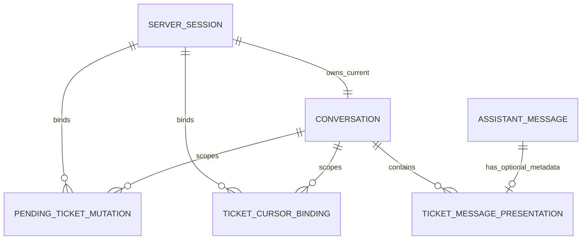
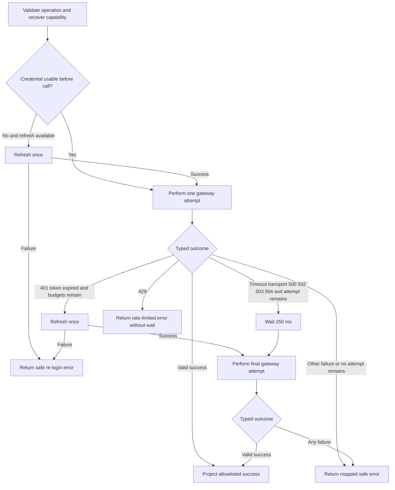
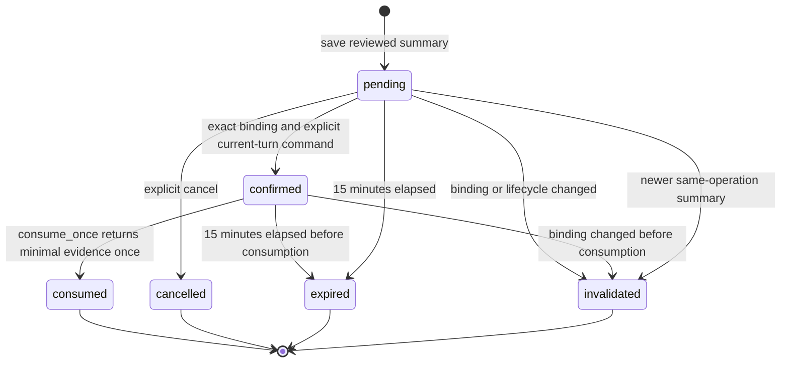

# U1 Ticket Read Skeleton — Functional Specification

## Sources and Scope

- `inception/user-stories/stories.md` — US1.1, US1.2, U1 portions of US4.1 and US5.1
- `inception/domain-design/components.md` — IdentitySession, TicketOperations, AgentConversation, and ApplicationLifecycle ownership
- `inception/units-generation/unit-of-work.md` — U1 boundaries, responsibilities, and verification obligations
- `inception/units-generation/unit-of-work-story-map.md` — shared-story allocation
- `inception/contract-design/contract-summary.md` — C-01, C-02, C-03, C-03A, C-06, C-07
- `construction/u1-ticket-read-skeleton/functional-design/entities.md` — owned state
- `construction/u1-ticket-read-skeleton/functional-design/rules.md` — authoritative numbered business rules
- `construction/u1-ticket-read-skeleton/functional-design/functional-design-questions.md` — approved confirmation and server-session lifetime decisions

U1 is the walking skeleton inside the existing application. It connects the existing authenticated server session, existing Agent/Runner conversation, one `ticket_read` function tool, user-delegated ITSM v2 reads, safe structured results, and optional presentation metadata. It also supplies the common cursor, confirmation, registry, and lifecycle contracts required by U2 and U3. It does not perform a create or update.

## Functional Boundary

| Capability | U1 behavior | Explicit non-behavior |
|---|---|---|
| Identity and authority | Recover current user from a server session whose persisted absolute expiry is still in the future, then create the delegated request capability | Accept identity, role, token, or permission from model/tool input or extend session lifetime from activity/token refresh |
| Ticket list | Validate and canonicalize the allowed query; call the list endpoint; project a safe page | Fetch invisible records, infer missing data, or expose raw cursor |
| Continuation | Resolve a server-bound continuation reference and replay its exact query with stored upstream cursor | Accept a raw cursor or modified query for a continuation |
| Ticket detail | Treat ID as opaque; call detail endpoint; project allowlisted fields; accept a valid visible detail even when update evidence is absent | Distinguish absent from inaccessible or expose headers/problem detail |
| Update-read extension | Offer U3 a typed server-only `read_for_update` result containing safe detail plus exact validated `IfMatchVersion` | Return weak, missing, non-decimal, or version-mismatched ETag as usable update evidence |
| Recovery | Apply one shared read attempt budget, one refresh budget, and safe error mapping | Let gateway/tool/presentation layers retry independently |
| Create credential refresh provider | Accept U2's already-consumed durable refresh reservation plus remaining deadline, perform at most one exchange, atomically commit the session credential, and return a same-actor capability | Reset/replay the reservation, retry exchange internally, expose a token, or permit a second refresh after failure/crash |
| Confirmation foundation | Store, confirm, and consume typed pending create/update reviews once, returning minimal `ConsumedMutationEvidenceV1` to later Units | Execute POST/PATCH, treat tool arguments as confirmation, or treat consumed evidence alone as transport authority |
| Update review publication | Atomically replace only the exact expected same-scope pending update inside U1 `ticket_tools_state_v1` | Invalidate by broad selector, write U3 `ticket_tools_update_v1`, or create a cross-owner transaction |
| Agent integration | Register `ticket_read` in an extensible fail-closed registry | Add another Agent, service, loop, or final write/update tool implementation |
| Conversation output | Preserve the existing assistant reply and optionally attach typed presentation metadata | Require new metadata for old rows or make the browser trust ITSM text |

## Actors and Functional Ports

| Actor or port | Responsibility |
|---|---|
| Current user | Supplies a natural-language request and receives text-first results and next actions |
| Existing chat application | Owns session, conversation, message persistence, and lifecycle transitions |
| Existing Agent/Runner | Selects `ticket_read` and carries server-created request context; it is not an authority source |
| IdentitySession capability provider | Converts the authenticated server session into a request-scoped `TicketRequestCapability`; for U2 create recovery, implements `CredentialRefreshPortV1` against an already-consumed durable reservation |
| TicketRead tool boundary | Validates one read mode and returns `TicketReadToolResultV1` structured as untrusted data |
| TicketOperations | Owns canonical validation, attempt accounting, credential recovery decision, retry delay, projection, and safe errors |
| Internal read-for-update port | Reuses the read policy but returns `ReadForUpdateResultV1` only when strong ETag and public version agree exactly; it is not a model tool |
| ItsmGateway | Performs one typed outbound HTTP attempt per invocation and returns a typed transport outcome |
| Cursor repository | Issues and resolves continuation references bound to actor, conversation, and exact query |
| Pending mutation repository | Supplies later Units with revocable create/update review storage, exact-old `replace_update_pending`, separate `confirm` and `consume_once` operations, and one-time minimal consumption evidence |
| Tool and presentation registries | Compose independently owned tools and typed mappers while rejecting duplicates and incompatible versions |
| Presentation history repository | Correlates optional presentation metadata to existing assistant messages |
| ITSM API v2 | External system of record and final authority for visibility and returned ticket data |

## Derived Entity-Relationship View

This view is derived from the authoritative YAML in `entities.md`.

Text fallback: a server session owns the current conversation and scopes pending mutations and cursor bindings; each persisted assistant message may have zero or one exactly correlated presentation companion.

## Derived Rules Summary

This table is derived from the authoritative YAML in `rules.md`.

| Rule | Design effect |
|---|---|
| BR1.1 | Server session is the sole identity authority. |
| BR1.2 | Delegated credentials persist only in the protected server session and are used only at the outbound boundary. |
| BR1.3 | One refresh is available per operation. |
| BR1.4 | External text has no instruction authority. |
| BR1.5 | Failures use the exact SafeErrorV1 allowlist. |
| BR1.6 | Persisted session expiry is checked before capability construction. |
| BR1.7 | Session lifetime is an immutable absolute eight hours independent of token refresh. |
| BR1.8 | One durable U2 reservation permits at most one exchange and atomic session credential commit. |
| BR2.1 | First-page query fields are allowlisted. |
| BR2.2 | Limit defaults to 20 and ranges from 1 to 100. |
| BR2.3 | Read modes are mutually exclusive. |
| BR2.4 | Continuation requires exact server-side binding. |
| BR2.5 | Raw upstream cursors never cross model/API boundaries. |
| BR2.6 | List items use the exact SafeTicketSummaryV1 projection. |
| BR2.7 | A valid zero-item page is empty, not failed. |
| BR2.8 | Ticket IDs are opaque non-empty values. |
| BR2.9 | Ordinary detail projection does not require update evidence. |
| BR2.10 | A 404 does not distinguish absence from invisibility. |
| BR2.11 | Internal update reads require exact typed If-Match evidence. |
| BR2.12 | Continuation references use at least 128 bits of OS cryptographic randomness. |
| BR3.1 | A read makes at most two total HTTP attempts. |
| BR3.2 | Only allowlisted transient reads retry once after 250 ms. |
| BR3.3 | Rate limiting never waits or retries automatically. |
| BR3.4 | Every attempt uses the configured timeout. |
| BR3.5 | One gateway invocation is one HTTP attempt. |
| BR3.6 | Read result state is succeeded, empty, or failed only. |
| BR4.1 | Status and next actions remain text-accessible. |
| BR4.2 | Optional presentation never replaces reply text. |
| BR4.3 | Presentation requires locked correlation and commit readback. |
| BR4.4 | Registries reject duplicate or incompatible entries. |
| BR5.1 | Pending confirmation is unique per actor scope and operation. |
| BR5.2 | Operation-specific replacement never leaves competing consumable authority. |
| BR5.3 | Confirmation expires at the earliest time or binding boundary. |
| BR5.4 | Only current-turn server evidence authorizes confirmation. |
| BR5.5 | Lifecycle cleanup precedes context reuse while preserving the U2 durable create ledger. |
| BR5.6 | Session-expiry cleanup blocks Runner and ITSM until safe. |
| BR5.7 | Runner and expiry cleanup share one conversation lock and recheck expiry before publishing. |
| BR5.8 | One-time consumption returns minimal evidence but does not itself authorize transport. |
| BR5.9 | Update publication replaces only the exact expected U1 pending row and never writes U3 storage. |
| BR6.1 | Verification uses controlled doubles and blocks external calls. |
| BR6.2 | A 100000-reference test enforces continuation-reference strength. |

## Read Request Contract

`TicketReadToolInputV1` has three mutually exclusive modes:

1. **First-page list:** zero or more allowed filters plus optional sort and limit. No `ticket_id`, `continuation_ref`, or raw cursor.
2. **Continuation:** one `continuation_ref` only. Filters, sort, limit, `ticket_id`, and raw cursor are absent.
3. **Detail:** one non-empty opaque `ticket_id` only. List and continuation inputs are absent.

Mixed modes, unknown fields, malformed ranges, or a raw upstream cursor fail validation before any ITSM request. A result has `version: 1`, explicit state and mode, structured `untrusted_data`, and only the mode-appropriate page, detail, continuation, or safe error content.

## Server Session Storage and Migration Contract

`ServerSession.session_expires_at` is a persisted UTC timestamp separate from the existing logical `credential_expires_at`, whose physical column remains `itsm_token_expires_at`.

- On login or user switch, capture one server UTC time and persist both `created_at` and `session_expires_at = created_at + 8 hours` in the same session-create transaction.
- The eight-hour value is an absolute lifetime. Protected requests, conversation activity, and delegated-token refresh do not extend it.
- The expiry test is `now >= session_expires_at`; exactly at the stored timestamp the session is expired.
- The U1 additive session migration adds the required field and backfills each parseable legacy row with its existing `created_at + 8 hours`.
- A legacy row with missing or malformed `created_at` is backfilled with a value already expired at migration time. It cannot be granted a fresh lifetime merely because the application upgraded or restarted.
- Startup and protected-request paths read the persisted field. They never derive a new expiry from process start, cookie presence, or delegated-token expiry.
- The browser cookie remains an identifier only. Server-side expiry is authoritative even if the browser still sends the cookie.

U1's logical common storage contract is split by physical database ownership:

- `ticket_tools_state_v1` is migrated only in the existing Server Session SQLite database and owns `pending_ticket_mutations` plus `ticket_cursor_bindings`.
- `ticket_tools_history_v1` is migrated only in the existing Agents SDK history SQLite database and owns `ticket_message_presentations` beside conversation history.
- U2 and U3 consume these contracts but never edit either U1 migration namespace. U2 owns `ticket_tools_create_v1`; U3 owns `ticket_tools_update_v1`.

## Workflow FD-U1-01 — First-Page List

**Preconditions**

- The existing server session is valid and identifies a current user and conversation.
- The input selects first-page list mode.

**Main flow**

1. Recover a request-scoped capability from the server session. Reject any model-supplied identity or authority data.
2. Reject unknown fields and normalize all allowed filters, repeated values, timestamps, sort, and limit into `CanonicalTicketQueryV1`.
3. Use limit 20 when omitted; reject values outside 1 through 100.
4. Invoke the shared read execution policy with the canonical query and no upstream cursor.
5. The gateway performs one `GET /api/v2/tickets` attempt using only the current user's delegated credential and allowed query parameters.
6. On success, validate the external response and project only allowlisted `SafeTicketSummaryV1` fields.
7. If an upstream next cursor exists, store it with the actor/conversation/exact-query binding and return only the issued `continuation_ref` plus `has_more: true`.
8. Return a successful page. A zero-item page is success with text suggesting a condition change, without implying hidden records.
9. The existing reply remains present. A registered mapper may attach `TicketPresentationV1` whose external strings are marked `itsm_untrusted`.

**Postconditions**

- No secret, Authorization value, raw upstream cursor, raw header, or raw error is model-visible.
- Every item is an allowlisted projection; external strings have no control semantics.
- `has_more` is consistent with presence of a valid continuation reference.

**Failure flow**

- Validation failure: no outbound attempt; return an allowlisted field error and corrective next action.
- Transport/authentication/service failure: follow FD-U1-04.
- Malformed success: treat as contract failure; do not present partial data as successful.

## Workflow FD-U1-02 — List Continuation

**Preconditions**

- Input contains exactly one `continuation_ref`.
- The current server session and conversation are valid.

**Main flow**

1. Recover the current capability from the server session.
2. Resolve the continuation reference against the current user, session, conversation, serialization version, and stored canonical query hash.
3. If resolution succeeds, obtain the stored canonical query and upstream cursor without returning either cursor value to the model.
4. Execute the same read policy and list projection used for a first page.
5. Invalidate the consumed binding; if another upstream cursor exists, issue a new continuation reference bound to the same canonical query.
6. Return the next safe page and optional presentation metadata.

**Alternative and failure flows**

- Actor, lifecycle, hash, expiry, or tamper mismatch: fail closed with a safe instruction to start the search again.
- Upstream invalid cursor: invalidate the binding and instruct the user to restart the search without exposing the upstream detail.
- Any attempt to supply replacement filters or sort with a continuation: reject before resolution or outbound access.

## Workflow FD-U1-03 — Ticket Detail

**Preconditions**

- Input contains exactly one non-empty `ticket_id`.
- The server session identifies the current user and conversation.

**Main flow**

1. Recover the current capability and treat the ticket ID as an opaque path identifier.
2. Execute the shared read policy against `GET /api/v2/tickets/{id}`.
3. Validate the success body and project only `SafeTicketDetailV1` fields.
4. When a strong quoted-decimal ETag exactly equals the public numeric version, it may be retained as optional server-only metadata; otherwise discard it without failing this ordinary detail read.
5. Return the safe detail as untrusted structured data and attach optional typed presentation metadata while preserving the existing text reply.

**Alternative and failure flows**

- 404: return top-level state `failed` with SafeErrorV1 code `not_found`; do not say whether the ticket is absent or inaccessible.
- Missing or malformed optional fields: preserve absence rather than guessing.
- Missing, weak, non-decimal, or version-mismatched ETag with an otherwise valid visible detail: the ordinary read succeeds without update evidence.
- Other failures: follow FD-U1-04 and never label a failed response as success.

## Workflow FD-U1-03A — Internal Read for Update

This is a public U1 Python port for U3, not a function tool and not a model-visible result.

**Preconditions**

- U3 supplies a non-empty opaque ticket ID through `TicketOperationPolicyV1.read_for_update`.
- The current server session passes the expiry check and yields a request capability.

**Main flow**

1. Execute the same bounded read policy and safe detail projection as FD-U1-03.
2. Require an ETag header with the exact strong quoted-decimal form `"<version>"`.
3. Parse the decimal without accepting weak tags, alternative encodings, signs, zero, whitespace variants, or non-decimal text.
4. Compare it with `SafeTicketDetailV1.public_projection.version` exactly.
5. Return a typed `ReadForUpdateResultV1` containing the safe detail and opaque `IfMatchVersion`; keep the evidence server-only.

**Failure flow**

- Missing, weak, malformed, non-decimal, or mismatched ETag returns `SafeErrorV1` code `upstream_unavailable` and no `ReadForUpdateResultV1`.
- No update review or PATCH may proceed from this failure.
- The failure does not change FD-U1-03: the same response may still be valid for an ordinary detail read.

## Workflow FD-U1-04 — Authentication, Retry, and Safe Error Recovery

Before an operation budget exists, the application reads the persisted server-session expiry. An expired row enters FD-U1-07 cleanup and cannot produce a capability. A valid session then begins with an HTTP-attempt budget of two and a credential-refresh budget of one. The budget covers the whole user operation, not each layer.

Text fallback: validate and recover capability; refresh once if necessary; perform no more than two total gateway attempts; only transient allowlisted failures get one 250-millisecond retry; a 401 may consume the same final attempt after refresh; 429 returns immediately; all terminal failures become safe errors.

**Required invariants**

- Each gateway call is one HTTP attempt and contains no retry, delay, or refresh logic.
- A pre-call refresh does not consume an HTTP attempt but consumes the sole refresh budget.
- A first-call 401 followed by refresh can make one final HTTP call. No transient failure after that can cause a third call.
- A transient first failure can cause one final call. A later 401 cannot cause a third call.
- Every attempt uses `ITSM_TIMEOUT_SECONDS`; the only automatic delay is one 250-millisecond transient-read delay.
- 429 causes zero automatic waits and zero retries. Only validated integer retry seconds can be included in the safe next action.
- Raw exception strings, problem details, response bodies, headers, and secrets are discarded at their trust boundary.

### U2 create credential-refresh provider

The read-flow refresh budget above is operation-local. The cross-Unit `CredentialRefreshPortV1` used by U2 create recovery additionally requires durable one-shot proof from U2:

1. U2 durably marks one refresh reservation used in its own `ticket_tools_create_v1` attempt record before calling U1.
2. U2 constructs `refresh_reservation_id` as a server-authenticated opaque envelope over create attempt, user, session, conversation, used-at time, and a unique nonce; the V1 object still exposes only its three declared opaque fields.
3. U2's durable repository admits and records exactly one invocation claim for that reservation across restart. Replay is rejected there before U1 is called; U1 never reads or writes the U2 ledger.
4. U1 verifies the envelope authenticity and exact capability/create-attempt actor binding through the application reservation verifier, and accepts the reservation plus positive remaining deadline only on an exact match.
5. One accepted call performs no more than one token exchange and has no internal retry.
6. U1 atomically replaces the delegated credential in the existing server session before it returns success, then returns only a new capability bound to the same user, session, and conversation.
7. Failure or crash before commit leaves the reservation consumed and ends refresh for that create attempt. A crash after commit but before return is recovered from the committed session credential; it never authorizes a second exchange.
8. Token values, raw exchange responses, reservation reset/replay, and a second caller invocation for the create attempt are forbidden.

## Workflow FD-U1-05 — Pending Confirmation Foundation

U1 provides revocable state for U2 create reviews and U3 update reviews. It does not itself execute either mutation.

Text fallback: a reviewed summary creates `pending` state. Exact current-turn evidence may move it to `confirmed`; a separate `consume_once` operation then moves it to `consumed` and returns minimal evidence once. It otherwise becomes `cancelled`, `expired`, or `invalidated`; replacement by a newer same-operation summary is an invalidation reason, not a new V1 state.

**Save behavior**

1. Validate the create or update variant.
2. Derive user, session, and conversation from the server capability.
3. For create, atomically invalidate the prior pending or confirmed create in the same actor scope and insert the new pending create.
4. Before update prepare or revise, reject publication when an unexpired `confirmed` update exists in the actor scope. A crash between `confirm` and `consume_once` must resume exact consumption, or remain fail-closed until expiry or lifecycle invalidation; it cannot publish a competing pending update.
5. For update prepare, call `replace_update_pending` with `expected_old_mutation_id = null`; succeed only when no pending update exists in that actor scope.
6. For update revise, require the exact expected old mutation ID to match user, session, conversation, operation `update`, and status `pending`; invalidate that exact row and insert the new pending update in one `ticket_tools_state_v1` transaction.
7. On validation or insertion failure, change neither the old nor proposed new U1 row. Never invalidate by broad selector or write the U3 execution repository.
8. Save the new payload hash, target and version binding, creation time, and 15-minute expiry, while leaving a pending row for the other operation unchanged.

U3 owns the surrounding publication sequence: stage a non-authorizing row in `ticket_tools_update_v1`, call U1 replacement, then promote that exact row from `staged` to `active` by expected-state CAS. U1 owns only its local exact-old transaction; a staged U3 row or a U1 pending row alone never authorizes PATCH.

**Confirm and consume behavior for later Units**

1. Obtain `CurrentTurnEvidenceV1` from runner context, never from mutation-tool arguments.
2. Require the normalized current raw user turn to equal the independent command `확인` or `confirm`.
3. Match user, session, conversation, operation, payload hash, target, and base version exactly.
4. The repository `confirm` operation atomically moves a valid `pending` row to `confirmed`; it returns no transport authority.
5. A separate `consume_once` call repeats the exact binding checks, atomically moves the valid `confirmed` row to `consumed`, and returns only `ConsumedMutationEvidenceV1 { mutation_id, confirmed_at }`.
6. Reject expired, replacement-invalidated, lifecycle-invalidated, reused, consumed, or mismatched state without evidence and without calling mutation transport.
7. The consuming Unit binds the evidence to its own operation state and must satisfy its own execution preconditions. For U2, that includes durable-ledger evidence binding and a separate CAS claim; for U3, it includes the update-specific target, patch, version, and `If-Match` guarantees.

`ConsumedMutationEvidenceV1` never contains credentials, an idempotency key, canonical request bytes, raw confirmation text, or any claim that POST/PATCH executed. A crash after U1 consumption but before U2 evidence binding preserves the U2 attempt bytes and key, publishes a new pending review, and requires a new explicit confirmation; U1 never recreates evidence from the consumed row.

## Workflow FD-U1-06 — Tool and Presentation Assembly

1. At application composition, each Unit contributes a versioned tool registration with a unique tool name and zero or more presentation mappers.
2. U1 rejects duplicate names, unsupported contract versions, mapper collisions, and unknown presentation kinds.
3. During the U1 checkpoint, the registry contains `ticket_read` only. Final exactly-three-tool assembly is verified by U4 after U2 and U3 contribute their modules.
4. Before the Agent runs, the chat flow acquires the single application lock for the current conversation and holds it through message persistence and presentation commit.
5. Immediately after Runner completion and before deriving correlation, mapping a reply, committing presentation, choosing text-only fallback, or determining any response, re-read the persisted session under the same lock and require the original user, session, and conversation plus unexpired `session_expires_at` to match. If it is missing or expired, discard all Runner output, run FD-U1-07 expiry cleanup under the lock, and return `authentication_required` without publishing or recreating assistant text or metadata. If the persisted actor scope changed, discard the old-scope Runner output and return the safe stale-context response without deleting or modifying the newly committed session.
6. Only when the post-Runner session check remains valid, derive conversation ID, assistant sequence, and exact assistant-text hash from the assistant item that is already persisted in conversation history; never predict a sequence or correlate against an in-memory draft.
7. Map the read result into the existing assistant text reply and optional `TicketPresentationV1` blocks.
8. Under the same conversation lock, verify that the exact correlated assistant message still exists, then atomically insert or replace one canonical presentation companion row.
9. Commit and read back the companion row. Expose presentation in the current response only when readback proves the committed correlation and presentation contract still match.
10. On correlation, validation, persistence, commit, or readback failure after the valid post-Runner session check, return the existing assistant text without presentation and never claim that structured metadata was saved.
11. Release the conversation lock only after the text-only, text-plus-presentation, or expiry-cleanup response has been determined.
12. History retrieval left-joins metadata by conversation, assistant sequence, and exact text hash, and attaches it only when the presentation contract validates.
13. Any missing, old, unknown, corrupt, mismatched, or orphaned metadata is ignored and becomes cleanup-eligible; the browser receives the existing reply without presentation rather than an error.

Presentation text must identify loading, success, empty, error, and continuation states and the next action without relying on color or icons. All ITSM-origin text is tagged as untrusted and escaped at its destination.

## Workflow FD-U1-07 — Lifecycle Isolation

| Event | Ordered effects |
|---|---|
| User switch | Prepare new identity → acquire the old conversation's Runner lock → revalidate expected old user/session/conversation → invalidate old pending/confirmed authority and cursors → clear old presentation metadata before old SDK history → preserve U2 durable create-attempt ledger → commit new session identity → release lock |
| Logout | Acquire the conversation's Runner lock → revalidate expected user/session/conversation → invalidate pending/confirmed authority and cursors → clear presentation metadata before SDK history → preserve U2 durable create-attempt ledger → commit session deletion → release lock |
| Conversation clear | Acquire the conversation's Runner lock → revalidate expected user/session/conversation → invalidate that conversation's pending/confirmed authority and cursors → clear its presentation metadata before SDK history → commit cleared terminal state → release lock |
| Session expiry | Acquire the same conversation lock used by Runner → re-read persisted `session_expires_at` → clear presentation metadata → clear matching SDK history → invalidate pending state and cursors → preserve U2 durable create-attempt ledger → delete the expired session → require re-login; a pre-expired request never calls Runner or ITSM, and an in-flight Runner result is discarded if expiry is observed before publication |
| Upstream invalid cursor | Invalidate the affected cursor binding only; require a fresh search |

Cleanup operations are idempotent. Every lifecycle path that touches presentation metadata or SDK history runs under the same conversation lock as Runner, revalidates the expected actor scope after acquiring it, and holds it through the terminal lifecycle commit. A competing old-scope Runner either completes before cleanup starts or fails its post-Runner persisted-scope recheck and discards its output; it cannot recreate a message or presentation after cleanup commits. U1 cleanup never deletes or rewrites U2's `ticket_tools_create_v1` durable ledger; originating session and conversation IDs there are immutable historical bindings, not live references. If invalidation or session deletion fails, the request fails closed; a pre-expired request leaves Runner and ITSM call counts at zero, and a session that expires during Runner publishes neither the generated response nor presentation. A failure never authorizes use of old capability, pending confirmation, cursor, presentation, or SDK history in a new context.

### Session-expiry sequence

1. Read enough session scope by the opaque cookie identifier to resolve the conversation lock without creating a capability or touching SDK history.
2. Acquire the same application conversation lock used by protected chat, then re-read the persisted session row and `session_expires_at`; missing or malformed values are treated as expired.
3. If server time is before expiry, construct a capability carrying the same server-only expiry bound and continue while retaining the lock across Runner, message correlation, presentation commit/readback, and response determination.
4. Immediately after Runner and before publishing any response or presentation, re-read persisted expiry under the lock. If it is still in the future, finish normal correlation and publication; otherwise discard the Runner result and enter cleanup.
5. For an expired or missing session, clear presentation companions, clear matching SDK message/session history, invalidate pending mutations and cursor bindings, and delete the expired session row while the lock remains held.
6. Commit a terminal state in which SDK messages, SDK session history, presentation companions, pending/cursor authority, and the server session are absent; then return `authentication_required` and release the lock.
7. A competing expiry request waits for the lock and treats that already-empty terminal state as idempotent success. It never deletes history concurrently with Runner and never recreates metadata.
8. If cleanup cannot commit, return a safe authentication failure. A pre-expired request leaves Runner and ITSM counts at zero; a post-Runner expiry leaves response/presentation publication counts at zero, and a later request retries the same cleanup.

## Safe Output Semantics

Top-level `TicketReadToolResultV1.state` and nested `SafeErrorV1.code` are separate fields. A safe error code is never used as a top-level state.

| Top-level state | Mode and required content | Meaning |
|---|---|---|
| `succeeded` | `list` with non-empty `items` and `page`, or `detail` with `detail` | A contract-valid non-empty projection exists. |
| `empty` | `list` with empty `items` and valid `page` | The visible result set is valid and empty; this is not failure. |
| `failed` | `list` or `detail` with exact `SafeErrorV1` | The operation did not produce a safe successful projection. |

| Nested SafeErrorV1 code | Use in U1 | Required text-level next action |
|---|---|---|
| `invalid_input` | Invalid mode, field, value, continuation binding, or raw cursor input | Correct allowlisted fields or start the search again; no outbound success is claimed. |
| `authentication_required` | Capability is absent, expired, or cannot be refreshed | Sign in again. |
| `permission_denied` | ITSM denies the current delegated user | Request access or choose an allowed action without revealing protected data. |
| `not_found` | Detail 404, covering both absence and invisibility | Check the ID or access without confirming which condition applies. |
| `conflict` | A typed upstream conflict that cannot be represented as success | Retry only through the user-directed operation named by the server-owned message key. |
| `rate_limited` | 429 with no automatic wait or retry | Retry after validated seconds when present, otherwise later. |
| `upstream_unavailable` | Exhausted transient failure, malformed contract result, invalid required update evidence, or unmapped safe upstream failure | Retry later; no partial success is claimed. |
| `ambiguous_result` | Reserved shared V1 code; no normal read path emits it | Do not report success; follow the server-owned recovery message if ever received from a shared boundary. |

Specific presentation wording is selected from server-owned `message_key` and optional `field_errors`; no `safe_message`, `field`, `next_action`, `ticket_not_found`, `temporarily_unavailable`, `continuation_invalid`, or `contract_failure` field/code is added to V1.

## Verification Scenarios

U1 must be demonstrable without real OpenAI or ITSM access using a controlled model double and a controlled HTTP transport double. Unexpected external network access is a test failure.

| Scenario group | Required observations |
|---|---|
| List query | Every allowed filter, repeated parameters, sort, default/boundary limits, rejection of 101 and unknown fields |
| Continuation | Issue/resolve round trip, exact-query binding, actor/conversation mismatch, tamper, expiry, lifecycle invalidation, raw cursor non-exposure, injectable OS-CSPRNG boundary, 100000 references with zero collisions and no sequential or timestamp-only pattern |
| Detail | Opaque ID, safe allowlist, absent values, ordinary success without ETag, valid version evidence, non-enumerating 404 |
| Read for update | Importable U1 typed port, valid strong quoted-decimal ETag success, and missing/weak/non-decimal/mismatched ETag `upstream_unavailable` while ordinary detail meaning stays unchanged |
| Retry | One retry for each allowed transient class, exactly 250 ms, two-attempt ceiling, per-attempt timeout, no third call when refresh/retry paths meet |
| Rate limiting | Immediate safe error, no sleep, no retry, validated Retry-After only |
| Identity and secrecy | Delegated token restored only from the protected server-session secret field and used at outbound transport; service token and model-supplied identity ignored; secret canaries absent from pending/cursor/history/create/update records and every observable output |
| Untrusted content | Instruction-shaped titles/descriptions cannot alter user, authority, confirmation, registry selection, or subsequent operation |
| Confirmation repository | Create/update variant round trips, per-operation supersession, 15-minute expiry, exact binding, separate confirm/consume_once transitions, one-time minimal evidence, repeat-consume rejection, crash between confirm/consume blocks competing publication, idempotent invalidation, and U2 ledger preservation across lifecycle cleanup |
| Update replacement | Null expected-old prepare succeeds only with no same-scope pending update; revise changes only the exact expected pending row; any unexpired confirmed row blocks publication; rejection preserves old state, inserts no new U1 row, touches no U3 row, and makes zero PATCH calls |
| Create refresh provider | Durable one-invocation claim required before U1; authenticated envelope mismatch for user/session/conversation/create attempt or deadline makes zero exchanges; replay across restart is rejected by U2 before U1; one accepted call makes at most one exchange; success follows atomic session credential commit; failure and both crash boundaries permit no second exchange and expose no credential |
| Lifecycle barriers | Barrier tests interleave Runner persistence with user switch, logout, conversation clear, and session expiry; the lifecycle path acquires the same lock, revalidates actor scope, commits cleanup, and proves no old-user SDK message or presentation can be recreated afterward |
| Session expiry | New login writes `created_at + 8 hours`; activity/token refresh does not extend it; just-before succeeds while exact/just-after expire; migration backfills valid legacy rows and expires malformed rows; restart reuses the persisted deadline; pending/cursor/presentation/SDK-history/session cleanup is idempotent; a barrier test interleaves in-flight Runner history writes with an expiry request and proves lock serialization, zero rows after cleanup, and zero response or metadata regeneration |
| Registries | Independent read/write/update registrations compose against the contract; duplicate and incompatible entries fail closed |
| Presentation history | Restart restoration with exact message correlation, old-row fallback, corrupt metadata fallback, clear-before-history ordering |
| Existing experience | Existing login, chat, conversation history/clear, text reply, keyboard, and screen-reader flows remain usable |

## Acceptance-Criterion Allocation

- U1 completes AC1.1.1–AC1.1.6 and AC1.2.1–AC1.2.5.
- U1 completes the read/common foundation allocated from AC4.1.1–AC4.1.3 and the server-session expiry cleanup foundation for AC4.1.4–AC4.1.5. Mutation-specific recovery and final cross-tool lifecycle assurance remain with U2–U4.
- U1 completes the read contract/network-isolation portion of AC5.1.2 and read-experience portion of AC5.1.4.
- Exact final three-tool assembly, whole-suite coverage, README, and outcome measurement remain U4 responsibilities and are not claimed by this specification.
