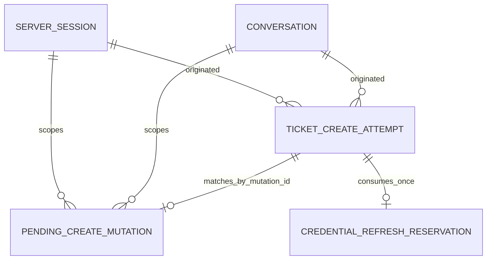

# U2 Ticket Write — 엔터티 설계

## Sources

- `inception/units-generation/unit-of-work.md` — U2 경계, 소유권, 저장 namespace
- `inception/units-generation/unit-of-work-story-map.md` — U2 acceptance criteria 배정
- `inception/user-stories/stories.md` — US2.1 및 공유 US4.1·US5.1 동작
- `inception/requirements-analysis/requirements.md` — FR3, FR5, FR6.3 및 관련 NFR
- `inception/domain-design/components.md` — `TicketOperations`, `ItsmGateway`, lifecycle 소유권
- `inception/contract-design/contract-summary.md` — C-01, C-03A, C-04, C-06, C-07 V1 계약
- `construction/u2-ticket-write/functional-design/functional-design-questions.md` — 확인된 ledger-first/public-port-only 방향

## Authoritative Entity Model

아래 YAML block이 데이터 shape의 source of truth다. U2는 C-04에서 이미 승인된 `ticket_create_attempts`만 사용한다. 별도 pre-confirm table이나 U1 table을 함께 쓰는 transaction port는 추가하지 않는다.

```yaml
schema_version: 1
unit: u2-ticket-write

entities:
  - name: TicketCreateAttemptV1
    owner: U2.TicketOperations.create_extension
    description: 확인 전부터 정확한 canonical bytes와 멱등 key를 보존하고, 확인 뒤 허용된 POST와 결과 조정을 기록하는 durable create ledger row.
    additional_properties: false
    identity: create_attempt_id
    attributes:
      - {name: create_attempt_id, logical_type: opaque_string, required: true, unique: true, references: null, allowed_values: null, default: server_generated_unpredictable_identifier, min: null, max: null, constraints: [non_secret, immutable, stable_reconciliation_reference]}
      - {name: user_id, logical_type: integer, required: true, unique: false, references: current_server_user, allowed_values: null, default: null, min: null, max: null, constraints: [server_derived, immutable]}
      - {name: originating_session_id, logical_type: opaque_string, required: true, unique: false, references: ServerSession, allowed_values: null, default: null, min: null, max: null, constraints: [audit_binding, immutable]}
      - {name: originating_conversation_id, logical_type: opaque_string, required: true, unique: false, references: Conversation, allowed_values: null, default: null, min: null, max: null, constraints: [audit_binding, immutable]}
      - {name: normalized_payload_hash, logical_type: sha256, required: true, unique: false, references: NormalizedTicketCreateV1, allowed_values: null, default: null, min: null, max: null, constraints: [immutable, must_equal_u1_pending_binding]}
      - {name: canonical_request_bytes, logical_type: immutable_bytes, required: true, unique: false, references: CanonicalRequestBytesV1, allowed_values: null, default: null, min: 1, max: null, constraints: [server_only, byte_identical_replay_source, no_credentials]}
      - {name: serialization_version, logical_type: positive_integer, required: true, unique: false, references: CanonicalRequestBytesV1, allowed_values: [1], default: 1, min: 1, max: 1, constraints: [immutable]}
      - {name: request_bytes_hash, logical_type: sha256, required: true, unique: false, references: canonical_request_bytes, allowed_values: null, default: null, min: null, max: null, constraints: [immutable, recomputed_before_each_send]}
      - {name: idempotency_key, logical_type: secret_like_opaque_string, required: true, unique: true, references: null, allowed_values: null, default: os_csprng_minimum_128_bits, min: null, max: null, constraints: [server_only, never_logged_or_model_visible, immutable]}
      - {name: confirmed_mutation_id, logical_type: nullable_opaque_string, required: false, unique: true, references: PendingCreateMutationV1.mutation_id, allowed_values: null, default: null, min: null, max: null, constraints: [idempotent_evidence_binding, immutable_after_first_non_null_write]}
      - {name: confirmed_at, logical_type: nullable_utc_datetime, required: false, unique: false, references: ConsumedMutationEvidenceV1.confirmed_at, allowed_values: null, default: null, min: null, max: null, constraints: [idempotent_evidence_binding, immutable_after_first_non_null_write]}
      - {name: attempt_count, logical_type: integer, required: true, unique: false, references: null, allowed_values: null, default: 0, min: 0, max: 2, constraints: [counts_every_ticket_POST_including_refresh_recall_and_reconciliation]}
      - {name: status, logical_type: enum, required: true, unique: false, references: null, allowed_values: [prepared, in_flight, retryable_after_reconcile, retryable_no_apply, completed, terminal_failure, ambiguous], default: prepared, min: null, max: null, constraints: [durable_state_machine]}
      - {name: claim_id, logical_type: nullable_opaque_string, required: false, unique: true, references: null, allowed_values: null, default: null, min: null, max: null, constraints: [server_generated_per_claim, never_model_visible]}
      - {name: claim_deadline_at, logical_type: nullable_utc_datetime, required: false, unique: false, references: null, allowed_values: null, default: null, min: null, max: null, constraints: [server_clock_only, no_earlier_than_claim_start_plus_attempt_timeout]}
      - {name: refresh_reservation_id, logical_type: nullable_opaque_string, required: false, unique: true, references: CredentialRefreshReservationV1.refresh_reservation_id, allowed_values: null, default: null, min: null, max: null, constraints: [server_generated_once, immutable_after_first_non_null_write, never_model_visible]}
      - {name: refresh_used_at, logical_type: nullable_utc_datetime, required: false, unique: false, references: CredentialRefreshReservationV1.refresh_used_at, allowed_values: null, default: null, min: null, max: null, constraints: [durably_written_before_refresh_port_call, immutable_after_first_non_null_write]}
      - {name: refresh_state, logical_type: enum, required: true, unique: false, references: CredentialRefreshReservationV1, allowed_values: [unused, reserved, committed, failed], default: unused, min: null, max: null, constraints: [monotonic_one_shot_state_machine]}
      - {name: refresh_base_credential_generation, logical_type: nullable_non_negative_integer, required: false, unique: false, references: TicketRequestCapability.server_only_metadata.credential_generation, allowed_values: null, default: null, min: 0, max: null, constraints: [written_with_reservation, never_model_visible_or_logged]}
      - {name: refresh_committed_credential_generation, logical_type: nullable_non_negative_integer, required: false, unique: false, references: TicketRequestCapability.server_only_metadata.credential_generation, allowed_values: null, default: null, min: 1, max: null, constraints: [must_be_greater_than_refresh_base_credential_generation, never_model_visible_or_logged]}
      - {name: refresh_committed_at, logical_type: nullable_utc_datetime, required: false, unique: false, references: CredentialRefreshCommitEvidenceV1.refresh_committed_at, allowed_values: null, default: null, min: null, max: null, constraints: [written_only_after_session_commit_or_generation_recovery]}
      - {name: last_outcome, logical_type: nullable_safe_outcome, required: false, unique: false, references: SafeErrorV1_or_allowlisted_transport_outcome, allowed_values: null, default: null, min: null, max: null, constraints: [no_raw_detail_headers_or_secrets]}
      - {name: result_ticket_id, logical_type: nullable_opaque_string, required: false, unique: false, references: external_ITSM_ticket, allowed_values: null, default: null, min: null, max: null, constraints: [required_only_for_completed]}
      - {name: created_at, logical_type: utc_datetime, required: true, unique: false, references: null, allowed_values: null, default: prepare_or_revise_server_time, min: null, max: null, constraints: [immutable]}
      - {name: retained_until, logical_type: utc_datetime, required: true, unique: false, references: null, allowed_values: null, default: created_at_plus_24_hours, min: null, max: null, constraints: [monotonic, minimum_24_hours_after_confirmation, cleanup_not_before_boundary]}
    entity_constraints:
      - prepare 또는 revise는 U1 pending review를 공개하기 전에 이 row를 prepared 상태로 commit한다.
      - prepared row 자체는 실행 권한이 아니다. 같은 actor scope와 payload hash의 U1 pending row가 공개되고 이후 consume_once가 반환한 mutation_id와 confirmed_at이 이 row에 결합돼야 실행 claim을 시도할 수 있다.
      - create_attempt_id는 U2가 독립 소유한다. U1 mutation identity는 consume evidence를 받은 뒤 confirmed_mutation_id로 한 번만 결합하며 다른 attempt나 mutation으로 재결합할 수 없다.
      - 같은 user·originating session·originating conversation에서 실행 가능한 `prepared` create attempt는 하나뿐이다. 새 review 준비는 이전 미확인 row를 먼저 실행 불가능하게 닫으므로 actor binding과 payload hash로 matching row를 결정적으로 찾을 수 있다.
      - Review 교체는 이전 row가 `prepared`이고 confirmation evidence가 없을 때만 expected-state CAS로 그 row를 terminal_failure로 닫고, U1 이전 pending을 invalidate한 다음 새 ledger와 새 pending을 만든다. 이전 row가 이미 evidence-bound 또는 in_flight이면 교체를 중단한다.
      - 한 row의 idempotency_key, canonical_request_bytes, serialization_version, request_bytes_hash는 평생 불변이다.
      - confirmation evidence 결합 시 retained_until은 max(기존 값, confirmed_at_plus_24_hours)로 단조 증가한다.
      - POST 전에 prepared, retryable_after_reconcile 또는 retryable_no_apply에서 in_flight로의 조건부 claim과 claim identity·deadline·attempt_count 증가를 하나의 U2-owned atomic update로 commit한다.
      - 동시에 경쟁하는 caller 중 claim 승자만 POST한다. claim_deadline_at 이전의 active claim은 탈취할 수 없고 패자는 관찰한 durable 상태를 반환한다.
      - deadline이 지난 in_flight는 자동 재전송하지 않는다. claim_id를 expected value로 사용하는 CAS로 stale 상태를 조정 대상으로 넘기고, 결과 확인 뒤에만 completed, retryable_after_reconcile 또는 terminal ambiguous로 전이한다.
      - 변경 미적용이 권위 있게 보장된 token-expired 401만 retryable_no_apply로 전이한다. 이 상태도 기존 전역 attempt_count와 같은 key·bytes를 사용한다.
      - 첫 POST 전 credential 만료·만료 임박과 retryable_no_apply 복구는 같은 one-shot refresh를 공유한다. refresh_state unused에서 reservation ID, used-at, base credential generation을 먼저 durable commit한 뒤 U1 CredentialRefreshPortV1을 정확히 한 번 호출한다.
      - refresh success는 U1 atomic session commit 뒤 더 큰 credential generation과 committed-at을 기록해야 한다. Reservation은 실패·중단·재시작 뒤에도 재설정하거나 재사용할 수 없다.
      - restart가 reserved를 보면 현재 server session generation이 base보다 크고 actor binding이 같을 때만 committed로 조정한다. 같거나 낮으면 failed와 terminal_failure로 닫고 두 번째 refresh 또는 POST를 금지한다.
      - timeout, connection loss 또는 결과 불명확은 먼저 결과 조정을 거친다. 생성되지 않음이 확인되거나 조회가 실패·불명확해도 count가 남아 있을 때만 retryable_after_reconcile가 된다.
      - completed는 result_ticket_id와 created 또는 Idempotent-Replayed evidence를 요구한다.
      - 수정·취소·교체·만료된 미확인 row는 terminal_failure와 안전한 last_outcome으로 닫으며 실행할 수 없다.
      - user switch, logout, conversation clear, session expiry는 retained_until 전 row를 삭제하지 않는다.
      - credential, Authorization, client secret, OpenAI API key, raw exception, raw problem detail, unrestricted headers는 금지한다.
    relationships:
      - {to: PendingCreateMutationV1, cardinality: one_to_one_after_consumption, direction: TicketCreateAttemptV1_binds_ConsumedMutationEvidenceV1, required: true_for_execution}
      - {to: ServerSession, cardinality: many_to_one_historical, direction: TicketCreateAttemptV1_to_originating_ServerSession, required: true}
      - {to: Conversation, cardinality: many_to_one_historical, direction: TicketCreateAttemptV1_to_originating_Conversation, required: true}

consumed_entities:
  - name: PendingCreateMutationV1
    owner: U1.TicketOperations
    identity: mutation_id
    refinements: {operation: create, ticket_id: null, base_version: null}
    bindings: [user_id, session_id, conversation_id, operation, normalized_payload_hash]
    lifetime: latest_create_review_per_actor_scope_until_consumed_cancelled_invalidated_or_15_minutes
    storage_namespace: ticket_tools_state_v1
    public_operations_used: [put, get, confirm, consume_once, invalidate]
    modification_by_u2: forbidden

functional_ports:
  - name: PendingMutationRepositoryV1
    owner: U1
    usage_by_u2: public_contract_only
    operations_used: [put, get, confirm, consume_once, invalidate]
    transaction_participation_by_u2: forbidden

  - name: TicketCreateAttemptRepositoryV1
    owner: U2
    storage_namespace: ticket_tools_create_v1
    table: ticket_create_attempts
    operations:
      create_prepared:
        input: [create_attempt_id, actor_bindings, normalized_payload_hash, canonical_request_bytes, serialization_version, request_bytes_hash, idempotency_key, created_at, retained_until]
        output: [prepared_attempt_reference, exact_existing_attempt, conflict]
        invariant: commit_before_U1_pending_review_is_published
      supersede_prepared:
        input: [actor_bindings, expected_create_attempt_id, expected_status_prepared, expected_confirmation_evidence_null]
        output: [terminalized_previous_attempt, no_previous_attempt, current_non_replaceable_state]
        invariant: must_complete_before_previous_U1_pending_invalidation_and_new_attempt_creation
      find_prepared_for_binding:
        input: [user_id, originating_session_id, originating_conversation_id, normalized_payload_hash]
        output: [one_prepared_attempt, not_found, conflict]
        invariant: multiple_executable_matches_fail_closed
      bind_confirmation_evidence:
        input: [create_attempt_id, consumed_mutation_id, confirmed_at, expected_actor_and_payload_binding]
        output: [evidence_bound_and_retention_extended, exact_existing_binding, conflict]
        atomic_effect: set_confirmed_fields_once_and_extend_retained_until_to_at_least_confirmed_at_plus_24_hours
      claim_for_send:
        input: [create_attempt_id, expected_status_prepared_or_retryable, expected_attempt_count_below_2, required_bound_confirmation_evidence, required_refresh_guard_unused_with_current_valid_capability_or_committed_with_matching_higher_generation, new_claim_id, claim_deadline_at]
        output: [claimed_in_flight, current_durable_state, rejected]
        atomic_effect: increment_attempt_count_set_in_flight_and_write_claim_identity_and_deadline
      record_definitive_outcome:
        input: [create_attempt_id, expected_status_in_flight, expected_claim_id, safe_transport_outcome]
        output: [completed, retryable_no_apply, terminal_failure, stale_claim_current_state]
        invariant: status_and_claim_id_must_both_match_or_no_write_occurs
      mark_outcome_ambiguous:
        input: [create_attempt_id, expected_in_flight, expected_claim_id, safe_ambiguous_outcome]
        output: [ambiguous, stale_claim_current_state]
        invariant: status_and_claim_id_must_both_match_or_no_write_occurs
      begin_stale_claim_reconciliation:
        input: [create_attempt_id, expected_in_flight, expected_claim_id, server_now_at_or_after_claim_deadline]
        output: [reconciliation_owner, active_claim, current_durable_state]
      record_reconciliation:
        input: [create_attempt_id, expected_ambiguous_or_stale_claim, expected_claim_id, allowlisted_reconciliation_result]
        output: [completed, retryable_after_reconcile, ambiguous, stale_claim_current_state]
        invariants:
          - retryable_after_reconcile_only_when_attempt_count_below_2
          - expected_state_and_claim_id_must_both_match_or_no_write_occurs
      consume_refresh_reservation:
        input: [create_attempt_id, expected_status_prepared_or_retryable_no_apply, required_bound_confirmation_evidence, expected_refresh_state_unused, current_credential_generation, new_refresh_reservation_id, server_refresh_used_at]
        output: [CredentialRefreshReservationV1, already_used_current_state, rejected]
        atomic_effect: persist_refresh_reservation_id_refresh_used_at_base_credential_generation_and_state_reserved_once_before_any_refresh_port_invocation
        invariant: reservation_is_never_reset_replaced_or_replayed
      record_refresh_committed:
        input: [create_attempt_id, expected_refresh_state_reserved, expected_refresh_reservation_id, committed_credential_generation_greater_than_base, server_refresh_committed_at]
        output: [CredentialRefreshCommitEvidenceV1, current_durable_state, rejected]
        atomic_effect: set_refresh_state_committed_and_commit_evidence_once
      recover_refresh_after_restart:
        input: [create_attempt_id, expected_refresh_state_reserved, expected_refresh_reservation_id, current_same_actor_session_credential_generation]
        output: [committed_from_higher_generation, failed_from_same_or_lower_generation, current_durable_state]
        atomic_effect: compare_generation_then_set_committed_or_failed_and_terminal_failure_without_invoking_refresh_port
      record_refresh_failure:
        input: [create_attempt_id, expected_refresh_state_reserved, expected_refresh_reservation_id, safe_refresh_error]
        output: [failed_and_terminal_failure, current_durable_state]
        atomic_effect: set_refresh_state_failed_and_status_terminal_failure_without_new_claim
      terminate_unconfirmed:
        input: [create_attempt_id, expected_prepared, safe_reason]
        output: terminal_failure_or_existing_state
    concurrency:
      - claim_for_send uses compare-and-set on status, attempt_count, confirmation evidence and claim identity.
      - exactly one caller can win each counted send claim.
      - an active in_flight claim cannot be replaced before claim_deadline_at.
      - stale-claim reconciliation uses expected claim_id so only one recovery caller becomes reconciliation owner.
      - every transport and reconciliation outcome write compares both expected in_flight state and expected claim_id; a late stale claimant receives current state and changes nothing.
      - exactly one caller can durably consume the credential-refresh reservation; every loser, restart and crash recovery path performs zero additional refresh calls.
      - claim_for_send rejects refresh_state reserved or failed and accepts committed only when the current capability carries the recorded committed generation and same actor binding.
      - a losing caller never invokes ItsmGatewayV1.

value_objects:
  - name: TicketWriteDraftV1
    description: prepare 또는 revise에서만 받는 model-visible draft.
    additional_properties: false
    required: [title, description, service, impact_level, urgency, impact_note, occurred_at]
    optional: [component, model, classification]
    constraints:
      - title 길이는 1~200, description 길이는 1~5000이다.
      - impact_note 길이는 1~1000이다.
      - service, component, model selector는 ID 또는 name 중 정확히 하나를 가진다.
      - impact_level은 extensive, significant, moderate, minor 중 하나다.
      - urgency는 critical, high, medium, low 중 하나다.
      - classification은 standard 또는 restricted이며 기본값은 standard다.
      - occurred_at은 timezone-qualified timestamp 또는 명시적 now variant다.

  - name: ResolvedCatalogV1
    description: create body에 쓰는 server-resolved active catalog identity.
    additional_properties: false
    required: [service_id]
    optional: [component_id, model]
    constraints:
      - supplied selector마다 active normalized match가 정확히 하나여야 한다.
      - component_id는 service_id에 속해야 한다.
      - retired 또는 deprecated item은 대체하지 않고 거부한다.

  - name: NormalizedTicketCreateV1
    description: byte serialization 전 완전히 검증된 logical create body.
    additional_properties: false
    required: [title, description, service_id, impact_level, urgency, impact_note, occurred_at, classification]
    optional: [component_id, model]
    field_order: [title, description, service_id, component_id, model, impact_level, urgency, impact_note, occurred_at, classification]
    constraints:
      - absent optional field는 추측하지 않고 생략한다.
      - classification 기본값 standard를 hashing 전에 materialize한다.
      - occurred_at은 prepare 또는 revise 때 canonical UTC RFC3339 값으로 고정한다.
      - server-generated ticket field는 금지한다.

  - name: CanonicalRequestBytesV1
    description: 한 attempt의 모든 POST가 사용하는 deterministic UTF-8 JSON bytes.
    additional_properties: false
    required: [serialization_version, body_bytes, sha256]
    constraints:
      - Version 1은 선언된 field order, compact JSON, UTF-8, insignificant whitespace 없음 규칙을 사용한다.
      - absent optional field는 생략하고 classification 기본값은 포함한다.
      - 매 시도는 재구성한 object가 아니라 저장된 exact bytes를 사용한다.
      - credential과 transport header는 포함하지 않는다.

  - name: SafeMutationReviewV1
    description: normalized payload hash에 결합된 사람이 읽을 수 있는 전체 create summary.
    additional_properties: false
    required: [operation, normalized_payload_hash, fields, choices]
    constraints:
      - operation은 create이며 choices는 server-owned labels 확인, 수정, 취소다.
      - canonical body field마다 한 번씩 나타나며 ITSM-origin label은 untrusted로 표시한다.
      - credential, idempotency key, raw transport data는 포함하지 않는다.

  - name: CreateCompletionEvidenceV1
    description: shared SafeMutationResultV1와 TicketMutationToolResultV1로 결정적으로 mapping되는 internal create evidence.
    additional_properties: false
    required: [operation, ticket_id, idempotent_replayed]
    optional: [request_id]
    constraints:
      - operation은 create다.
      - ticket_id는 created 또는 Idempotent-Replayed evidence가 있을 때만 존재한다.
      - public output은 TicketMutationToolResultV1.data 안의 SafeMutationResultV1 shape를 그대로 사용한다.

  - name: CredentialRefreshReservationV1
    description: U2가 첫 POST 전 만료·만료 임박 또는 token-expired no-apply 결과 뒤 U1 credential refresh를 한 번만 호출했음을 입증하는 server-only durable projection.
    additional_properties: false
    required: [create_attempt_id, refresh_reservation_id, refresh_used_at, base_credential_generation]
    constraints:
      - Bound confirmation evidence가 있는 prepared 또는 retryable_no_apply row에서 refresh 미사용 상태를 expected value로 하는 CAS 승자만 생성한다.
      - reservation은 CredentialRefreshPortV1 호출 전에 ticket_create_attempts row에 commit한다.
      - 한 create attempt에 정확히 하나만 존재하며 실패, crash 또는 restart 뒤 reset·replace·replay하지 않는다.
      - credential, authorization, idempotency key, canonical request bytes를 포함하거나 노출하지 않는다.
      - U1 port의 성공은 같은 user·session·conversation binding을 유지한 새 request-scoped capability와 기존 server session credential의 atomic commit을 의미한다.

  - name: CredentialRefreshCommitEvidenceV1
    description: U1 atomic session credential commit이 끝났거나 restart에서 그 commit을 generation 증가로 복원했음을 증명하는 server-only evidence.
    additional_properties: false
    required: [create_attempt_id, refresh_reservation_id, base_credential_generation, committed_credential_generation, refresh_committed_at]
    constraints:
      - committed credential generation은 base generation보다 커야 한다.
      - actor binding이 같은 current server session에서만 생성하거나 복원한다.
      - 이 evidence와 현재 capability generation이 일치해야 refresh 경로의 다음 send claim을 허용한다.
      - credential 값, fingerprint, authorization과 refresh token을 포함하지 않는다.

  - name: TicketWritePluginV1
    description: 기존 Agent와 presentation layer에 대한 U2-owned registry contribution.
    required: [contract_version, tool_name, function_tool_factory, presentation_mappers]
    constraints:
      - contract_version은 1이고 tool_name은 ticket_write다.
      - U1 RegistryV1을 통해 등록하며 common registry 구현을 수정하지 않는다.
      - mapper key는 ticket_input, ticket_review, ticket_success, ticket_auth_error, ticket_rate_limited, ticket_ambiguous, ticket_unavailable로 제한한다.
```

## Entity Summary

| Model | Ownership | Purpose | Lifetime |
|---|---|---|---|
| `TicketCreateAttemptV1` | U2 | 확인 전에 reviewed bytes와 key를 보존하고 확인 뒤 counted execution·reconciliation을 기록 | prepare/revise 시 생성; 확인 시점부터 최소 24시간으로 연장 |
| `PendingCreateMutationV1` | U1, U2가 공개 port로 소비 | revocable confirmation binding 보존 | user/session/conversation의 최신 create review, 최대 15분 |
| `NormalizedTicketCreateV1` | U2 value object | 확인 전에 검증된 create body 고정 | 한 prepare 또는 revise cycle |
| `CanonicalRequestBytesV1` | U2 value object | byte-identical replay 보장 | 대응 ledger row와 동일 |
| `CredentialRefreshReservationV1` | U2 server-only value object | 한 create attempt의 refresh 호출을 durable하게 한 번으로 제한 | 첫 사용 시 생성 후 ledger retention과 동일 |
| `CredentialRefreshCommitEvidenceV1` | U2 server-only value object | U1 session commit 완료 또는 restart 복원 후 다음 claim을 승인 | reservation committed 뒤 ledger retention과 동일 |
| `SafeMutationReviewV1` | Shared envelope, U2 mapper | 전체 create field와 명시적 다음 명령 표시 | pending confirmation 하나 |

## Derived Relationship View



텍스트 대체: U2는 먼저 독립 `create_attempt_id`의 `TicketCreateAttemptV1`을 `prepared`로 저장한다. 그 뒤 같은 actor scope와 payload hash의 U1 pending review를 공개한다. `consume_once`가 반환한 mutation ID와 확인 시각을 해당 ledger row에 결합한 뒤에만 실행 claim 대상이 된다. Token-expired no-apply 복구는 같은 row에 one-shot refresh reservation을 먼저 기록한다. Revocable confirmation이 사라져도 durable ledger와 사용된 reservation은 보존된다.

## Logical Storage Boundary

- U2는 기존 additive namespace `ticket_tools_create_v1`의 `ticket_create_attempts`만 소유한다.
- U2는 U1-owned `ticket_tools_state_v1` 또는 `ticket_tools_history_v1` migration을 변경하지 않는다.
- U1 pending 상태와 U2 ledger를 함께 쓰는 cross-namespace transaction은 없다. 두 repository는 각자 소유한 상태만 변경한다.
- ledger-first 순서는 confirmation 공개 전에 exact bytes와 key의 durability를 보장한다. 중간 중단으로 남은 orphan `prepared` row는 U1 consumption evidence가 없으므로 실행 권한이 없다.
- cleanup은 `retained_until` 이전 row를 지우지 않으며, 확인된 row는 confirmation server time부터 최소 24시간을 보장한다.

## Assumptions & Open Questions

None.
