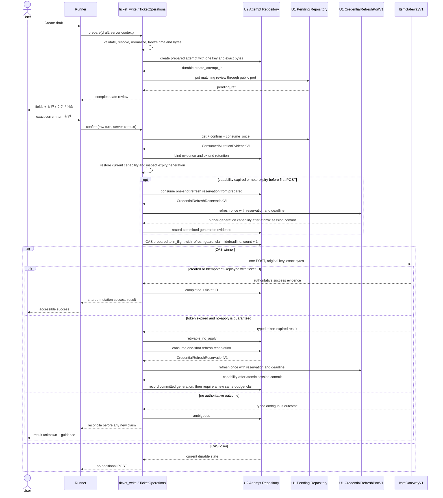
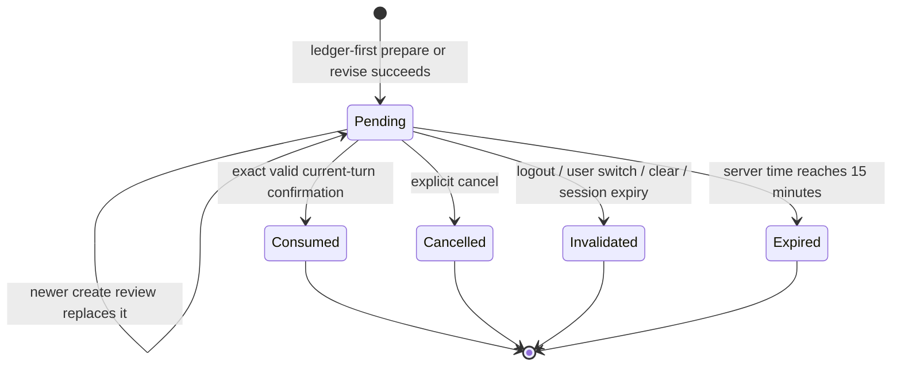
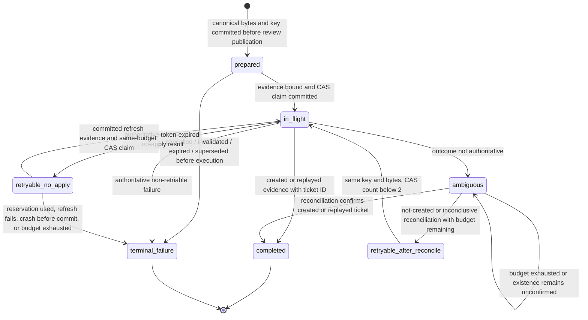

# U2 Ticket Write — 기능 명세

## Sources

- `inception/units-generation/unit-of-work.md` — U2 범위·소유권·delivery boundary
- `inception/units-generation/unit-of-work-story-map.md` — U2 acceptance-criteria allocation
- `inception/user-stories/stories.md` — US2.1 및 공유 US4.1·US5.1 outcome
- `inception/requirements-analysis/requirements.md` — create, identity, safety, reliability, presentation 요구사항
- `inception/domain-design/components.md` — component responsibility와 trust boundary
- `inception/contract-design/contract-summary.md` — C-01, C-03A, C-04, C-06, C-07 V1 계약
- `construction/u2-ticket-write/functional-design/functional-design-questions.md` — 확인된 ledger-first/public-port-only 방향
- `construction/u2-ticket-write/functional-design/entities.md` — authoritative entity model
- `construction/u2-ticket-write/functional-design/rules.md` — authoritative business rules

## Scope and Boundaries

U2는 기존 U1 Agent/runtime skeleton에 ticket creation을 추가한다. `ticket_write` FunctionTool contribution, create validation과 catalog resolution, complete review, U1 공개 confirmation 연산의 소비, idempotent POST orchestration, durable ambiguity handling, create-specific presentation mapper를 소유한다.

U2는 U1-owned server session, pending-confirmation schema, history repository, Runner serialization, gateway foundation, common registry, lifecycle coordinator를 대체하거나 수정하지 않는다. 특히 U1 pending table에 직접 쓰지 않고 새 cross-owner transaction port도 만들지 않는다. U3 update semantics와 U4 whole-application release assurance는 범위 밖이다.

| Actor or component | U2 responsibility | Boundary |
|---|---|---|
| Authenticated user | Create field 제공, normalized summary 검토, explicit current-turn choice 전송 | Identity와 delegated capability는 server session에서만 온다 |
| Agent and Runner | prepare/revise intent routing과 turn serialization | Model output은 mutation을 confirm할 수 없다 |
| `ticket_write` FunctionTool | Create draft 수락과 typed safe state 반환 | Credential, idempotency key, raw upstream detail은 tool contract를 넘지 않는다 |
| `TicketOperations` create extension | Validate, catalog resolve, normalize, ledger-first review, U1 confirmation, counted attempt orchestration | Operation policy를 소유하고 gateway는 retry·confirmation policy를 소유하지 않는다 |
| U1 `PendingMutationRepositoryV1` | Latest create review와 revocable binding 보존 | U2는 공개 `put`, `get`, `confirm`, `consume_once`, `invalidate`만 사용한다 |
| U2 create-attempt repository | 기존 `ticket_tools_create_v1.ticket_create_attempts`에 `TicketCreateAttemptV1` 보존 | Confirmation 공개 전부터 durable하며 confirmed row는 최소 24시간 보존한다 |
| U1 `CredentialRefreshPortV1` | U2가 먼저 durable consume한 reservation과 current capability로 credential을 최대 한 번 교환하고 기존 server session에 atomic commit | Raw token은 port를 넘지 않고 reservation 재사용은 금지된다 |
| `ItsmGatewayV1` create method | Supplied delegated capability, key, immutable bytes로 POST 정확히 한 번 수행 | Hidden retry, refresh, sleep, reconciliation이 없다 |
| U1 RegistryV1 and presentation | U2 tool factory와 create mapper key load | U2는 common registry를 수정하지 않고 registration만 기여한다 |

## Functional Workflows

### FD-U2-01 — Prepare or Revise a Ledger-First Review

1. Runner는 raw current user turn을 model-produced tool argument와 분리해 보존한다.
2. `ticket_write`는 `TicketWriteDraftV1` field만 받는다. Unknown field, missing required value, invalid length·enum·time input은 network access 전에 실패한다.
3. `TicketOperations`은 active catalog에서 service와 optional component·model을 해석한다. Selector마다 active normalized match가 정확히 하나여야 하며 component는 service에 속해야 한다.
4. `occurred_at`을 UTC로 canonicalize한다. Explicit now는 injected server clock을 한 번만 capture하고 confirmation에서 다시 capture하지 않는다.
5. Default classification을 materialize하고 absent optional을 생략해 `NormalizedTicketCreateV1`과 version 1 canonical UTF-8 bytes, normalized-payload hash, request-bytes hash를 만든다.
6. 같은 actor scope의 이전 create review가 있으면 U2는 이전 row가 evidence 없는 `prepared`인지 expected-state CAS로 확인해 먼저 `terminal_failure`로 닫는다. Confirm이 먼저 evidence를 결합했거나 claim을 얻었다면 CAS가 실패하고 revise를 중단한다.
7. 이전 row가 안전하게 닫힌 뒤 U1 공개 `invalidate`로 이전 pending을 무효화한다. 이 단계가 실패하면 새 ledger나 pending을 만들지 않는다. 이전 pending confirm이 동시에 성공해도 이미 terminalized된 ledger에는 evidence를 결합하거나 POST 권한을 만들 수 없다.
8. 교체 선행 단계가 모두 끝난 뒤 U2는 독립 `create_attempt_id`와 CSPRNG idempotency key를 할당하고 새 `TicketCreateAttemptV1`을 `prepared`, `attempt_count: 0`으로 commit한다. `created_at`과 initial `retained_until = created_at + 24h`도 함께 저장한다.
9. 새 ledger commit이 성공한 뒤에만 U1 공개 `put`으로 같은 actor binding·payload hash·15분 expiry의 pending review를 저장한다. U1 mutation ID는 `consume_once` evidence로 돌아온 뒤에만 U2 row에 결합된다. Pending publish 전에 중단되면 evidence 없는 orphan `prepared` row만 남아 실행할 수 없다.
10. Response는 canonical field 전체와 정확한 선택 `확인`, `수정`, `취소`를 보여준다. 이 workflow의 ticket POST 수는 0이다.

### FD-U2-02 — Explicit Confirmation through U1 Public Ports

1. Runner는 raw current turn이 shared contract의 normalization 뒤 `확인` 또는 `confirm`과 정확히 같은지 검사한다. Quoted, embedded, historical, model-generated, external text는 confirmation이 아니다.
2. U2는 U1 공개 `get`과 `confirm`으로 pending age, user, session, conversation, operation, payload hash를 검증한다.
3. U1 공개 `consume_once`가 fresh consume 또는 same mutation·same binding의 already-consumed result를 입증하고 `ConsumedMutationEvidenceV1(mutation_id, confirmed_at)`을 반환해야 다음 단계로 간다. Cancelled, invalidated, expired 또는 mismatched state는 zero-POST failure다.
4. U2는 actor binding과 payload hash로 유일한 실행 가능 `prepared` ledger를 선택하고 serialization version·exact bytes hash를 다시 검증한다. Prepare/revise가 같은 actor scope의 이전 미확인 row를 닫기 때문에 0개 또는 복수 match는 fail-closed zero-POST 오류다.
5. U2 repository는 evidence의 mutation ID와 confirmed_at을 같은 attempt에 idempotent compare-and-set으로 결합하고 `retained_until = max(existing retained_until, confirmed_at + 24h)`로 단조 증가시킨다. 이미 다른 mutation evidence가 결합된 row는 충돌로 닫는다.
6. Evidence 결합까지는 POST count를 증가시키지 않는다. 다음 단계는 current capability의 만료 상태와 durable refresh state를 확인하는 FD-U2-03이며, credential readiness가 증명되기 전에는 send claim을 만들지 않는다.
7. U1 consume 뒤 U2 evidence 결합 전 중단은 자동 실행 권한을 남기지 않는다. 기존 attempt·key·bytes를 유지한 새 U1 review와 새 explicit confirmation을 요구한다. Evidence 결합 뒤 credential readiness 또는 claim 전 중단은 같은 bound evidence와 기존 ledger로 복구하며 새 key나 bytes를 만들지 않는다.

### FD-U2-03 — Execute the Counted Ticket POST

1. U2는 current server session이 같은 user를 authorize하는지 확인하고 request-scoped capability의 server-only credential generation과 expiry를 읽는다. Credential 값은 gateway boundary 밖으로 꺼내지 않는다.
2. 첫 POST 전 capability가 만료됐거나 만료 임박했으면 bound evidence가 있는 `prepared` row에서, no-apply 401 뒤라면 `retryable_no_apply` row에서 refresh state `unused`를 expected value로 reservation ID, used-at과 base credential generation을 atomic commit한다. 두 경로는 한 attempt의 같은 one-shot reservation을 공유한다.
3. Reservation CAS 승자만 current capability, durable `CredentialRefreshReservationV1`, positive remaining deadline으로 U1 `CredentialRefreshPortV1`을 정확히 한 번 호출한다. U1은 token exchange를 최대 한 번 수행하고 성공 credential을 기존 server session에 atomic replace한 뒤 같은 actor binding과 더 큰 generation의 capability를 반환한다.
4. U2는 더 큰 generation과 commit 시각을 `committed` evidence로 기록한다. Refresh 실패는 `failed`와 `terminal_failure`로 닫는다. Restart가 `reserved`를 관찰하면 current same-actor server-session generation이 base보다 큰 경우에만 `committed`로 복원하고, 같거나 낮으면 `failed`로 닫는다. 어느 경우에도 refresh port를 다시 호출하지 않는다.
5. 원래 capability가 유효하고 refresh state가 `unused`이거나, current capability generation이 durable `committed` evidence와 일치할 때만 U2는 bound evidence, `attempt_count < 2`, `prepared` 또는 retryable state를 expected value로 CAS claim한다. 승자는 unique `claim_id`, `claim_deadline_at`, `attempt_count + 1`, `in_flight`를 POST 시작 직전에 atomic commit한다. Reserved 또는 failed refresh state는 claim을 거부한다.
6. Stored canonical bytes의 hash와 serialization version, immutable key binding을 다시 검증한다.
7. `ItsmGatewayV1`은 exact stored bytes, original idempotency key, delegated capability, per-attempt timeout으로 HTTP attempt를 정확히 한 번 수행한다.
8. Valid created response 또는 valid `Idempotent-Replayed` response에 ticket ID가 있으면 expected `claim_id`의 ledger를 `completed`로 commit한다.
9. 권위 계약이 변경 미적용을 보장하는 typed token-expired 401이면 expected `claim_id`로 `retryable_no_apply`를 기록하고 step 2의 동일 one-shot refresh flow로 돌아간다. Reservation을 이미 사용했다면 terminal authentication failure이며 두 번째 refresh나 POST를 수행하지 않는다.
10. Definitive non-retryable failure와 ambiguous outcome도 expected `in_flight`와 expected `claim_id`가 함께 일치할 때만 기록한다. Deadline 뒤 새 claim이 시작된 후 도착한 이전 claimant의 응답은 current durable state만 반환하고 어떤 상태도 덮어쓰지 않는다.
11. Internal `CreateCompletionEvidenceV1`을 shared `SafeMutationResultV1`의 `operation: create`, `ticket_id`, optional `idempotent_replayed`, `request_id`로 mapping하고 `TicketMutationToolResultV1.data`에 넣는다.
12. Canonical bytes와 idempotency key는 접근 통제된 U2 ledger에만 보존한다. Raw header, body, exception, problem detail과 credential은 model, result, presentation, history, log, metric, test output에 나타나지 않는다.

### FD-U2-04 — Reconcile Ambiguity or Restart

1. Timeout, transport interruption, authoritative result 없는 qualifying server failure는 expected `claim_id`로 row를 `ambiguous`로 기록한다. Restart에서 `in_flight`를 관찰한 것만으로는 active sender를 실패로 간주하지 않는다.
2. `server_now < claim_deadline_at`인 active claim은 누구도 탈취하거나 재전송할 수 없다. Deadline 이후에는 expected `claim_id` CAS 승자 한 명만 stale-claim reconciliation owner가 된다.
3. Durable ledger는 originating session, conversation, pending review가 정리돼도 reconciliation authority를 보존한다. Reconciliation은 문서화된 결과 조회 수단이 있으면 먼저 사용하고, 없거나 조회 실패·불명확이면 그 사실을 safe outcome으로 기록한다.
4. 결과 조회에서 ticket ID가 created 또는 replayed evidence로 확인되면 새 POST 없이 `completed`가 된다. 생성되지 않음이 확인되거나 조회가 실패·불명확하고 `attempt_count < 2`이면 `retryable_after_reconcile`로 전이한다.
5. `retryable_after_reconcile`의 새 CAS claim 승자만 same stored key·bytes·version·hash로 second POST를 수행한다. `ambiguous`에서 직접 POST하거나 active claim을 건너뛰는 경로는 없다.
6. 총 두 POST가 끝났거나 결과 조정 뒤에도 생성 여부를 확정하지 못하면 terminal `ambiguous`로 남기고 더 보내지 않는다. 429는 즉시 반환하며 automatic sleep과 retry가 0회다.

### FD-U2-05 — Cancel, Revise, and Lifecycle Isolation

1. `취소`, explicit cancel, field-changing turn은 U1 공개 `invalidate`로 current pending을 닫고 대응 `prepared` ledger를 실행 불가능한 terminal state로 바꾼다. POST는 0회다.
2. Logout, user switch, conversation clear, session expiry도 revocable pending을 invalidate하고 아직 미실행인 matching ledger의 authorization을 제거한다.
3. 이 lifecycle event는 `retained_until` 전 durable ledger를 삭제하지 않는다. Ambiguous 또는 completed evidence는 server-owned reconciliation과 audit을 위해 남는다.
4. Changed body는 항상 새 complete review, mutation identity, ledger row, idempotency key를 요구한다. 이미 confirmed된 intent에 새 key를 발급하지 않는다.

### FD-U2-06 — Registration, Presentation, and History

1. U2는 contract version 1, tool name `ticket_write`, FunctionTool factory, create mapper key를 가진 `TicketWritePluginV1`을 U1 `RegistryV1`에 기여한다.
2. Presentation은 input correction, complete review, success, authentication failure, rate limiting, ambiguity, upstream unavailability에 text-first mapping을 제공한다.
3. Catalog label과 response text는 escaped untrusted data다. Instruction으로 해석하거나 control state를 바꾸지 않는다.
4. History에는 safe operation outcome만 기록한다. Credential, key, canonical bytes, raw exception, unrestricted header·body는 제외한다.

## Primary Interaction Sequence

텍스트 대체: U2는 review를 공개하기 전에 독립 create attempt에 exact bytes와 key를 `prepared`로 저장한다. Exact current-turn confirmation은 U1 공개 port로 consume하고 반환된 evidence를 같은 actor·payload attempt에 결합한다. U2 CAS claim 승자만 counted POST를 한 번 수행한다. 401 미적용 보장에서는 U2가 one-shot refresh reservation을 먼저 durable consume하고 U1 port를 한 번 호출한 뒤에만 새 claim을 시도한다. 불명확 결과는 별도 durable 조정을 거치며, authoritative ticket ID evidence만 success가 된다.

## State Models

### Pending Create Review

텍스트 대체: U1은 actor scope의 최신 create review만 pending으로 유지한다. Exact confirmation으로 한 번 consume하거나 cancel, lifecycle invalidation, replacement, 15분 expiry로 끝난다. Consumed 외 terminal transition은 모두 zero POST다.

### Durable Create Attempt

텍스트 대체: Durable row는 review 전에 prepared가 된다. U1 consumption evidence가 row에 결합되고 claim identity·deadline을 가진 U2 CAS가 성공해야 in_flight가 된다. 변경 미적용 401은 retryable_no_apply에서 durable one-shot refresh reservation을 소비한 뒤 새 claim으로만 진행하고, 불명확 결과는 reconciliation 뒤 retryable_after_reconcile를 거친다. Ambiguous에서 직접 재전송하지 않으며 completed는 authoritative created/replayed evidence를 요구한다.

## Crash and Concurrency Semantics

| Boundary | Durable observation | Recovery and safety result |
|---|---|---|
| Ledger commit 전 중단 | Row 없음, U1 pending 없음 | Fresh prepare 필요, POST 0회 |
| 이전 review terminalization과 U1 invalidation 사이 중단 | 이전 ledger는 실행 불가, 이전 pending은 남을 수 있음 | Stale confirmation이 consume돼도 evidence bind/claim 실패; 새 review 생성 전 invalidation 재실행 |
| 이전 pending invalidation 후 새 ledger commit 전 중단 | 이전 ledger·pending 모두 실행 불가 | Fresh prepare가 새 ledger부터 다시 시작; POST 0회 |
| Ledger commit 후 U1 pending publish 전 중단 | Orphan `prepared` row | Consumption evidence가 없어 실행 불가; retention 뒤 cleanup |
| U1 pending publish 후 review response 전 중단 | `prepared` row + pending binding | Pending ref를 사용자에게 안전하게 복원할 수 없으면 expiry/invalidation; 자동 실행 없음 |
| U1 consume 후 evidence 결합 전 중단 | Consumed pending + evidence 없는 `prepared` row | 동일 attempt·key·bytes로 새 review를 게시하고 새 explicit confirmation 요구; 자동 POST 0회 |
| Evidence 결합 후 CAS 전 중단 | confirmed fields가 있는 `prepared` row | 동일 bound evidence로 claim 재개; 새 key·bytes 없음 |
| 첫 POST 전 만료·만료 임박 capability | `prepared`, evidence bound, refresh unused | Reservation을 먼저 commit하고 U1 port를 1회 호출; commit evidence 전 claim·POST 0회 |
| CAS commit 후 deadline 전 restart·경쟁 | `in_flight`, claim ID/deadline, count 증가 완료 | Active claim은 탈취하지 않고 current state 반환; 추가 POST 0회 |
| Claim deadline 이후 restart | stale `in_flight`와 기존 claim ID | Expected claim ID CAS 승자만 결과 조정; 조정 전 추가 POST 0회 |
| 이전 claimant 응답이 새 claim 뒤 늦게 도착 | Stored `claim_id`가 이전 응답과 다름 | 모든 outcome write가 거부되고 current durable state만 반환; 최신 claim 상태 보존 |
| Concurrent refresh callers | `retryable_no_apply`, refresh reservation 없음 | Reservation CAS 승자만 U1 refresh port 1회 호출; 패자는 current state 반환, refresh 0회 |
| Refresh reservation commit 후 U1 port 성공 전 중단 | `reserved`, base credential generation 기록 | Current same-actor session generation이 base보다 크면 `committed`로 복원하고, 같거나 낮으면 `failed`와 terminal failure; 두 경우 모두 두 번째 refresh 0회 |
| 두 confirm이 경쟁 | 한 caller만 CAS 승리 | 패자는 current state만 반환하고 gateway call 0회 |

## Gateway Outcome Decisions

| Gateway observation | Durable transition | Additional automatic POST | User-visible result |
|---|---|---:|---|
| Valid created response with ticket ID | `completed` | No | Ticket ID가 있는 success |
| Valid `Idempotent-Replayed` response with ticket ID | `completed` | No | Replay indicator가 있는 success |
| Typed 401 token-expired, no-apply guaranteed, refresh reservation unused, total count below two | `retryable_no_apply`, then durable reservation consumption | At most one after one U1 refresh-port call and new CAS claim | Final outcome 또는 authentication required |
| Typed 401 after refresh or no refresh capability | `terminal_failure` unless send certainty is unknown | No | Authentication required; never success |
| 429 | Safe non-success evidence 보존 | No sleep and no retry | Rate limited, optional validated Retry-After |
| Definitive validation, permission, other non-retriable 4xx | `terminal_failure` | No | Allowlisted safe error |
| Timeout, connection loss, response loss after send | `ambiguous`, then reconciliation; optionally `retryable_after_reconcile` | At most one same-key, byte-identical POST after reconciliation | Result unknown until evidence |
| 500/502/503/504 without authoritative body | `ambiguous`, then reconciliation; optionally `retryable_after_reconcile` | At most one within total cap after reconciliation | Ambiguous 또는 safe unavailable |
| Malformed success-like response or missing ticket ID | `ambiguous` or `terminal_failure` | Only within shared cap | Never success |
| Byte/hash/key mismatch before send | `terminal_failure` | No | Safe consistency failure; outbound 0회 |

Attempt counter는 최초 전송과 refresh 또는 reconciliation 뒤의 재전송을 포함한 실제 ticket POST만 센다. Catalog 조회, 결과 조회, credential refresh port 호출 자체는 세지 않으며, claim은 credential readiness가 증명된 뒤 POST 시작 직전에 count를 올린다. 그 뒤 POST도 같은 예산을 사용하므로 어떤 경로도 실제 POST 두 번을 넘지 않는다.

## Derived Entity Relationships

```mermaid
flowchart LR
    Draft[TicketWriteDraftV1] --> Resolved[ResolvedCatalogV1]
    Resolved --> Normalized[NormalizedTicketCreateV1]
    Normalized --> Bytes[CanonicalRequestBytesV1]
    Bytes --> Ledger[U2 TicketCreateAttemptV1 prepared]
    Normalized --> Review[SafeMutationReviewV1]
    Ledger --> Pending[U1 PendingCreateMutationV1]
    Pending -->|public consume_once| Evidence[ConsumedMutationEvidenceV1]
    Evidence --> Bind[U2 evidence binding]
    Ledger --> Bind
    Bind --> Claim[U2 CAS execution claim]
    Ledger --> Claim
    Claim --> Gateway[ItsmGatewayV1 one-attempt create]
    Gateway -->|no-apply 401| Reservation[CredentialRefreshReservationV1 consumed once]
    Reservation --> Refresh[U1 CredentialRefreshPortV1]
    Refresh --> Claim
    Gateway --> Completion[CreateCompletionEvidenceV1]
    Completion --> Result[TicketMutationToolResultV1]
    Plugin[TicketWritePluginV1] --> Tool[ticket_write]
    Plugin --> Present[Create presentation mappers]
```

텍스트 대체: Valid draft는 normalized body와 canonical bytes를 만든다. Bytes와 one key는 기존 U2 ledger에 먼저 저장되고, 이후 U1 pending review가 공개된다. Public consume evidence를 ledger에 결합한 뒤 U2 CAS claim이 한 caller에게만 gateway 권한을 준다. No-apply 401은 durable one-shot reservation을 거쳐 U1 refresh port를 한 번만 호출한다. Completion evidence는 unchanged shared mutation result로 mapping된다.

## Derived Rule Application

| Decision point | Governing rules | Required result |
|---|---|---|
| Draft admission | BR2.1–BR2.5 | Deterministic normalized body 또는 safe correction, POST 0회 |
| Review creation | BR3.1–BR3.3 | Existing ledger-first complete review, exact binding, 15분 expiry |
| Confirmation | BR3.4–BR3.6 | Exact current-turn token과 U1 public consume evidence 또는 POST 0회 |
| Pre-send | BR4.1, BR4.2, BR4.4, BR4.6 | Bound evidence, retention extension, claim identity·deadline, one CAS winner, counted in_flight |
| Outcome and reconciliation | BR4.3, BR4.5, BR4.7–BR4.11 | Explicit retryable states, one-shot durable refresh, stale-claim reconciliation, maximum two one-attempt calls, no fabricated success |
| Trust boundaries | BR5.1–BR5.3 | Delegated server authority와 allowlisted non-instructional data |
| Integration and UX | BR5.4–BR5.6 | Text-equivalent presentation, additive registration, deterministic verification |

## Acceptance and Verification Scenarios

| Scenario | Expected observation | Acceptance criteria |
|---|---|---|
| Valid draft with explicit now | Clock 한 번 capture, full review, existing ledger `prepared`, POST 0회 | AC2.1.1, AC2.1.2, AC2.1.3 |
| Invalid length, enum, timezone, retired catalog, mismatched component | Safe correction, ledger/pending publish 없음, POST 0회 | AC2.1.1, AC2.1.2 |
| New review supersedes old review | Old pending과 old prepared ledger는 실행 불가; newest binding만 confirm 가능 | AC2.1.4 |
| Revise와 이전 confirm이 경쟁 | 이전 ledger terminalization 또는 evidence binding 중 한 CAS만 승리; revise 실패 시 새 review 없음, confirm 실패 시 POST 0회 | AC2.1.4, AC2.1.5 |
| Quoted, historical, model-generated confirmation text | Confirmation 거부, POST 0회 | AC2.1.3, AC4.1.2 |
| Crash after ledger commit before U1 pending publish | Orphan prepared row는 실행 불가, key 재사용 POST 없음 | AC2.1.3, AC2.1.4 |
| Crash after U1 consume before evidence bind | Same attempt·key·bytes를 유지한 새 review와 새 confirmation, 자동 POST 0회 | AC2.1.5, AC4.1.3 |
| Crash after evidence bind before claim | Bound evidence와 existing row로 복구, new key 없음 | AC2.1.5, AC4.1.3 |
| Two concurrent exact confirmations | CAS winner 한 명만 one counted POST; loser POST 0회 | AC2.1.3, AC2.1.5, AC4.1.4 |
| Restart before active claim deadline | Active claim takeover 0회, additional POST 0회 | AC2.1.5, AC4.1.5 |
| Restart after claim deadline | Expected claim ID CAS winner만 reconcile하고 결과 확인 전 POST 0회 | AC2.1.5, AC4.1.5 |
| Late response from superseded claim | Expected claim ID mismatch로 state write 0건, newest claim/result 유지 | AC2.1.5, AC4.1.5 |
| Expired or near-expiry credential before first POST | Prepared row에서 reservation·base generation commit, U1 refresh 1회, committed evidence 뒤 first claim; POST count는 실제 전송 때만 1 | AC4.1.3, AC4.1.4 |
| Authoritative no-apply 401 then refresh | `retryable_no_apply`, one durable-reserved refresh, committed evidence, same key·bytes and shared remaining budget claim | AC4.1.3, AC4.1.4 |
| Two refresh callers race after no-apply 401 | Durable reservation winner만 U1 refresh port 1회 호출, loser refresh 0회 | AC4.1.3, AC4.1.4 |
| Crash before or after U1 atomic credential commit | Reservation remains used; commit 전 fail closed, commit 후 session credential 복원, second refresh 0회 | AC4.1.3, AC4.1.4 |
| First send timeout, reconciliation replayed ticket ID | 두 POST 모두 same key·bytes, count 2, success 한 번 표시 | AC2.1.5, AC2.1.6, AC4.1.3 |
| Ambiguous result with exhausted cap | Third POST 0회, result unknown 표시 | AC2.1.5, AC2.1.6, AC4.1.6 |
| 429 with valid or invalid Retry-After | Sleep/retry 0회, validated seconds만 노출 | AC2.1.6, AC4.1.6 |
| Logout, switch, clear, expiry before confirmation | Pending과 미확인 authorization 무효, POST 0회 | AC4.1.4, AC4.1.5 |
| Same lifecycle after ambiguous send | Revocable state는 정리되고 ledger는 confirmation부터 최소 24시간 보존 | AC4.1.5 |
| Malicious catalog label or problem detail | Escaped data로만 취급, control state 불변, raw detail 비노출 | AC4.1.2, AC4.1.6 |
| Network-blocked deterministic suite | Clock, randomness, catalog, gateway, restart, concurrency를 live call 없이 검증 | AC5.1.2, AC5.1.4 |
| Registry and accessible mapper verification | `ticket_write`와 create mapper가 RegistryV1에서 resolve되고 text equivalent 제공 | AC5.1.4 |

## Completion Conditions

모든 U2 acceptance criterion이 하나 이상의 authoritative business rule에 mapping되고, 모든 workflow에 fail-closed zero-send path가 있으며, 기존 ledger가 confirmation 공개와 network보다 먼저 존재하고, U1 public confirmation evidence가 U2 row에 결합되며, active claim은 deadline 전 탈취되지 않고, 명시적 retryable state의 CAS winner만 전역 2회 예산 안에서 POST하며, authoritative created/replayed ticket evidence 없이는 success가 불가능할 때 기능 설계가 충족된다.

## Assumptions & Open Questions

None.
