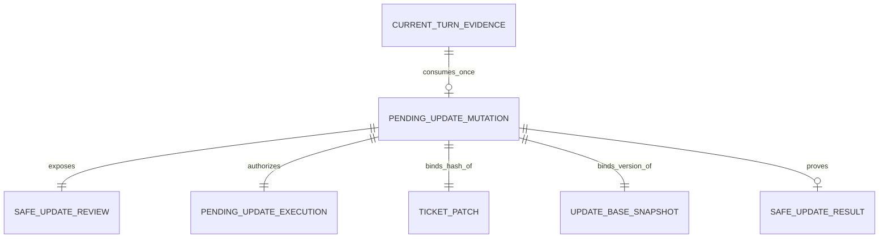
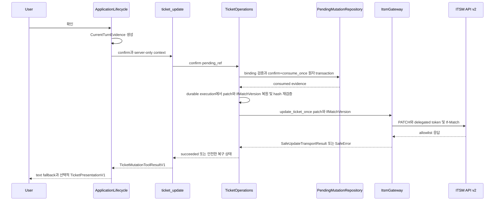
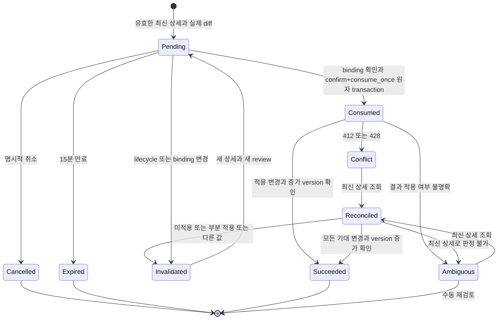

# U3 Ticket Update 기능 명세

## Sources

- `inception/units-generation/unit-of-work.md`
- `inception/units-generation/unit-of-work-story-map.md`
- `inception/user-stories/stories.md`
- `inception/requirements-analysis/requirements.md`
- `inception/domain-design/components.md`
- `inception/contract-design/contract-summary.md`
- `construction/u3-ticket-update/functional-design/functional-design-questions.md`
- `construction/u3-ticket-update/functional-design/entities.md`
- `construction/u3-ticket-update/functional-design/rules.md`

## Scope

이 명세는 U3 `u3-ticket-update`가 담당하는 `US3.1`, `US4.1`의 update 경로와 `US5.1`의 update 검증 경로를 정의한다. U3는 U1의 capability, 상세 projection, pending-mutation repository, gateway, registry와 presentation envelope를 소비하며 U2 create ledger에는 의존하지 않는다.

U3가 소유하는 결과는 `ticket_update` plugin, update presentation mapper, patch/version binding과 C-05 검증 증거다. 새 endpoint, Agent, 서비스나 화면을 만들지 않고 U1·U2 migration namespace를 수정하지 않는다. U1 `ticket_tools_state_v1` 뒤, U3 plugin 활성화 전에 적용하는 별도 namespace `ticket_tools_update_v1`에는 confirm 시 canonical patch bytes와 검증된 `IfMatchVersion`을 복원하기 위한 `pending_update_executions`만 추가한다. mutation ID 조회 외에 응답 유실 복구용 exact actor/session/conversation/ticket active-row locator를 U3 내부에 두되, 이 record와 locator는 C-02의 U1 confirmation authority를 대체하거나 외부 Unit 계약을 넓히지 않는다.

## Derived Entity Relationship

텍스트 대체: 하나의 `PendingUpdateMutation`은 같은 mutation ID와 actor binding의 `PendingUpdateExecution`과 결합된다. 전자는 사용자·세션·대화·티켓·patch hash·version의 실행 권한을, 후자는 canonical patch bytes와 U1이 검증한 server-only `IfMatchVersion`의 durable 복원을 담당한다. 하나의 `SafeUpdateReview`가 사용자에게 표시되고 현재 turn의 확인 증거는 pending을 최대 한 번 소비하며, 권위 있는 적용 증거가 있을 때만 하나의 `SafeUpdateResult`가 생긴다.

`PendingUpdateMutation` YAML은 `entities.md`가 원천이며 이 관계도는 파생 뷰다.

## UC-U3-01 Prepare or Revise Update

**Implements:** `US3.1`; `AC3.1.1`, `AC3.1.2`, `AC3.1.3`, `AC3.1.6`

### Preconditions

- HttpOnly session에서 현재 사용자가 복원되고 요청 범위 `TicketRequestCapability`가 만들어져 있다.
- action은 `prepare` 또는 `revise`다.
- `revise`이면 현재 사용자·세션·대화에 결합된 `pending_ref`가 있다.

### Ordered Flow

1. `TicketPatchInV1`의 여덟 허용 필드만 받고 unknown 또는 금지 필드가 있으면 전체 요청을 거부한다.
2. omitted와 explicit `null`을 보존하면서 길이·enum·타입을 검증한다.
3. U1의 update 전용 상세 조회를 현재 사용자 위임 capability로 실행한다.
4. 응답 body의 public `version`과 strong quoted-decimal ETag를 함께 검증한다. ETag가 없거나 weak·비정수·불일치이면 여기서 종료한다.
5. 허용된 최신 현재 값과 patch를 비교해 실제 diff만 만든다. diff가 비면 pending과 PATCH를 만들지 않는다.
6. ticket ID, serialization version 1의 compact UTF-8 fixed-key-order `canonical_patch_bytes`, `patch_bytes_hash`, base version, server-only `IfMatchVersion`, 변경 전후 필드 목록을 결정하고 새 mutation ID를 할당한다.
7. U3의 `PendingUpdateExecutionV1`을 새 mutation ID, user ID, originating session/conversation ID, ticket, base version, serialization version, canonical patch bytes/hash, `IfMatchVersion`, 생성·만료 시각과 함께 `staged`로 먼저 저장한다. 이 상태는 실행 권한이 아니다.
8. U1 `replace_update_pending`을 호출한다. `prepare`는 `expected_old_mutation_id_or_null=null`이며 같은 actor scope에 다른 pending update가 없어야 한다. `revise`는 화면의 정확한 이전 mutation ID를 expected-old로 전달하며 user·session·conversation·operation·pending 상태가 모두 일치해야 한다. 검증 또는 insert 실패 시 old/new U1 row는 모두 그대로여서 이전 review가 계속 유효하고 새 staged U3 row만 orphan cleanup 대상이 된다.
9. U1 replacement가 성공하면 한 U3 transaction에서 replacement evidence의 exact old active execution을 CAS-retire하고 new execution을 `expected_status=staged`와 exact binding CAS로 `active` 승격한다. Actor scope active partial unique index가 active row를 최대 하나로 제한한다. Commit 이후 activation transaction 전 crash에서는 다음 접근 또는 startup recovery가 mutation ID와 actor·ticket·patch hash·base version을 대조해 같은 retire/promote transaction만 재실행한다. 불일치하면 fail closed하고 orphan을 정리한다.
10. `pending_ref`, ticket ID, base version, 변경 전후 값과 `확인`·`수정`·`취소`를 담은 `SafeUpdateReviewV1`을 반환한다. `revise`에서도 1~9가 성공하기 전에는 이전 review를 무효화하지 않는다.

응답이 active 승격 뒤 사용자에게 도달하기 전에 유실되고 같은 actor와 ticket으로 다시 접근하면, U3 내부 locator가 exact active execution을 찾고 U1 pending과 mutation·actor·operation·ticket·patch hash·base version을 다시 대조한다. 최신 version이 base version과 같으면 stored patch와 최신 allowlist 값을 사용해 같은 pending_ref·review와 `review_required`를 재구성한다. version이 달라 안전한 이전 값 review를 재구성할 수 없으면 PATCH 없이 같은 pending_ref와 `conflict`를 돌려주고 그 reference로 `revise` 또는 `cancel`하도록 안내한다. 다른 actor/ticket row, staged·retired row 또는 불일치 U1 pending은 복구 후보가 아니다.

### Outcomes

- `review_required`: 새 pending과 전체 review가 유효하다.
- `failed` + `SafeErrorV1.code=invalid_input`: 입력, 금지 필드, 빈 patch 또는 no-op을 고쳐야 하며 PATCH 호출은 0회다.
- `failed` + 안전한 non-validation error code: 최신 상세, ETag 검증 또는 durable publication이 실패했으며 실행 가능한 새 review와 PATCH는 없다.

## UC-U3-02 Confirm and Execute Update

**Implements:** `US3.1`, `US4.1`; `AC3.1.3`, `AC3.1.4`, `AC4.1.2`, `AC4.1.3`

### Ordered Flow

1. `ApplicationLifecycle`이 Runner 전에 보존한 현재 raw HTTP chat message에서 `CurrentTurnEvidenceV1`을 계산한다.
2. 전체 turn이 정규화 후 독립 명령 `확인` 또는 `confirm`과 정확히 일치하는지 검사한다. 일치하지 않으면 동일 review와 `needs_explicit_confirmation`을 반환한다.
3. 현재 `TicketUpdateToolInputV1.ticket_id`를 U1 pending과 U3 execution의 ticket ID에 각각 대조하고, `pending_ref`의 user, session, conversation, operation, normalized payload hash와 base version도 현재 capability와 정확히 대조한다. target 또는 다른 binding이 다르면 consume 전에 종료하고 PATCH 호출은 0회다.
4. 같은 mutation ID의 `PendingUpdateExecutionV1`을 읽는다. `staged`이면 PATCH 권한으로 사용하지 않고, 먼저 U1 pending과 mutation·user·originating session/conversation·ticket·patch hash·base version을 모두 대조하는 crash recovery와 expected-state CAS를 완료한다. 이후 exact matching `active` row만 확인에 사용할 수 있으며 누락·불일치는 fail closed한다.
5. `serialization_version`을 확인하고 `canonical_patch_bytes`에서 `patch_bytes_hash`를 다시 계산해 U1 pending의 normalized payload hash와 대조한다. `IfMatchVersion`은 저장된 U1 검증 값을 그대로 사용하며 U3가 version에서 재구성하지 않는다.
6. pending이 만료·취소·무효화·소비되지 않았는지 검사하고 U1 repository transaction 안에서 confirmation binding 검증, confirmed 표시와 `consume_once`를 원자적으로 수행해 `ConsumedMutationEvidenceV1`을 반환한다. `confirmed`는 transaction 내부 중간 상태일 뿐 commit 뒤 관찰 가능한 상태로 남지 않으며 crash는 pending 또는 consumed 중 하나로만 수렴한다.
7. consumed evidence가 있을 때만 저장된 server-only `IfMatchVersion`과 canonical patch로 최초 `PATCH /api/v2/tickets/{id}` gateway 호출을 한 번 수행한다. 각 gateway 호출은 HTTP 시도 1회이며, 전체 사용자 operation은 권위 있는 미적용 보장 401 뒤의 추가 1회를 포함해 최대 2회다.
8. gateway의 allowlist 결과에서 ticket ID, 실제 적용 변경과 `new_version > base_version`을 검증한다.
9. 모든 성공 증거가 있으면 `SafeUpdateResult`와 `succeeded`를 반환한다. 없으면 성공으로 표시하지 않고 복구 흐름으로 이동한다.

### Sequence

텍스트 대체: 현재 사용자 turn에서 만든 확인 증거가 tool과 operations로 전달된다. tool input target, U1 pending과 U3 active durable execution의 mutation ID·actor·ticket·patch hash·base version을 대조하고 canonical patch bytes의 hash를 다시 검증한다. repository가 confirmation과 일회 소비를 한 transaction으로 완료한 뒤에만 gateway가 저장된 U1 검증 `If-Match`와 사용자 위임 token으로 최초 PATCH를 보낸다. 권위 있는 미적용 보장 401만 추가 1회를 허용하고, 결과는 allowlist 성공 또는 안전한 복구 상태로 기존 chat 응답에 표시된다.

## UC-U3-03 Conflict and Ambiguous Result Recovery

**Implements:** `US3.1`, `US4.1`; `AC3.1.5`, `AC4.1.3`, `AC4.1.6`

1. 412 또는 428이면 conflict로 분류하고 PATCH를 재전송하지 않는다.
2. timeout, transport 오류 또는 적용 여부가 보장되지 않는 401이면 ambiguous로 분류하고 PATCH를 재전송하지 않는다.
3. 401 `token_expired`가 수정 미적용을 권위 계약상 보장하고 이 execution의 refresh budget이 남았을 때만 U3 execution에 `UpdateCredentialRefreshReservationV1`을 durable reserve한 뒤 U1 `UpdateCredentialRefreshPortV1`을 한 번 호출해 같은 확인·base version·patch로 한 번 계속할 수 있다. Commit-response loss는 session credential generation으로 복구하며 refresh port를 재호출하지 않는다. 그 외에는 2번을 따른다.
4. conflict 또는 ambiguous 뒤에 현재 capability로 최신 상세와 강한 ETag/version을 다시 조회한다.
5. 모든 기대 변경이 최신 상세에 있고 version이 base version보다 증가했으면 권위 있는 적용으로 판정해 성공 결과를 만든다.
6. 변경이 전혀 없거나 일부만 있거나 다른 값이 있으면 기존 pending을 폐기한다. 아직 필요한 실제 diff를 새 base version에 대해 계산하고 새 review와 명시적 확인을 요구한다.
7. 최신 상세를 읽을 수 없거나 적용 여부를 판정할 수 없으면 ambiguous 상태와 수동 재검토 안내를 유지한다. 성공 또는 자동 PATCH 재호출은 금지한다.
8. 429는 기다리거나 재시도하지 않고 검증된 `Retry-After`만 안전하게 안내한다.

## UC-U3-04 Cancel and Lifecycle Invalidation

**Implements:** `US3.1`, `US4.1`; `AC3.1.6`, `AC4.1.4`, `AC4.1.5`

- 현재 raw turn이 독립 명령 `취소` 또는 `cancel`이면 full binding을 확인한 뒤 pending을 idempotent하게 cancelled로 만들고 PATCH를 호출하지 않는다.
- 사용자 전환, 로그아웃, session 만료, 대화 초기화는 해당 user/session/conversation의 pending update를 invalidated로 만든다.
- target ticket, 정규화 patch hash 또는 base version이 바뀌면 이전 pending을 재사용하지 않는다.
- pending 생성 후 15분이 지나면 expired로 처리한다.
- 인증 갱신 실패, 비활성 사용자 또는 session 만료에서는 pending을 폐기하고 ITSM 변경 요청을 보내지 않으며 재로그인과 미실행을 안내한다.
- U1 pending이 cancelled, invalidated, expired 또는 consumed terminal 상태가 되면 연결된 U3 execution은 멱등하게 retired로 표시하고 기존 session-state cleanup window 뒤 제거한다. 접근·startup·lifecycle cleanup은 unmatched·expired staged row와 terminal 또는 missing U1 pending의 active row도 비권한 상태로 처리한다. execution record의 존재만으로는 authority를 복원하지 않는다.

## Durable Publication and Crash Recovery

| Crash point | U1 pending | U3 execution | Recovery |
|---|---|---|---|
| staged 저장 전 | 기존 review 유지 | 새 row 없음 | 안전하게 다시 prepare 가능 |
| staged 저장 후, U1 replacement 전 | 기존 review 유지 | 새 row `staged` | 새 row를 orphan cleanup; 기존 review 사용 가능 |
| U1 atomic replacement 실패 | rollback되어 기존 review 유지 | 새 row `staged` | 새 row를 orphan cleanup; 오류 반환 |
| U1 replacement 성공 후, U3 activation transaction 전 | 새 pending 유효, 이전 pending invalidated | new `staged`, old `active` 가능 | 정확한 binding으로 old retire+new active를 한 transaction으로 완료; 불일치 시 fail closed |
| active 승격 후, 응답 전 | 새 pending 유효 | 같은 mutation의 `active` | exact actor·ticket locator와 U1 binding으로 pending_ref 복구; version이 같으면 review 재구성, 다르면 revise/cancel 안내; PATCH는 0회 |
| consume 뒤 PATCH 전 | pending `consumed` | execution `active` | 같은 consumed evidence에 대한 새 PATCH 권한을 만들지 않고 안전한 복구 상태로 종료 |

`pending_update_executions`의 provider test는 U1 migration 뒤/U3 plugin 활성화 전의 migration 순서, process restart 뒤 staged/active/retired round-trip, actor binding, canonical patch byte/hash 일치, server-only `IfMatchVersion` 보존, 접근·startup·lifecycle cleanup과 U1 exact-old atomic replacement 실패 시 이전 review 유지 여부를 검증한다.

## State Machine

텍스트 대체: 유효한 최신 상세와 실제 diff가 pending을 만든다. 명시적 확인과 일회성 소비는 하나의 repository transaction으로 pending에서 consumed로 전이하고 관찰 가능한 confirmed 중간 상태를 남기지 않는다. 이후 PATCH 결과는 성공, 충돌 또는 불명확이 된다. 충돌·불명확은 최신 상세로 조정하며 완전한 적용 증거가 있을 때만 성공한다. 그 외에는 기존 pending을 폐기하고 새 review를 만들거나 판정 불가 상태로 종료한다. 취소, lifecycle 변경, binding 변경과 만료는 PATCH 없이 끝난다.

## Error and Edge-Case Matrix

| Condition | PATCH calls after condition | Public state | Next action |
|---|---:|---|---|
| 허용 밖 필드 또는 invalid type | 0 | `failed` + `invalid_input` | 필드 수정 |
| 빈 patch 또는 no-op | 0 | `failed` + `invalid_input` | 실제 변경값 제공 |
| ETag 누락·weak·version 불일치 | 0 | `failed` | 나중에 다시 조회 |
| 확인 turn에 추가 문구 또는 tool 주장만 있음 | 0 | `needs_explicit_confirmation` | 독립 명령으로 확인 |
| pending binding 불일치·만료·소비됨 | 0 | `invalidated` | 새 prepare |
| 최초 PATCH가 401이며 미적용 보장과 refresh budget 있음 | 추가 PATCH 최대 1회, operation 총 최대 2회 | 결과에 따름 | 같은 확인·version·patch 유지 |
| 그 밖의 401 또는 timeout·transport | 0회 자동 재전송 | `ambiguous` | 최신 상세 조회 |
| 412 또는 428 | 0회 자동 재전송 | `conflict` | 최신 상세과 새 확인 |
| 429 | 0 | `failed` | 검증된 시각 이후 사용자 재요청 |
| 최신 상세에서 모든 변경·version 증가 확인 | 0 | `succeeded` | 결과 표시 |
| 최신 상세에서 미적용·부분 적용·다른 값 확인 | 0 | `review_required` | 남은 diff 재확인 |
| 최신 상세 조회도 실패 | 0 | `ambiguous` | 자동 수정 중단, 수동 재검토 |

## Derived Rules Summary

| Rule group | Behaviour |
|---|---|
| BR3.1~BR3.4 | 허용 patch와 최신 version·ETag가 없으면 review를 만들지 않는다. |
| BR3.5~BR3.7 | 전체 binding, 현재 turn 확인, 일회성 소비를 모두 통과해야 실행한다. |
| BR3.8~BR3.12 | `If-Match` PATCH는 한 번이며 충돌·불명확 결과는 최신 상세로 조정한다. |
| BR3.13~BR3.15 | lifecycle 변경에 확인을 폐기하고 비밀·권한 경계를 유지한다. |
| BR3.16~BR3.17 | 기존 registry·chat fallback을 보존하고 FakeModel·MockTransport로 검증한다. |
| BR3.18 | U3 execution을 staged로 먼저 저장하고 U1의 exact-old atomic replacement 뒤 expected-state CAS로 active 승격한다. |
| BR3.19 | U3 migration 순서와 접근·startup·lifecycle cleanup을 보존한다. |
| BR3.20 | 응답 유실 뒤 exact actor·ticket active review의 pending_ref를 안전하게 복구한다. |

이 표는 `rules.md`의 YAML을 요약한 파생 뷰다.

## Testable Scenarios

- 여덟 허용 필드 각각의 값·명시적 null·omitted와 금지 필드를 독립 검증한다.
- 최신 version과 정확히 일치하는 quoted ETag만 `If-Match`에 전달되고 invalid ETag에서는 PATCH가 0회인지 검증한다.
- 확인 전, no-op, 취소, binding 변경, 만료와 lifecycle 사건에서 PATCH가 0회인지 검증한다.
- tool input ticket ID가 U1 pending 또는 U3 active execution과 다르면 consume과 PATCH가 모두 0회인지 검증한다.
- 412·428·timeout·transport에서 자동 PATCH 재호출이 0회이고 최신 상세 기반 새 review가 만들어지는지 검증한다.
- 미적용 보장 401만 추가 1회 refresh/PATCH 경로를 사용해 전체 operation의 PATCH gateway 호출이 최대 2회이고, 그 밖의 401·충돌·불명확 결과에는 추가 PATCH가 0회인지 검증한다.
- 성공 표시에는 적용 변경과 증가 version이 모두 필요하고 partial 또는 판정 불가 결과가 성공이 아닌지 검증한다.
- process restart 뒤 `PendingUpdateExecution`에서 canonical patch와 원래 `IfMatchVersion`이 byte-for-byte 복원되고 hash·ticket·version 불일치는 fail closed하는지 검증한다.
- staged 저장, U1 exact-old replacement, active CAS 각 crash point와 stale expected-old·동시 confirm/revise를 주입해 이전 review 보존, 단일 승자, 새 review 복구와 orphan cleanup을 검증한다.
- confirm+consume_once transaction 전후 crash를 주입해 관찰 가능한 confirmed 중간 상태가 없고 pending 또는 consumed로만 수렴하는지 검증한다.
- active 승격 뒤 review 응답 유실과 process restart를 주입해 exact actor·ticket locator가 같은 pending_ref만 복구하고 다른 actor·ticket이나 staged/retired row는 반환하지 않는지 검증한다.
- U1 migration 뒤/U3 plugin 활성화 전 migration 순서와 접근·startup·lifecycle 경계의 staged orphan 및 terminal/missing-pending cleanup을 검증한다.
- validation과 no-op은 public `failed` state와 `SafeErrorV1.code=invalid_input` 조합으로만 표시되는지 mapper까지 검증한다.
- FakeModel, `httpx.MockTransport`, fake clock으로 실제 OpenAI·ITSM network 없이 실행한다.
- credential, Authorization, raw problem과 악의적 외부 텍스트 canary가 schema·결과·로그·표시에 나타나지 않는지 검증한다.

## Assumptions & Open Questions

None.
