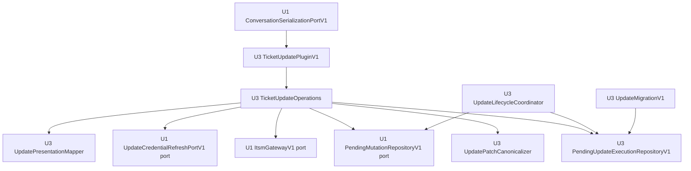

# U3 Ticket Update — 논리 컴포넌트 설계

## Sources

- `construction/u3-ticket-update/nfr-requirements/security-requirements.md`
- `construction/u3-ticket-update/nfr-requirements/tech-stack-decisions.md`
- `construction/u3-ticket-update/functional-design/functional-spec.md`
- `inception/contract-design/contract-summary.md`
- `construction/u3-ticket-update/nfr-design/security-design.md`
- `construction/u3-ticket-update/nfr-design/nfr-design-questions.md`

## Component Inventory

| Component | Owner | Responsibility | State owned | Dependencies | Failure boundary |
|---|---|---|---|---|---|
| `TicketUpdatePluginV1` | U3 | `ticket_update` tool schema, action dispatch, server context 전달 | 없음 | U1 registry, `TicketUpdateOperations` | invalid tool input은 U3 안에서 종료 |
| `TicketUpdateOperations` | U3 | prepare/revise/confirm/cancel orchestration, read/PATCH attempt budget, reconciliation | request-scoped counters only | canonicalizer, U1 ports, U3 repository, mapper | 한 사용자 operation; hidden retry 금지 |
| `UpdatePatchCanonicalizer` | U3 | allowlist validation, omit/null preservation, fixed-order bytes와 SHA-256 | 없음 | Pydantic/stdlib | mismatch에서 network 0 |
| `PendingUpdateExecutionRepositoryV1` | U3 | staged/active/retired persistence, CAS, locator, cleanup | `ticket_tools_update_v1.pending_update_executions` | existing server-session SQLite | U3 table transaction |
| `UpdateMigrationV1` | U3 | schema/index/marker 적용과 fingerprint 확인 | `ticket_tools_update_v1` migration marker | U1 migration readiness, SQLite | 실패 시 U3 plugin activation 0 |
| `UpdateLifecycleCoordinator` | U3 | startup/access/lifecycle cleanup과 activation-crash recovery | execution lifecycle transitions | U1 pending read port, U3 repository, clock | idempotent cleanup scope |
| `UpdatePresentationMapper` | U3 | allowlisted review/result/error를 기존 chat envelope로 변환 | 없음 | U1 presentation registry | text fallback 유지 |
| `PendingMutationRepositoryV1` | U1 | exact-old replacement, atomic confirm+consume, lifecycle invalidation | `ticket_tools_state_v1.pending_ticket_mutations` | existing session SQLite | U1 transaction only |
| `ItsmGatewayV1` | U1 | delegated auth, detail ETag validation, one-attempt PATCH/read | credential은 adapter 내부 | httpx, ITSM API v2 | 한 gateway call/HTTP attempt |
| `UpdateCredentialRefreshPortV1` | U1 IdentitySession | U3 durable reservation에 대한 one-shot delegated credential refresh와 session commit | existing server session credential | identity provider | update execution당 refresh invocation ≤1 |
| `ConversationSerializationPortV1` | U1 ApplicationLifecycle | Runner/history/publication/lifecycle의 single-process ordering | in-process lock state | existing lifecycle | 한 conversation blast radius |

## Dependency Direction



텍스트 대체: U3 plugin은 U3 operations에만 진입한다. Operations는 U3 canonicalizer/repository/mapper와 U1이 제공한 pending, gateway, refresh port에 의존한다. U3 lifecycle coordinator는 U3 repository와 U1 read port를 조정하지만 U1 table에 직접 접근하지 않는다. U1 serialization port가 conversation 단위의 외부 임계 구역을 제공한다.

Dependency는 U3 consumer에서 U1 public port 방향으로만 흐른다. U1은 U3 구현이나 table을 import하지 않고, U2와 U3도 서로의 namespace를 읽거나 쓰지 않는다.

## Responsibility Boundaries

### `TicketUpdateOperations`

- Action별 유효 입력과 current-turn evidence를 검증한다.
- Detail read, diff, durable publication, confirmation, PATCH와 reconciliation 순서를 소유한다.
- `read_attempt_count`로 update detail read를 최초 포함 최대 2회로 제한하고 timeout·transport·500·502·503·504에서만 injected 250ms delay 뒤 두 번째 호출을 허용한다. Deadline은 `2 × ITSM_TIMEOUT_SECONDS + 0.25초`다.
- `patch_attempt_count`와 safe-401 refresh budget을 한 execution 범위에서 공유한다.
- Gateway, repository와 mapper의 typed result만 결합하며 credential 또는 raw HTTP detail을 받지 않는다.

### `PendingUpdateExecutionRepositoryV1`

- `stage`, `get`, `activate_replacement`, `retire`, `cleanup`, `find_active_for_actor_ticket`, `reserve_refresh_once`, `reconcile_refresh_after_restart`를 제공한다.
- Write와 PATCH 전 hash 재계산, expected-state CAS와 actor-scoped locator를 강제한다.
- `activate_replacement`는 U1 replacement evidence의 exact old active row retirement와 new staged row promotion을 한 U3 transaction으로 수행한다. Actor scope active partial unique index가 active row를 최대 하나로 제한한다.
- Record 자체를 authority로 판정하지 않으며 U1 pending/evidence를 생성하지 않는다.
- Index는 exact actor/session/conversation/ticket active lookup만 지원하고 broad cross-actor scan을 application port로 노출하지 않는다.

### U1 ports

- `PendingMutationRepositoryV1`은 U1 namespace 안에서 exact-old replacement와 atomic confirm+consume을 수행한다.
- `ItsmGatewayV1`은 ETag parsing, bearer injection, timeout과 one-attempt transport를 소유한다.
- `UpdateCredentialRefreshPortV1`은 U3가 active execution에 durable reservation을 먼저 기록한 경우에만 update capability를 한 번 갱신하고 session credential commit 뒤 higher-generation capability를 반환한다.
- U3는 U1 adapter나 repository 구현을 호출하지 않고 interfaces에만 의존한다.

## Publication Interaction

```mermaid
sequenceDiagram
    participant Ops as U3 Operations
    participant ER as U3 ExecutionRepo
    participant PR as U1 PendingRepo
    participant UI as Existing Chat UI
    Ops->>ER: stage(execution)
    ER-->>Ops: staged mutation_id
    Ops->>PR: replace_update_pending(expected_old, replacement)
    alt replacement accepted
        PR-->>Ops: exact replacement evidence
        Ops->>ER: activate_replacement(old exact-retire + new active CAS)
        ER-->>Ops: one active row
        Ops-->>UI: pending_ref + review
    else rejected or failed
        PR-->>Ops: typed rejection; old unchanged
        Ops->>ER: retire(staged)
        Ops-->>UI: safe error; old review retained
    end
```

텍스트 대체: U3가 먼저 non-authorizing staged row를 저장하고 U1 exact-old replacement를 호출한다. 성공하면 replacement evidence를 사용해 같은 U3 transaction에서 exact old active execution을 retire하고 new staged execution을 expected-state CAS로 active 전환한 뒤 review를 게시한다. Old retirement 또는 new promotion의 affected-row 조건이 다르면 U3 transaction 전체를 rollback한다. U1 replacement가 실패하면 staged row만 retire하며 U1의 이전 review는 유지한다.

## Confirm and Transport Interaction

1. Plugin은 current tool target과 server-only current-turn evidence를 operations에 전달한다.
2. Operations는 U1 pending과 U3 active execution의 mutation·actor·ticket·hash·version을 대조하고 canonical bytes hash를 다시 계산한다.
3. U1 pending repository가 atomic confirm+consume evidence를 반환한다.
4. Operations가 최초 gateway call을 시작하며 attempt counter를 1로 만든다.
5. Authoritative no-apply 401만 U3 repository의 durable `reserve_refresh_once` 뒤 U1 `UpdateCredentialRefreshPortV1`을 한 번 호출하고 counter 2의 마지막 gateway call을 허용한다. Commit-response loss는 credential generation으로 복구하며 port를 재호출하지 않는다.
6. Conflict/ambiguous는 read-only reconciliation으로 전환하고 PATCH path로 되돌아가지 않는다.

## Failure Domains and Blast Radius

| Failure | Contained by | Blast radius | Degraded behavior |
|---|---|---|---|
| Invalid patch or external text | canonicalizer + mapper | current request | PATCH 0, safe correction text |
| U3 migration failure | migration activation fence | U3 plugin only | read/create plugin 영향 없음; update unavailable |
| U3 table write/CAS failure | U3 repository transaction | current update review | old review 유지 또는 fail closed |
| U1 replacement rejection | U1 exact-old transaction | same actor's update intent | previous review remains valid |
| ITSM detail unavailable | U1 gateway policy | current user operation | review/PATCH 생성 안 함 |
| PATCH conflict/ambiguity | operations attempt fence | consumed mutation | latest read, no automatic resend |
| Credential refresh failure | U1 IdentitySession port | current request/session | no further PATCH, re-login guidance |
| Lifecycle cleanup failure | idempotent coordinator | matching execution rows | rows remain non-authorizing; retry next boundary |
| Response loss | actor-scoped locator | same actor/ticket | same pending recovery or conflict |
| Conversation lock contention | U1 serialization port | one conversation | wait/fail per existing lifecycle policy |

## Startup and Shutdown Ordering

Startup:

1. Existing server-session DB opens.
2. U1 `ticket_tools_state_v1` migration/fingerprint succeeds.
3. U3 migration runs transactionally and verifies schema/index/marker.
4. U3 startup cleanup and exact activation-crash recovery run.
5. U3 plugin and presentation mapper register through U1 registries.

Shutdown adds no new background worker. Repository transactions complete or roll back under existing application shutdown. Next startup repeats migration verification and cleanup idempotently.

## Shared Resources and Isolation

- Shared physical resource: existing server-session SQLite file. Logical ownership is separated by migration namespace and table-level repository boundary.
- Shared request resource: U1 `TicketRequestCapability`; it is opaque, non-serializable and never stored by U3.
- Shared transport: U1 httpx gateway. U3 cannot configure retries independently.
- Shared identity boundary: U1 update refresh port. U3 owns only opaque reservation evidence and never receives credential material.
- Shared conversation ordering: U1 application lock. It is adequate only for the current single-process deployment.
- No U3 cache, queue, thread pool, separate connection pool or background scheduler is introduced.

## Verification Ownership

| Owner | Evidence produced | Consumer |
|---|---|---|
| U3 repository tests | migration idempotency/rollback, row round-trip, single-active CAS, refresh reservation, locator isolation, cleanup, tamper | U3 completion; U4 general evidence aggregation |
| U1 provider contract tests | exact-old replacement rollback, atomic consume, one-attempt gateway, update refresh atomic session commit | U3 consumer suite; U4 |
| U3 operations tests | binding matrix, publication crash points, read/PATCH attempts, refresh generation recovery, reconciliation, response loss | U4 general evidence aggregation |
| U3 mapper/tool tests | schema closure, text fallback, secret/external-text canaries | U4 full Agent regression |
| U4 | exact-three-tool assembly, full suite, changed-line coverage and release evidence aggregation | release gate |

## User Outcome Measurement Ownership

- U4 owns the comparison runner, environment lock, trial ledger and median verdict.
- U3 provides a generated update fixture factory, Assistant start/end instrumentation and success predicate: expected changes plus increased version rendered in the existing chat.
- The existing ITSM UI adapter records the same first-action start and rendered-success end events without product-code instrumentation changes.
- Both methods use the same anonymized actor role, deployment/browser/device/network profile, warm cache and generated starting version. One warm-up per method is excluded, followed by three valid trials.
- The ledger records monotonic timestamps, duration, external-screen transitions, success/failure and reproducibility metadata. Assistant passes only when its median is lower and all external-screen transition counts are zero.

## Assumptions & Open Questions

None.
