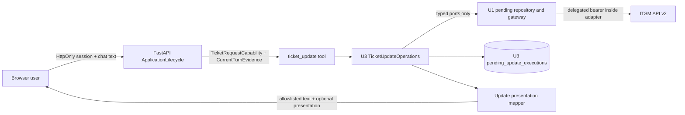

# U3 Ticket Update — 보안·복구 설계

## Sources

- `construction/u3-ticket-update/nfr-requirements/security-requirements.md`
- `construction/u3-ticket-update/nfr-requirements/tech-stack-decisions.md`
- `construction/u3-ticket-update/functional-design/functional-spec.md`
- `inception/contract-design/contract-summary.md`
- `construction/u3-ticket-update/nfr-design/nfr-design-questions.md`

## Design Scope

이 설계는 기존 FastAPI modular monolith 안에서 U3 `ticket_update`가 사용하는 보안 경계, durable execution 저장, 원자적 review publication, PATCH 시도 제한과 crash recovery를 정의한다. 새 서비스·queue·cache·database·distributed lock을 추가하지 않는다. U1은 요청 capability, pending confirmation, gateway와 conversation serialization을 계속 소유하고 U3는 update execution material과 plugin만 소유한다.

## Trust Boundaries

텍스트 대체: 브라우저의 HttpOnly session과 현재 chat turn은 FastAPI lifecycle에서 서버 전용 capability와 turn evidence로 변환된다. U3 operations는 U1 typed port와 U3 소유 execution table만 사용한다. 위임 bearer는 U1 gateway adapter 밖으로 나오지 않으며, 사용자에게는 allowlist 결과만 전달된다.

| Boundary | 허용 데이터 | 금지 데이터·행동 | 실패 방식 |
|---|---|---|---|
| Browser → ApplicationLifecycle | session cookie, 현재 raw turn, ticket update 업무 입력 | user/role/token 주장, tool 인자 기반 confirmation | 현재 session identity로 재결합하거나 거부 |
| Runner → `ticket_update` | validated tool input, opaque `pending_ref`, server context | credential, `IfMatchVersion`, canonical bytes | closed schema 오류 |
| U3 → U1 ports | capability, exact binding, typed patch, server-only version | U1 table 직접 접근, selector 기반 broad invalidation | `SafeErrorV1` 또는 fail closed |
| U3 → U3 SQLite | `PendingUpdateExecutionV1` allowlist | credential, Authorization, raw header/problem | transaction rollback |
| U1 gateway → ITSM | delegated bearer, exact patch bytes, exact `If-Match` | service token for ticket API, hidden retry | 한 HTTP attempt 결과 |
| Mapper → model/UI/log | allowlisted business projection, message key, safe request ID | secrets, canonical bytes, raw external detail | generic safe error |

## Authentication and Authorization Design

1. `ApplicationLifecycle`은 HttpOnly session으로 사용자를 복원하고 한 HTTP request 범위의 `TicketRequestCapability`를 만든다.
2. 현재 raw turn은 Runner 전에 `CurrentTurnEvidenceV1`으로 계산한다. NFKC·outer trim·casefold 뒤 전체 문자열이 `확인` 또는 `confirm`일 때만 explicit confirmation이다.
3. Confirm 전에 tool input ticket ID, mutation ID, user, session, conversation, operation, patch hash, base version과 expiry를 U1 pending 및 U3 active execution 양쪽에 대조한다.
4. U1 repository는 binding 검증, transaction 내부 confirmed 표시와 `consume_once`를 하나의 commit으로 완료하고 `ConsumedMutationEvidenceV1`을 반환한다. Commit 뒤 관찰 가능한 confirmed 중간 상태는 없다.
5. Exact active execution, exact U1 pending, current-turn confirmation과 consumed evidence 중 하나라도 없으면 PATCH authority는 성립하지 않는다.
6. 실제 update 권한과 `is_major` 허용 여부는 ITSM API가 판정하며 U3는 로컬 role 추론이나 권한 확대를 하지 않는다.

## Input, External Text, and Output Controls

- `TicketPatchInV1`은 `additional_properties=false`로 여덟 허용 필드만 받고 omitted와 explicit `null`을 구분한다.
- Canonicalizer는 serialization version 1, compact UTF-8 JSON과 고정 key order를 사용한다. Hash는 저장 시와 PATCH 직전에 exact bytes로 다시 계산한다.
- Strong quoted-decimal ETag가 public version과 정확히 일치할 때 U1만 `IfMatchVersion`을 만든다. U3는 값을 변형하거나 숫자에서 재구성하지 않는다.
- ITSM 제목·설명·impact note·오류 문자열은 구조화된 비신뢰 data다. Tool choice, actor, confirmation, retry와 policy 결정을 바꾸는 지침으로 해석하지 않는다.
- `SafeErrorV1`, transport result와 presentation mapper는 allowlist projection만 통과시킨다. Unknown field, malformed success 또는 version 미증가는 success가 아니다.
- Credential canary, canonical patch canary, raw header/problem/exception canary를 model input, tool schema/result, UI response, log와 테스트 실패 출력에서 모두 검사한다.

## Durable Publication and Concurrency

### Publication protocol

1. U3는 새 execution을 `staged`로 transaction 저장하고 hash를 재검산한다.
2. `prepare`는 expected-old `null`, `revise`는 화면이 제공한 exact old mutation ID로 U1 `replace_update_pending`을 호출한다.
3. U1 transaction은 동일 actor/session/conversation/operation의 expected old가 `pending`인지 확인한 뒤 정확히 그 row만 invalidated하고 replacement를 insert한다. 검증·insert 실패는 old/new U1 row를 모두 바꾸지 않는다.
4. U3 `activate_replacement` transaction은 U1 replacement evidence의 exact old mutation ID가 있으면 같은 actor scope의 old active execution을 CAS-retire하고, mutation·actor·ticket·patch hash·base version과 `expected_status=staged`를 만족하는 new row를 active로 승격한다. 두 affected-row 조건 중 하나라도 다르면 전체 U3 transaction을 rollback한다.
5. Review는 active 승격 뒤에만 반환한다. Broad selector invalidation과 cross-owner transaction은 사용하지 않는다.

### Crash and race resolution

| Crash/race point | Durable evidence | Recovery decision |
|---|---|---|
| U3 stage 전 | old U1 pending only | 새 prepare 가능 |
| stage 후/U1 commit 전 | non-authorizing staged row | old review 유지, staged retire/cleanup |
| U1 replacement rejection | old pending unchanged, staged row | old review 유지, staged retire |
| U1 commit 후/U3 activation transaction 전 | new U1 pending + new staged + old active 가능 | new U1 binding을 기준으로 old exact-retire와 new active를 한 U3 transaction으로 완료; 불일치 fail closed |
| active 후/review response 전 | new pending + active row | exact actor/ticket locator로 같은 pending만 복구 |
| confirm과 revise 경쟁 | U1 transaction affected row + U3 expected-state CAS | 한 경로만 승리, loser는 consume/PATCH 0회 |
| consume commit 후/PATCH 전 | consumed evidence + active row | 새 PATCH authority를 재발급하지 않고 안전한 복구 상태 |

단일-process 배포에서는 기존 per-conversation serialization이 Runner, history, pending publication과 lifecycle cleanup의 외부 임계 구역을 제공한다. SQLite transaction과 CAS는 저장소 경계를 보호한다. 다중-process 배포는 이번 범위 밖이며, 도입 시 shared lock 또는 동등한 database arbitration 없이는 지원하지 않는다.

## Migration, Storage, and Data-at-Rest Design

- U3 migration ID와 schema namespace는 `ticket_tools_update_v1`이며 `pending_update_executions`, exact actor/session/conversation/ticket locator index와 actor scope당 active row를 최대 하나로 제한하는 partial unique index를 만든다.
- Startup 순서는 U1 `ticket_tools_state_v1` 확인 → U3 migration → U3 cleanup/recovery → U3 plugin registration이다.
- Migration은 SQLite transaction 안에서 schema·index·migration marker를 함께 적용한다. 반복 startup은 marker와 schema fingerprint가 일치하면 no-op이다. 중간 실패는 transaction rollback 후 plugin registration을 중단하며, marker/schema 불일치는 자동 추측 수정 없이 fail closed한다.
- U3 repository만 이 table을 쓴다. U1·U2는 U3 storage를 읽거나 수정하지 않고 U3도 U1·U2 namespace를 직접 쓰지 않는다.
- DB file 권한, process identity와 disk protection은 기존 server-session SQLite의 운영 통제를 상속한다. Canonical payload는 일반 log, error dump, diagnostics export와 presentation export에서 제외한다. 운영 backup이 기존 session DB를 포함하는 경우 동일 접근 통제와 보존 정책을 적용하며 별도 평문 export를 만들지 않는다.
- `update_execution_retention_cutoff`은 `retired_at + existing_session_state_cleanup_window`다. U1 pending이 terminal/missing이면 즉시 non-authorizing/retired가 되고 cutoff 이후 물리 삭제한다. Unmatched·expired staged row는 접근·startup·lifecycle cleanup에서 멱등 retire/delete한다.
- Release evidence는 DB path, owner identity, permission/ACL class, disk protection, session cleanup window, backup 포함 여부·암호화·접근 주체·retention을 기록한다. POSIX 환경은 DB file `0600`과 parent directory `0700` 또는 동등하게 owner process만 접근 가능한 ACL이 최소 조건이다.
- File/ACL evidence가 없거나 owner 외 read/write가 가능하거나, backup이 평문·무제한 보존이거나 기존 승인된 server-session backup retention보다 길면 U3 activation이 아니라 release gate를 실패시킨다. Runtime은 이를 감추기 위해 permission을 임의 완화하지 않는다.

## Detail Read Attempt Policy

`TicketUpdateOperations`의 `read_for_update` policy가 review 생성과 reconciliation 상세 조회의 attempt를 소유한다.

- 한 read operation은 `read_attempt_count=0`에서 시작하며 gateway 호출 직전에 증가한다. 최초 포함 최대 2회다.
- 두 번째 read는 첫 결과가 timeout, transport error, 500, 502, 503 또는 504일 때만 허용한다. 다른 4xx, malformed response, 429와 두 번째 실패는 즉시 종료한다.
- 첫 retryable failure 뒤 injected sleeper로 정확히 250ms를 기다린다. Production은 monotonic clock을, test는 fake clock을 사용한다.
- 각 gateway 호출의 전체 timeout은 `ITSM_TIMEOUT_SECONDS`이며 operation deadline은 `2 × ITSM_TIMEOUT_SECONDS + 0.25초`다. 남은 deadline이 양수가 아니면 두 번째 호출을 시작하지 않는다.
- Token refresh 뒤 read recall도 동일 `read_attempt_count`에 포함한다. Gateway, wrapper와 mapper는 독자 retry를 하지 않는다.

## PATCH Attempt and Recovery Policy

`TicketUpdateOperations`가 confirmation execution 범위의 `patch_attempt_count`와 U3 durable refresh reservation을 단독 소유한다. 첫 PATCH의 authoritative no-apply `token_expired` 401 뒤 U3 repository가 active execution에 `UpdateCredentialRefreshReservationV1`을 원자적으로 reserve한 뒤에만 U1 `UpdateCredentialRefreshPortV1.refresh_update_capability_once`를 호출한다.

| Outcome | PATCH total bound | Next action |
|---|---:|---|
| Normal success/failure | 1 | allowlist result 검증 |
| Authoritative no-apply `token_expired` on first call | 2 | refresh 최대 1회 후 동일 bytes/version으로 마지막 호출 |
| Other 401, second 401 | 1 또는 2에서 종료 | ambiguous 또는 안전 오류 |
| 412/428 | 1 | 최신 상세 read, 새 confirmation |
| Timeout/transport/ambiguous | 1 | 자동 resend 없이 최신 상세 조정 |
| 429 | 1 | sleep 0, validated `Retry-After` 안내 |

Gateway 한 번의 호출은 HTTP attempt 한 번만 수행한다. Retry decorator, httpx transport retry, tool wrapper recall과 reconciliation PATCH는 금지한다. 조정 read에서 모든 기대 변경과 version 증가가 확인될 때만 success를 만든다.

Refresh reservation은 mutation·actor·base credential generation에 결합하고 reset하지 않는다. U1은 session credential을 원자 commit한 뒤 더 높은 generation의 same-binding capability만 반환한다. Commit 전 crash/failure는 second refresh 없이 fail closed한다. Commit 후 응답 유실은 다음 request에서 session credential generation이 reservation의 base보다 높은지 비교해 `committed`로 복구하고 U1 port를 다시 호출하지 않는다.

## Response-Loss Recovery

U3 내부 `find_active_for_actor_ticket`은 user, originating session, originating conversation과 ticket을 모두 입력받아 active row를 최대 하나 반환한다. 결과의 mutation·actor·operation·ticket·patch hash·base version을 U1 pending과 다시 대조한다.

- Latest version이 base version과 같으면 canonical patch와 최신 allowlist detail로 같은 `pending_ref`와 review를 재구성한다.
- Version이 다르면 같은 `pending_ref`와 conflict를 반환해 revise/cancel을 요구하고 PATCH를 보내지 않는다.
- Staged·retired·expired row, 다른 actor/ticket row, terminal/missing U1 pending은 반환하지 않고 cleanup한다.
- 이 locator는 복구용 조회일 뿐 execution authority가 아니다. U3 provider test가 restart·response-loss·actor isolation을 검증하고 U4는 일반 release evidence aggregation에서 그 결과를 소비한다.

## User Outcome Measurement Design

U4 Release Assurance가 측정 orchestrator와 evidence 집계를 소유하고 U3는 update 시나리오 fixture와 Assistant 측 instrumentation contract를 제공한다.

| Field | Rule |
|---|---|
| `scenario` | `ticket_update` 고정 |
| `method` | `existing_itsm_ui` 또는 `assistant` |
| `trial` | 방식별 1~3; warm-up 1회는 기록하되 median에서 제외 |
| `environment` | 동일 deployment version, browser/device와 network profile 식별자 |
| `actor_role` | 익명화된 동일 account/role reference |
| `fixture_ref` | 매 trial 전에 동일 규칙으로 만든 ticket과 starting version의 opaque reference |
| `cache_condition` | warm cache만 유효 trial로 인정 |
| `started_at_monotonic` | 준비된 변경값을 보고 첫 조작을 시작한 시점 |
| `ended_at_monotonic` | 기대 변경값과 증가한 version이 화면에 모두 표시된 시점 |
| `duration_seconds` | end-start; 음수·missing은 invalid trial |
| `external_screen_transitions` | Assistant trial은 0이어야 함 |
| `success` / `failure_reason` | 종료 조건 충족 여부와 allowlisted 실패 사유 |
| `measured_at_utc`, `commit`, `network_profile` | 재현성 metadata |

각 방식은 동일 actor·환경·network·warm-cache 조건에서 유효 trial 3개를 가져야 한다. Median은 정렬된 세 duration의 두 번째 값이다. Assistant median이 기존 UI median보다 작고 Assistant의 모든 trial에서 `external_screen_transitions=0`일 때만 NFR8.1이 통과한다. Hardcoded ticket ID를 사용하지 않으며 실패 trial을 임의 제외하지 않고 실패 사유와 함께 다시 준비한 replacement trial을 별도 기록한다.

## Verification Design

| Evidence set | Deterministic mechanism | Blocking assertion |
|---|---|---|
| Identity and confirmation | FakeModel, raw-turn fixture, actor/target matrix | mismatch consume/PATCH 0 |
| Publication atomicity | SQLite failure injection, exact affected-row count, barriers | old review preserved, active winner ≤1 |
| Migration safety | temporary existing session DB, repeated startup, forced rollback | correct order, idempotent second run, partial failure activation 0 |
| Integrity | byte snapshots, tampered row/hash/version/actor | mismatch network call 0 |
| Attempts and reconciliation | `httpx.MockTransport`, fake clock, read/PATCH/refresh counters | read ≤2 with exact retry set/250ms; PATCH ≤2 only safe-401; refresh invocation ≤1 |
| Lifecycle and retention | fake UTC clock, repeated cleanup | terminal immediate non-authority, cutoff delete, idempotent repeats |
| Response loss | post-active response drop + restart | same actor/ticket pending only, active locator result 0 or 1, duplicate pending 0 |
| User outcome | generated fixtures, monotonic timer, fixed evidence schema | valid trials 3+3, Assistant median lower, screen transitions 0 |
| Secret and external text | unique canaries across capture surfaces | leak 0, instruction effect 0 |
| Regression and quality | existing + new pytest, network default-deny, changed-line coverage | tests 100%, network 0, changed application lines ≥80% |

## Residual Risks

- 다중-process 또는 다중-host 배포는 current per-conversation lock을 공유하지 않는다. 배포 형태가 바뀌기 전 shared arbitration 설계가 필요하다.
- Existing session-state cleanup window의 운영값과 backup retention은 저장소 밖 배포 절차가 소유한다. U3는 그 값을 늘리지 않으며 release evidence에 실제 값을 기록해야 한다.
- PATCH consume 뒤 process crash는 안전상 자동 실행을 복구하지 않는다. 사용자는 조정 결과나 새 review를 요구받을 수 있으며 이는 중복 mutation 방지를 위한 의도적 가용성 trade-off다.

## Assumptions & Open Questions

None.
