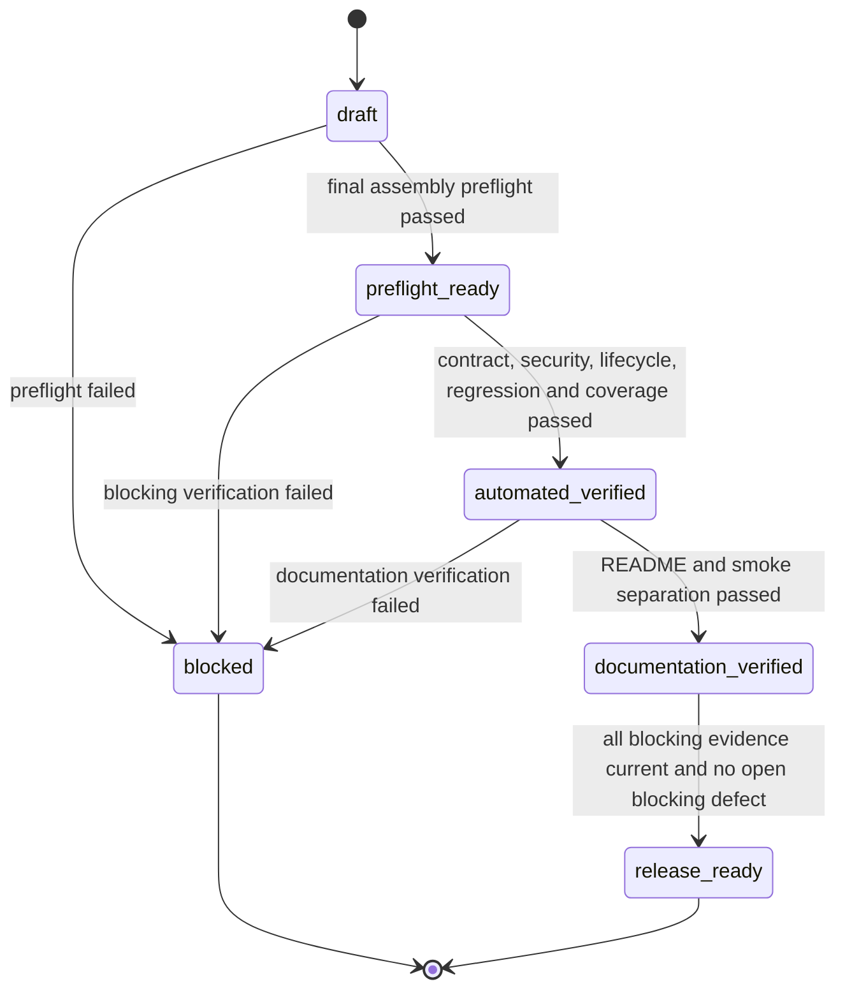
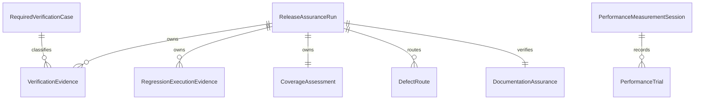

# U4 출시 보증 Functional Specification

## Sources

- Unit: `u4-release-assurance`
- Stories: `US4.1`, `US5.1`
- Acceptance criteria: `AC4.1.1`~`AC4.1.6`, `AC5.1.1`~`AC5.1.6`
- `inception/requirements-analysis/requirements.md`
- `inception/domain-design/components.md`
- `inception/contract-design/contract-summary.md`
- 이 디렉터리의 `entities.md`, `rules.md`

## Purpose and Boundary

U4는 U1~U3이 제공한 공통 runtime과 read, create, update plugin을 기존 Assistant 안에 최종 조립하고, 계약·보안·수명주기·회귀·coverage·문서 증거를 하나의 출시 판정으로 묶는다. U4는 C-01~C-07 계약을 재정의하거나 U1~U3의 결함을 우회하지 않는다. 실제 OpenAI 또는 ITSM 호출은 기본 자동화에서 금지하며, 실제 연동 smoke와 NFR8 성과 측정은 명시적으로 분리된 절차로 남긴다.

기존 UI의 표시·키보드·화면 읽기 회귀는 검증 범위지만 새 화면이나 component를 만들지 않으므로 `frontend-components.md`는 적용하지 않는다.

## Required Verification Catalog

아래 표는 `RequiredVerificationCase`의 전체 source of truth다. 각 `check_id`는 한 `ReleaseAssuranceRun` 안에서 정확히 하나의 `VerificationEvidence`를 가져야 하며, 모두 `passed`가 아니면 `release_ready`가 될 수 없다. 여러 계약이 같은 이름의 case를 갖더라도 소유 계약 prefix가 달라 별도 증거로 유지한다.

| Check ID | Contract | Required procedure |
|---|---|---|
| C03.01 | C-03 | exact_three_tool_names |
| C03.02 | C-03 | duplicate_registration_fails_closed |
| C03.03 | C-03 | capability_is_not_serializable_or_model_visible |
| C03.04 | C-03 | lifecycle_order_is_atomic_and_idempotent |
| C03.05 | C-03 | create_ledger_survives_revocable_state_cleanup |
| C03.06 | C-03 | cursor_filter_identity_and_lifecycle_binding |
| C03.07 | C-03 | cursor_issue_resolve_exact_query_round_trip_and_hash_tamper_rejection |
| C03.08 | C-03 | pending_create_and_update_variant_repository_round_trip |
| C03.09 | C-03 | update_pending_atomic_replacement_preserves_old_on_failure |
| C03.10 | C-03 | update_execution_staged_active_retired_round_trip_and_server_only_field_non_exposure |
| C03.11 | C-03 | update_execution_activation_crash_recovery_and_tamper_rejection |
| C03.12 | C-03 | update_execution_lifecycle_and_orphan_cleanup |
| C03.13 | C-03 | concurrent_update_confirm_and_revise_has_one_authorized_winner |
| C03.14 | C-03 | presentation_history_restart_restore_and_text_fallback |
| C03.15 | C-03 | presentation_correlation_rejects_sequence_or_hash_mismatch |
| C04.01 | C-04 | validation |
| C04.02 | C-04 | catalog_id_or_name_resolution |
| C04.03 | C-04 | explicit_now_freezing |
| C04.04 | C-04 | ledger_first_review_publication |
| C04.05 | C-04 | confirmation_from_server_current_turn |
| C04.06 | C-04 | consume_evidence_binding |
| C04.07 | C-04 | crash_before_evidence_binding_requires_reconfirmation |
| C04.08 | C-04 | cancellation |
| C04.09 | C-04 | claim_identity_and_deadline |
| C04.10 | C-04 | active_claim_non_takeover |
| C04.11 | C-04 | stale_claim_reconciliation |
| C04.12 | C-04 | retryable_after_reconcile |
| C04.13 | C-04 | retryable_no_apply |
| C04.14 | C-04 | proactive_expiry_refresh_before_first_POST |
| C04.15 | C-04 | durable_refresh_reservation |
| C04.16 | C-04 | refresh_port_atomic_commit |
| C04.17 | C-04 | refresh_generation_recovery_after_commit |
| C04.18 | C-04 | refresh_crash_without_second_invocation |
| C04.19 | C-04 | byte_identical_retry |
| C04.20 | C-04 | shared_total_attempt_ceiling |
| C04.21 | C-04 | idempotent_replay |
| C04.22 | C-04 | second_ambiguous_result_is_terminal |
| C04.23 | C-04 | lifecycle_preserves_historical_actor_binding |
| C04.24 | C-04 | retention |
| C04.25 | C-04 | secret_canary |
| C05.01 | C-05 | allowed_fields |
| C05.02 | C-05 | forbidden_fields |
| C05.03 | C-05 | omit_vs_null |
| C05.04 | C-05 | no_op |
| C05.05 | C-05 | confirmation_from_server_current_turn |
| C05.06 | C-05 | confirmation_binding |
| C05.07 | C-05 | exact_quoted_if_match_from_validated_etag_and_version |
| C05.08 | C-05 | invalid_etag_forbids_patch |
| C05.09 | C-05 | conflict |
| C05.10 | C-05 | ambiguous_result |
| C05.11 | C-05 | total_patch_attempt_ceiling |
| C05.12 | C-05 | durable_update_refresh_reservation |
| C05.13 | C-05 | refresh_port_atomic_commit |
| C05.14 | C-05 | refresh_generation_recovery_without_second_invocation |
| C05.15 | C-05 | permission_delegation |
| C05.16 | C-05 | execution_store_round_trip |
| C05.17 | C-05 | server_only_field_non_exposure |
| C05.18 | C-05 | atomic_replacement_rollback |
| C05.19 | C-05 | exact_old_row_invalidation |
| C05.20 | C-05 | single_active_execution_per_actor_scope |
| C05.21 | C-05 | concurrent_confirm_revise |
| C05.22 | C-05 | staged_orphan_cleanup |
| C05.23 | C-05 | activation_crash_recovery |
| C05.24 | C-05 | lifecycle_terminal_cleanup |
| C05.25 | C-05 | response_loss_locator_isolation |
| C05.26 | C-05 | tamper_rejection |
| C05.27 | C-05 | secret_canary |
| REL.01 | release | baseline_full_suite_evidence |
| REL.02 | release | final_full_suite_evidence |
| REL.03 | release | changed_application_source_manifest_and_coverage |
| REL.04 | release | unexpected_network_default_deny_and_bypass_probe |
| REL.05 | release | all_secret_boundaries_canary_scan |
| REL.06 | release | existing_API_UI_history_model_and_accessibility_regression |
| REL.07 | release | README_and_live_smoke_separation |

`REL.01`과 `REL.02`는 같은 test command와 환경 profile을 사용하고 각각 `RegressionExecutionEvidence`의 `baseline`과 `final` record를 요구한다. 두 record는 total, passed, failed, skipped count, exit status, output digest와 실행 시각을 필수로 갖는다. `REL.03`의 manifest는 승인된 U1~U3 source manifest 합집합에 U4가 변경한 애플리케이션 경로를 더하고 중복·test·docs·generated file을 제외한 뒤 coverage 실행 전에 고정한다.

## Workflow 1 — Final Assembly Preflight

1. 검증 대상 `source_revision`과 재현 가능한 환경 profile로 `ReleaseAssuranceRun`을 `draft` 상태로 만든다.
2. U1 공통 registry에 U1 read, U2 write, U3 update plugin을 조립한다.
3. registry의 이름 집합이 정확히 `ticket_read`, `ticket_write`, `ticket_update`인지, 중복·알 수 없는 계약 version이 fail-closed인지 검증한다.
4. 기존 Agent, Runner, model 이름, reasoning effort, tracing 설정과 chat API 응답의 기존 필수 필드가 유지되는지 확인한다.
5. C-01~C-07의 provider/consumer version과 storage ownership이 일치하는지 확인한다. U4는 schema나 migration ownership을 바꾸지 않는다.
6. preflight 항목이 모두 통과하면 `preflight_ready`로 전이한다. 하나라도 실패하면 `DefectRoute`를 만들고 `blocked`로 전이한다.

## Workflow 2 — Security, Network, and Contract Verification

1. FakeModel과 격리 transport를 설치하고 허용된 mock endpoint 외 network 접근을 기본 거부한다.
2. model 입력, function-tool schema·결과, 오류, 로그와 테스트 실패 출력에 서로 구분 가능한 비밀 canary를 주입한다.
3. Required Verification Catalog의 C04.01~C04.25와 C05.01~C05.27을 누락 없이 실행한다. 각 case는 동일 이름의 넓은 suite가 아니라 자기 `check_id`로 개별 판정한다.
4. 세 도구 각각에 대해 현재 서버 session의 사용자 고정, 위임 credential 사용, 서비스 credential의 ticket 호출 0건을 검증한다.
5. read는 전체 시도 2회와 250ms 고정 지연, create는 same key·same bytes와 총 POST 2회, update는 허용된 미적용 401 경로 외 PATCH 자동 재전송 0회를 검증한다.
6. create와 update의 durable refresh reservation이 실행당 한 번만 소비되고, crash 뒤 두 번째 exchange가 발생하지 않는지 검증한다.
7. 원본 problem detail, header, exception이 안전 오류 경계를 넘지 않고 429가 대기·재시도 없이 즉시 반환되는지 검증한다.
8. `REL.04`의 default-deny와 deliberate bypass probe, `REL.05`의 모든 비밀 경계 canary scan을 별도 증거로 기록한다.
9. 각 catalog case의 procedure, 관찰 count, 결과와 digest를 해당 `check_id`의 `VerificationEvidence`로 기록한다.
10. catalog 항목 누락, 예상하지 않은 network 호출, 비밀 canary 노출 또는 계약 위반이 한 건이라도 있으면 즉시 `blocked`로 전이한다.

## Workflow 3 — Cross-Tool Lifecycle and Concurrency Verification

1. Required Verification Catalog의 C03.01~C03.15를 누락 없이 실행하고 각 case를 자기 `check_id`로 기록한다.
2. 같은 conversation에서 chat 실행과 사용자 전환, 로그아웃, 대화 초기화, session 만료를 결정적으로 교차시킨다.
3. 하나의 conversation 직렬화 경계 안에서 current binding이 다시 확인되고, 무효화와 history 정리 뒤에만 session 변경이 commit되는지 관찰한다.
4. revocable pending mutation, cursor, presentation metadata와 SDK history는 계약 순서에 따라 idempotent하게 정리되는지 검증한다.
5. U2 create ledger의 역사적 actor binding과 최소 24시간 중복 방지 상태는 lifecycle 정리 뒤에도 보존되는지 검증한다.
6. U3 update는 staged/active/retired 전이, exact-old replacement, crash-after-U1-commit 복구에서 정확히 한 active 실행만 권한을 가지는지 검증한다.
7. 동시 confirm/revise 또는 response-loss 상황에서 권한 있는 winner와 공개 결과가 각각 하나뿐인지 검증한다.
8. presentation metadata는 persisted assistant message의 sequence와 text hash가 정확히 맞을 때만 restart 뒤 복원되고, mismatch에서는 기존 text fallback을 사용하는지 검증한다.
9. lifecycle 실패가 교차 사용자 capability·confirmation·cursor·presentation 재사용으로 이어지면 `blocked`로 전이한다.

## Workflow 4 — Full Regression, Coverage, and Defect Routing

1. 변경 전 기준선 전체 suite를 실행해 `REL.01`과 `RegressionExecutionEvidence(phase=baseline)`를 기록한다. test command, total/pass/fail/skip count, exit status, output digest와 환경 profile을 빠짐없이 보존한다.
2. impact subset이 아니라 기존·신규 테스트를 포함한 같은 command의 완료본 전체 suite를 실행해 `REL.02`와 `RegressionExecutionEvidence(phase=final)`를 기록한다.
3. 완료본의 failed 또는 skipped count가 0이 아니거나 exit status가 0이 아니면 실패다. 기준선과 완료본의 command 또는 환경이 다르면 비교 evidence는 무효다.
4. 실패가 있으면 failed check와 C-01~C-07 또는 U4 조립 책임을 연결해 `DefectRoute`를 만든다.
5. 승인된 U1~U3 source manifest의 합집합에 U4가 변경한 application 경로를 더하고 중복·test·docs·generated file을 제외해 변경 application source manifest를 coverage 전에 고정한다.
6. manifest digest, ordered path set, executable line, covered line과 계산 비율을 `REL.03` 및 `CoverageAssessment`로 기록한다. threshold 충족을 위해 파일을 사후 제외하지 않는다.
7. 결함 소유 Unit이 수선하면 이전 run의 defect 상태를 `repaired`로 바꾸되 닫지 않는다.
8. 수선된 새 source revision에는 이전 run을 predecessor로 가리키는 새 `ReleaseAssuranceRun`을 만들고 모든 catalog case, 전체 suite, coverage를 다시 실행한다.
9. 새 run에서 동일 실패 검사가 통과하면 이전 defect를 `reverified`로 연결하되 이전 revision의 evidence를 새 판정에 복사하지 않는다.
10. Required Verification Catalog의 모든 case가 passed이고 전체 suite 통과율 100%, coverage 80% 이상, 현재 run의 blocking defect 0건이면 `automated_verified`로 전이한다.

## Workflow 5 — Documentation and Smoke Readiness

1. README가 세 도구의 목적과 동작, 기존 설정, 실행 방법, session·delegated credential 보안 경계, test와 coverage 명령을 설명하는지 확인한다.
2. README가 기본 자동화는 FakeModel과 격리 transport를 사용하며 실제 OpenAI·ITSM 호출을 하지 않는다고 명확히 설명하는지 확인한다.
3. 실제 연동 smoke 절차가 기본 자동화와 별도로 문서화되고, 필요한 credential·대상 환경·안전한 테스트 데이터·정리 방법을 명시하는지 확인한다.
4. 명시적 credential과 사람이 선택한 실행 의사가 없으면 smoke를 실행하지 않는다. 미실행은 자동화 실패가 아니라 별도 상태다.
5. 문서의 명령과 실제 보증 절차가 일치하면 `DocumentationAssurance`를 passed로 기록하고 `documentation_verified`로 전이한다.
6. 문서가 불완전하거나 실제 절차와 다르면 U4 문서 결함으로 `blocked` 처리한다.

## Workflow 6 — NFR8 Real-Environment Measurement

1. 동일 계정·역할·권한, 브라우저·장치, 배포 version과 network를 고정해 `PerformanceMeasurementSession`을 만든다.
2. read, create, update마다 생성형 일회용 데이터를 준비하고 각 trial 전에 같은 초기 상태로 복원한다. 제품 코드나 지침에 티켓 ID를 하드코딩하지 않는다.
3. Assistant와 기존 ITSM UI 방식마다 warm-up 1회를 수행하되 기록된 trial과 중앙값에서 제외한다.
4. 각 방식·시나리오에 trial 번호 1·2·3을 사전 지정하고 각 번호를 정확히 한 번만 수행한다. 첫 사용자 조작부터 요구사항에 정의된 완료 사건 또는 명시적 실패 종료까지 monotonic clock으로 잰다.
5. UTC 측정 시각, source revision, 환경, 익명화 역할, 방식, 시나리오, trial 번호, 생성 데이터 reference, cache·network 조건, 시작·종료, duration, 성공·실패 사유와 화면 전환 수를 기록한다.
6. 어느 trial이라도 계정·환경·장치·배포·network·cache 조건이 달라지거나 필수 기록이 없으면 측정 세션을 `invalid`로 만든다. 이는 정상 조건에서의 업무 실패와 구분한다.
7. 정상 조건에서 trial이 실패하거나 완료 사건에 도달하지 못하면 그 번호를 실패로 보존하고 추가 trial로 교체하지 않으며 해당 시나리오의 성과 목표를 미충족으로 판정한다.
8. 사전 지정된 세 trial이 모두 성공한 경우에만 시나리오별 방식의 세 duration 중앙값을 계산한다.
9. Assistant 중앙값이 기존 UI보다 짧고 Assistant 외부 화면 전환이 세 번 모두 0일 때만 해당 시나리오를 충족으로 판정한다.
10. 이 Functional Design은 측정 방법과 record 계약을 정의하며 실제 환경의 결과를 미리 생성하거나 성공으로 간주하지 않는다.

## Release Assurance State Machine

텍스트 대체: 실행은 `draft`에서 시작한다. 최종 조립 preflight가 통과하면 `preflight_ready`, 자동 계약·보안·수명주기·회귀·coverage가 통과하면 `automated_verified`, 문서 검증이 통과하면 `documentation_verified`가 된다. 최신 증거가 모두 유효하고 blocking defect가 없을 때만 `release_ready`다. 어느 차단 검사든 실패하면 그 실행은 terminal `blocked`다. 수선된 새 revision은 이전 실행을 predecessor로 가리키는 새 run의 `draft`에서 시작하며 이전 evidence를 재사용하지 않는다.

## Entity Relationship View

텍스트 대체: 한 `ReleaseAssuranceRun`은 여러 `VerificationEvidence`와 `DefectRoute`, 하나의 `CoverageAssessment`, 하나의 `DocumentationAssurance`를 가진다. 한 `PerformanceMeasurementSession`은 여러 `PerformanceTrial`을 가진다. 성과 측정 record는 출시 자동화 evidence와 구분되지만 같은 source revision을 기록해 비교할 수 있다.

## Derived Rules Summary

| Concern | Governing rules | Functional effect |
|---|---|---|
| 최종 조립 | BR4.1, BR4.9 | 세 tool과 기존 Agent/Runner/API 동작을 함께 보존한다. |
| 신원·비밀 | BR4.2, BR4.4 | 서버 session actor와 delegated credential을 벗어난 mutation을 막는다. |
| 복구 상한 | BR4.3, BR4.6 | refresh·HTTP 예산과 safe-error 경계를 넘는 숨은 재시도를 막는다. |
| lifecycle | BR4.5 | revocable 상태는 정리하고 durable 중복 방지 상태는 보존한다. |
| 테스트·coverage | BR4.7, BR4.8, BR4.13 | 실제 network 없이 전체 suite 100%와 변경 line coverage 80%를 요구한다. |
| 문서·smoke | BR4.10, BR4.11 | 기본 자동화와 명시적 실제 연동 절차를 분리한다. |
| 사용자 성과 | BR4.12 | 실제 환경에서 방식별 3회 중앙값과 화면 전환 0회로만 판정한다. |
| 결함·증거 | BR4.14, BR4.15 | 소유 Unit 수선 뒤 새 revision의 재검증 증거를 요구한다. |

## Failure and Edge-Case Semantics

- 테스트가 실행되지 않았거나 evidence digest를 확인할 수 없으면 실패를 성공으로 대체하지 않고 `not_run`으로 유지한다.
- 같은 source revision의 일부 검사만 다시 실행해도 다른 evidence의 입력·환경이 달라졌다면 전체 release-ready 판정을 재사용하지 않는다.
- U1~U3 계약 실패는 U4에서 완화하거나 기대값을 바꿔 통과시키지 않는다.
- NFR8 측정 실패나 미실행은 성과 목표를 미확인 상태로 남긴다. 자동화된 기능·보안 출시에 필요한 증거와 실제 사용자 성과 주장에 필요한 증거를 혼동하지 않는다.
- 실제 smoke 결과에는 credential, Authorization header, 원본 provider 오류를 기록하지 않는다.

## Assumptions & Open Questions

None.

