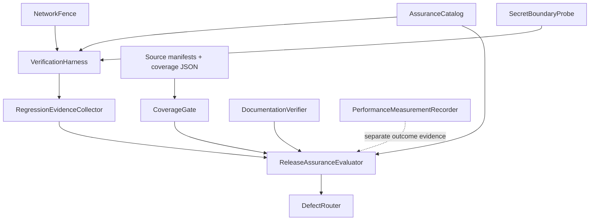

# U4 NFR Logical Components

## Sources

- `../nfr-requirements/*.md`
- `../../functional-design/functional-spec.md`
- `inception/contract-design/contract-summary.md`

## Component Inventory

| Component | Responsibility | Depends on | Failure domain |
|---|---|---|---|
| AssuranceCatalog | C03/C04/C05/REL stable check ID와 phase membership 제공 | approved contracts | 누락·중복 catalog는 전체 release block |
| VerificationHarness | FakeModel/MockTransport로 catalog case 실행과 safe counters 수집 | existing pytest fixtures, U1~U3 public contracts | 한 check 실패는 owning Unit defect로 격리 |
| NetworkFence | 허용 transport 외 DNS/TCP default-deny와 bypass self-test | pytest process boundary | fence self-test 실패는 전체 suite block |
| SecretBoundaryProbe | model/tool/log/error/test-failure surface canary scan | verification output streams | 한 exposure가 전체 release block |
| CoverageGate | manifest union, missing-source check, changed executable line 80% 판정 | coverage 7.17 JSON, source manifests, approved base | 불완전 denominator는 fail-closed |
| RegressionEvidenceCollector | baseline/final full-suite count·digest·environment record | pytest command | command/environment mismatch는 비교 무효 |
| ReleaseAssuranceEvaluator | phase completeness, coverage, docs, defect predicate와 terminal state 계산 | catalog, evidence records | stale/missing evidence는 blocked |
| DocumentationVerifier | README topic과 기본 automation/live-smoke 분리 검증 | repository docs | REL.07 실패는 final release block |
| PerformanceMeasurementRecorder | NFR8 actual-environment trial ledger와 outcome 계산 | explicit measurement session | invalid/not-met/not-measured 상태 분리 |
| DefectRouter | failed check를 owning Unit/contract에 연결하고 fresh reverify 요구 | contract ownership table | repaired-only defect는 release block 유지 |

모든 component는 기존 repository 안의 test/release-time logical module 또는 절차다. 새 runtime service나 배포 resource가 아니다.

## Dependency Diagram

텍스트 대체: catalog가 VerificationHarness와 ReleaseAssuranceEvaluator에 expected set을 제공한다. NetworkFence와 SecretBoundaryProbe는 harness의 안전 경계다. RegressionEvidenceCollector, CoverageGate, DocumentationVerifier가 phase별 evidence를 evaluator에 제공하고 실패는 DefectRouter로 전달된다. PerformanceMeasurementRecorder는 별도 실제 환경 outcome을 기록하며 자동화 test 결과를 대체하지 않는다.

## Shared Resources and Isolation

| Resource | Owners/consumers | Isolation rule |
|---|---|---|
| server-session SQLite | U1/U2/U3 runtime; U4 tests only | U4는 namespace를 재정의하지 않고 migration/schema fingerprint만 검증 |
| Agents SDK history SQLite | U1 AgentConversation; U4 regression | persisted message correlation을 public contract로 검증 |
| pytest process | U4 harness | network fence와 canary probes가 process-wide default-deny |
| coverage JSON | CoverageGate only | source content 없이 line execution data로만 사용 |
| release evidence | ReleaseAssuranceEvaluator | source revision과 schema allowlist에 고정 |

## Blast Radius Map

- NetworkFence 또는 SecretBoundaryProbe 실패: 전체 U4 release block.
- 특정 C04/C05 case 실패: U2 또는 U3 owning Unit으로 route하되 전체 predicate는 blocked.
- CoverageGate input incompleteness: coverage result 자체를 생성하지 않고 blocked.
- DocumentationVerifier 실패: automation evidence는 보존하지만 final release는 blocked.
- NFR8 `not_measured`/`invalid`/`not_met`: 사용자 성과 달성 주장을 금지하며 결과를 자동화 pass로 바꾸지 않는다.

## Assumptions & Open Questions

None.

