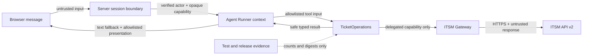

# U4 Security Design

## Sources

- `../nfr-requirements/security-requirements.md`
- `../nfr-requirements/observability-requirements.md`
- `../../functional-design/rules.md`
- `inception/contract-design/contract-summary.md`

## Trust Boundaries

텍스트 대체: browser와 ITSM 응답은 모두 비신뢰 입력이다. 서버 session이 actor를 고정하고 opaque capability만 Runner context에 넣는다. TicketOperations만 operation policy를 적용하며 gateway는 delegated credential로 단일 전송한다. model과 browser에는 allowlisted 업무 data만 돌아가고 test/release evidence에는 count와 digest만 남는다.

## Defense-in-Depth Controls

| Layer | Control | Covers |
|---|---|---|
| Identity | HttpOnly random session ID에서 actor 복원; client/model의 username·role·permission 무시 | NFR2.1, NFR2.2 |
| Authorization | ticket request는 delegated capability만 허용; service credential ticket call fail-closed | NFR2.1, NFR2.3 |
| Tool schema | 업무 field와 opaque reference만 허용; credential field와 additional property 거부 | NFR1.1, NFR3.1 |
| External text | `untrusted_data=true`, allowlisted field projection, browser text-node rendering | NFR1.2, NFR1.3 |
| Mutation integrity | create consume evidence + ledger CAS; update validated ETag + exact `If-Match` | NFR3.1, NFR3.2, NFR3.3 |
| Lifecycle | conversation serialization, actor revalidation, revocable cleanup, durable ledger preservation | NFR3.4, NFR3.5, NFR3.6 |
| Network | pytest process default-deny and deliberate bypass self-test | NFR1.4, NFR1.6 |
| Evidence | safe check ID, numeric count, digest and non-secret request ID only | NFR1.5 |

## Secret Canary Architecture

`SecretBoundaryProbe`는 서로 다른 canary를 access token, refresh credential, client secret, OpenAI API key와 Authorization value에 할당한다. 값 자체를 failure message에 포함하지 않고 boundary별 boolean/count만 수집한다.

검사 surface:

- function-tool schema와 serialized model input
- function-tool result와 browser response
- application log와 safe HTTP error
- pytest assertion message와 traceback
- captured stdout/stderr
- test runner report와 coverage output

어느 surface에서든 canary match count가 1 이상이면 즉시 실패한다. 실패 출력은 `secret boundary violation: <boundary-id>`만 사용하고 canary value, prefix 또는 일부 substring도 출력하지 않는다.

## Network Isolation Architecture

1. 기본 pytest fixture가 허용된 in-process transport와 `httpx.MockTransport` 외 socket/DNS 연결을 거부한다.
2. deliberate bypass probe가 직접 socket 경로를 시도해 fixture가 실제로 차단하는지 검증한다.
3. 예상 밖 network attempt는 destination category와 count만 기록하며 hostname credential query를 출력하지 않는다.
4. 실제 smoke는 별도 command와 explicit credential/environment gate 뒤에서만 실행한다.

## Input and Error Handling

- Pydantic/typed boundary에서 unknown field, invalid enum, forbidden mutation field를 거부한다.
- missing과 invisible 404는 동일 safe `not_found` 결과다.
- raw problem detail, headers, exception, canonical mutation bytes는 model·browser·evidence로 전달하지 않는다.
- 412/428, ambiguity, refresh failure는 성공으로 표현하지 않는다.

## Security Verification Matrix

| Threat | Negative case | Required observation |
|---|---|---|
| Cross-user authority | 다른 session의 pending reference 재사용 | POST/PATCH 0, safe rejection |
| Prompt injection | ticket/problem text의 권한·확인 변경 지시 | actor/tool/arguments unchanged |
| Credential leakage | 모든 boundary canary | exposure count 0, diagnostic value absent |
| Duplicate create | crash, concurrent confirm, ambiguous response | confirmed intent당 ticket <= 1 |
| Lost update | weak/missing/mismatched ETag, 412/428 | PATCH 0 또는 overwrite 0 |
| Hidden external call | direct socket/DNS bypass | fixture detects and fails |

## Assumptions & Open Questions

None.

