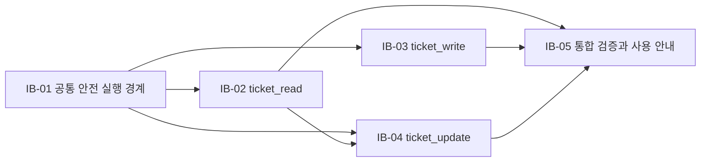

# ITSM 티켓 도구 의도 백로그

## 우선순위 원칙

이 백로그는 `intent-statement.md`의 사용자 성과, `feasibility-assessment.md`의 진행 조건, `constraint-register.md`의 확정 제약을 전달 가능한 능력 단위로 정리한다. 승인된 첫 릴리스 범위는 모두 Must Have이며, 공통 보안 경계를 먼저 세운 뒤 조회, 등록, 수정, 통합 검증 순으로 진행한다.

우선순위 판단 기준은 다음과 같다.

- 사용자 가치: Assistant 안에서 조회·등록·수정을 완결하는 데 필수인가
- 위험 감소: 비밀정보, 권한, 중복 등록, 동시 수정 같은 높은 영향의 위험을 먼저 낮추는가
- 의존성: 후속 능력이 안전하게 동작하기 위한 선행 조건인가
- 검증 가능성: 실제 OpenAI 호출 없이 계약과 회귀를 증명할 수 있는가

## 우선순위 백로그

| 순서 | ID | 능력 | 사용자·사업 가치 | 핵심 수용 경계 | 의존성 | MoSCoW |
|---:|---|---|---|---|---|---|
| 1 | IB-01 | 공통 안전 실행 경계 | 현재 사용자의 기존 권한으로만 세 도구를 안전하게 사용할 수 있다. | 서버 세션과 사용자 위임 권한 사용, ITSM의 권한·가시성 유지, 비밀정보 비노출, 안전한 오류 안내, 기존 동작 무회귀 | 없음 | Must |
| 2 | IB-02 | `ticket_read` 검색·목록·상세 | 사용자가 다른 화면으로 이동하지 않고 필요한 티켓을 찾고 확인한다. | ID 상세 조회, 문서화된 전체 목록 필터·정렬·커서 페이지네이션, 보이지 않는 티켓 존재 여부 비노출 | IB-01 | Must |
| 3 | IB-03 | `ticket_write` 안전한 등록 | 사용자가 대화에서 필요한 정보를 모아 새 티켓을 등록한다. | 계약상 필수·선택 정보만 사용, 실행 전 최종 요약과 명시적 확인, 중복 등록 방지, 결과·오류의 안전한 안내 | IB-01 | Must |
| 4 | IB-04 | `ticket_update` 충돌 안전 수정 | 사용자가 대화에서 기존 티켓의 허용된 내용을 안전하게 변경한다. | 현재 티켓 확인, 허용 필드만 변경, 실행 전 최종 요약과 명시적 확인, 동시 변경 시 덮어쓰기 금지 | IB-01, IB-02 | Must |
| 5 | IB-05 | 통합 검증과 사용 안내 | 팀이 기능의 안전성·회귀 없음·사용자 가치를 증명하고 운영자가 재현할 수 있다. | 실제 OpenAI 없는 자동화 테스트, 기존·신규 테스트 통과, 정확히 세 도구 노출, 대표 시나리오 성과 측정, README 갱신 | IB-01~IB-04 | Must |

## 백로그 항목 상세

### IB-01 — 공통 안전 실행 경계

- **의도:** 모든 티켓 작업이 현재 로그인 사용자와 기존 ITSM 권한 경계 안에서 일관되게 실행되게 한다.
- **포함:** 인증 주체 유지, 권한·가시성 위임, 비밀정보 보호, 계약에 맞는 안전한 오류, 기존 Assistant 동작 보존.
- **완료 신호:** 비밀값이나 내부 오류 정보 없이 세 능력이 같은 안전 경계를 사용할 수 있고 기존 사용자 전환·세션·대화 흐름이 유지된다.
- **완화하는 위험:** 토큰 노출, 권한 확대, 오류를 통한 내부정보 노출, 토큰 만료로 인한 잘못된 실행.

### IB-02 — `ticket_read` 검색·목록·상세

- **의도:** 사용자가 자연어로 자신의 권한 범위 안에서 티켓을 찾고 세부 내용을 확인하게 한다.
- **포함:** ID 상세 모드와 검색·목록 모드, API v2가 문서화한 전체 필터·정렬·커서 페이지네이션.
- **완료 신호:** 허용된 사용자는 원하는 티켓 또는 다음 페이지를 얻고, 권한 없는 티켓은 존재 여부가 드러나지 않는다.
- **완화하는 위험:** 과도한 결과 반환, 잘못된 커서 재사용, 가시성 우회.

### IB-03 — `ticket_write` 안전한 등록

- **의도:** 사용자가 대화 안에서 필요한 정보를 확인하고 의도한 티켓을 한 번만 생성하게 한다.
- **포함:** 계약상 필수 등록 정보와 허용된 선택 정보, 최종 변경 요약, 명시적 사용자 확인, 중복 방지.
- **완료 신호:** 확인 전에는 생성되지 않고, 확인 후에는 같은 요청의 재시도에서도 중복 없이 결과가 안내된다.
- **완화하는 위험:** 불완전하거나 허용되지 않은 데이터 전송, 의도하지 않은 생성, 재시도에 따른 중복 티켓.

### IB-04 — `ticket_update` 충돌 안전 수정

- **의도:** 사용자가 현재 내용을 바탕으로 허용된 변경만 적용하고 다른 사용자의 최신 변경을 잃지 않게 한다.
- **포함:** 대상 티켓 확인, 계약상 허용 필드, 최종 변경 요약, 명시적 사용자 확인, 동시 수정 충돌 처리.
- **완료 신호:** 확인 전에는 수정되지 않고, 확인 후 현재 버전에만 변경이 적용되며 충돌 시 자동 덮어쓰지 않는다.
- **완화하는 위험:** 금지 필드 수정, 빈 수정, 권한 없는 변경, 동시 변경 유실.

### IB-05 — 통합 검증과 사용 안내

- **의도:** 릴리스 판단에 필요한 계약·보안·회귀·사용자 가치 증거와 재현 가능한 실행 안내를 제공한다.
- **포함:** 실제 OpenAI를 호출하지 않는 자동화 테스트, 기존 전체 테스트, 대표 시나리오 확인, README.
- **완료 신호:** 모든 자동화 검증이 통과하고 외부 화면 전환 0회와 완료 시간 감소가 기록되며, 문서만으로 기능 실행과 테스트를 재현할 수 있다.
- **완화하는 위험:** 기존 기능 회귀, 비밀정보 누출의 미탐지, 기능과 문서 불일치, 측정 조건 왜곡.

## 의존성 및 가치 흐름 맵

텍스트 대체: `IB-01 → IB-02 → IB-04`, `IB-01 → IB-03`, 그리고 `IB-02 + IB-03 + IB-04 → IB-05`.

## 보류 백로그

다음 항목은 이번 의도에서 Won't Have이며 우선순위 번호를 부여하지 않는다.

- 티켓 삭제, 상태 전이, 담당자 배정
- 첨부파일, 댓글, 작업 기록, 통계, 내보내기
- 새 Agent·별도 서비스·새 화면
- 기존 모델 설정 또는 화면 재설계
- 신규 인프라·SLA·규제 체계 도입

향후 필요성이 확인되면 이번 범위에 끼워 넣지 않고 별도 의도로 정의한다.

## 완료 정의

- IB-01부터 IB-05까지 모든 Must 항목이 수용 경계를 충족한다.
- Agent에 노출되는 티켓 도구가 정확히 세 개이며 각 도구가 승인된 역할만 수행한다.
- 등록·수정은 최종 요약과 명시적 확인 없이 실행되지 않는다.
- 권한·가시성·비밀정보·오류·중복·충돌 조건이 자동화된 증거로 확인된다.
- 기존 및 신규 자동화 테스트가 실제 OpenAI API 호출 없이 통과한다.
- 대표 시나리오의 외부 화면 전환 0회와 기존 방식 대비 시나리오별 중앙 완료 시간 감소를 확인한다.
- README가 구현 내용과 실행·테스트 방법을 정확히 반영한다.
