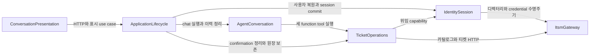

# ITSM 티켓 도구 컴포넌트 설계

## Sources

- `inception/requirements-analysis/requirements.md`
- `inception/user-stories/stories.md`
- `inception/refined-mockups/interaction-spec.md`
- `aidlc/spaces/default/codekb/itsm_dlc/architecture.md`
- `aidlc/spaces/default/codekb/itsm_dlc/component-inventory.md`
- `inception/practices-discovery/team-practices.md`
- `inception/domain-design/domain-design-questions.md`
- `docs/itsm/integration-guide.md`
- `docs/itsm/openapi.json`

## Component Catalogue

```yaml
components:
  - name: ItsmGateway
    summary: ITSM API v2의 인증·디렉터리·카탈로그·티켓 HTTP 계약을 격리하는 외부 연동 경계
    behaviour: >
      기존 앱 단위 httpx 생명주기와 timeout 설정을 재사용한다. 인증·디렉터리 호출과
      카탈로그·티켓 호출은 내부 어댑터로 분리하되 하나의 논리적 gateway 공개 경계를
      제공한다. 티켓 호출에는 호출자가 제공한 현재 사용자의 위임 credential만 사용하고,
      계약에 없는 필드나 헤더를 보내지 않는다. 원본 problem detail, Authorization 값,
      예외 문자열을 경계 밖으로 내보내지 않고 allowlist 기반 transport 결과로 변환한다.
    responsibilities:
      - ITSM API v2 HTTP 요청과 응답의 계약 수준 직렬화·역직렬화
      - 서비스 credential 기반 디렉터리·카탈로그 호출과 사용자 위임 credential 기반 티켓 호출의 분리
      - 시도별 timeout, 상태 코드, ETag, Idempotent-Replayed, Retry-After의 안전한 추출
      - 원본 오류·비밀정보가 상위 경계로 전파되지 않도록 1차 정제
    depends_on: []
    dependents:
      - component: IdentitySession
        interaction: 사용자 확인, 위임 credential 발급·갱신과 현재 사용자 검증
      - component: TicketOperations
        interaction: 카탈로그 확인과 티켓 목록·상세·등록·수정 HTTP 실행
    external_dependencies:
      - name: ITSM API v2
        kind: third-party-api
        purpose: 사용자·카탈로그·티켓의 권한 있는 원천 시스템
      - name: httpx AsyncClient
        kind: other
        purpose: 앱 생명주기 동안 공유하는 비동기 HTTP transport
    entities: []

  - name: ApplicationLifecycle
    summary: 보호된 chat과 사용자 전환·로그아웃·대화 초기화의 호출 순서와 실패 처리를 소유하는 기존 FastAPI 애플리케이션 경계
    behaviour: >
      기존 FastAPI route와 앱 조립 경계를 application-level coordinator로 사용한다. chat은
      IdentitySession에서 현재 사용자를 복원하고 요청 범위 capability를 만든 뒤
      AgentConversation을 호출한다. 사용자 전환·로그아웃·대화 초기화는 기존 session을
      즉시 교체하지 않고, revocable confirmation 무효화와 conversation 이력 정리를
      idempotent하게 수행한 뒤 session 변경을 마지막에 commit한다. 중간 정리가 실패하면
      새 사용자를 활성화하지 않고 기존 session을 유지한 채 안전 오류를 반환한다.
      TicketCreateAttempt 원장은 lifecycle 정리 대상에서 제외한다.
    responsibilities:
      - 보호된 chat 요청의 현재 사용자 복원, capability 생성과 AgentConversation 호출 순서
      - 사용자 전환·로그아웃·대화 초기화의 단일 수명주기 조정
      - PendingTicketMutation 무효화, conversation 이력 정리, session commit의 명시적 순서
      - 부분 실패 시 새 session 활성화를 막고 재실행 가능한 안전 상태 유지
      - TicketCreateAttempt 원장을 최소 24시간 보존하도록 lifecycle 삭제 범위 제한
    depends_on:
      - component: IdentitySession
        interaction: 현재 사용자 복원, 새 credential 준비와 session 변경의 최종 commit
        style: sync
      - component: TicketOperations
        interaction: revocable confirmation 무효화와 durable create-attempt 조회·보존
        style: sync
      - component: AgentConversation
        interaction: 기존 Runner 실행과 conversation 이력 정리
        style: sync
    dependents:
      - component: ConversationPresentation
        interaction: 기존 HTTP·브라우저 경계가 호출하는 application use case 제공
    external_dependencies: []
    entities: []

  - name: IdentitySession
    summary: HttpOnly 세션에서 현재 사용자를 복원하고 위임 credential 수명주기를 관리하는 기존 경계
    behaviour: >
      클라이언트나 모델이 제시한 사용자·역할·권한을 신뢰하지 않고 임의 세션 ID로 서버
      세션을 조회한다. 만료 또는 만료 임박한 위임 credential은 기존 경로로 요청별 최대
      한 번 갱신하며, 갱신 실패·비활성 사용자·세션 만료 시 변경 capability를 제공하지 않는다.
      사용자 전환과 로그아웃 결과는 상위 조정 경계가 관련 대화와 보류 변경을 무효화할 수
      있도록 명시적인 수명주기 결과로 제공한다.
    responsibilities:
      - 서버 세션과 CurrentUser의 단일 소유
      - 사용자 위임 credential의 서버 전용 저장·갱신·폐기
      - 사용자 전환·세션 종료·비활성 사용자 처리
      - 티켓 작업에 현재 사용자로 고정된 요청 범위 capability 제공
    depends_on:
      - component: ItsmGateway
        interaction: 디렉터리 사용자 확인, token exchange, 현재 사용자 검증과 credential 갱신
        style: sync
    dependents:
      - component: TicketOperations
        interaction: 현재 사용자와 갱신 가능한 위임 capability 제공
      - component: ApplicationLifecycle
        interaction: 보호 요청과 session 수명주기를 위한 현재 사용자·commit 동작 제공
    external_dependencies:
      - name: Server Session SQLite
        kind: database
        purpose: 임의 세션 ID, 현재 사용자와 서버 전용 credential 저장
    entities:
      - name: ServerSession
        identifier: session_id
        attributes: [user_id, display_name, role, permissions, delegated_credential, credential_expires_at, credential_generation, refresh_credential]

  - name: TicketOperations
    summary: 세 function tool의 조회·등록·수정 규칙과 안전한 변경 수명주기를 소유하는 내부 업무 컴포넌트
    behaviour: >
      ticket_read, ticket_write, ticket_update의 입력을 ITSM v2 계약에 맞게 검증·정규화한다.
      목록·상세 조회는 context를 제한하고 정해진 일시 오류에만 제한 재시도한다. 등록은
      전체 본문 확인과 동일 body bytes·Idempotency-Key를 결합하고, 수정은 최신 상세와
      version을 확인한 뒤 If-Match를 강제한다. 권한·가시성·우선순위·서버 생성 필드는
      ITSM 판정을 그대로 따르며 로컬에서 확대하지 않는다. 성공 근거가 불완전하면 성공
      상태를 만들지 않고, 모델에는 allowlist 업무 data와 안전한 오류만 돌려준다. 등록
      prepare·revise에서 직렬화 version, canonical request bytes와 예측 불가능한 idempotency
      key를 기존 durable ledger에 `prepared`로 먼저 저장한 뒤 U1 공개 경계로 확인 대상을
      게시한다. `prepared` 자체에는 실행 권한이 없으며, 같은 mutation에 대한 U1 공개
      `consume_once`가 반환한 mutation ID·확인 시각을 원장에 idempotent하게 결합하고 U2 소유
      CAS claim까지 얻은 경우에만 POST한다. 증거 결합 전 crash에서는 기존 bytes·key를 유지한
      새 pending review와 재확인을 요구한다. originating session·conversation ID는 삭제 가능한
      엔터티의 live reference가 아니라 immutable historical actor binding이다. 확인 시점에는
      retention을 그 시점부터 최소 24시간으로 단조 연장한다. 실행 claim은 identity와 deadline을
      가진다. stale `in_flight`와 일반 불명확 결과는 먼저 ITSM 결과를 조회하고, 티켓이 없으며
      전역 attempt count가 2 미만일 때만 `retryable_after_reconcile`로 전환해 같은 bytes·key로
      다시 claim한다. 두 번째 불명확 결과는 추가 POST가 금지된 terminal `ambiguous`로 둔다.
      변경 미적용이 보장된 token-expired 401은 `retryable_no_apply`에 기록한 뒤 credential을
      갱신하지만 별도 예산을 만들지 않는다. 첫 POST 전 만료와 이 401 복구는 모두 U2가 같은
      one-shot refresh reservation을 durable consume한 뒤 U1 port를 한 번 호출하고, server-session
      credential generation 증가를 commit evidence로 조정한다. 모든 retryable 상태의 POST CAS claim은 같은 전역
      attempt count가 2 미만일 때만 허용해 최초 시도를 포함한 실제 POST를 최대 2회로 제한한다.
      별도 확인 전 테이블이나 U1 schema 변경, 컴포넌트 간 transaction port는 추가하지 않는다.
    responsibilities:
      - 검색·목록·ID 상세 use case와 cursor·limit·필터 규칙
      - 등록 필드·카탈로그·발생 시각 검증, 명시적 확인과 멱등 실행
      - 수정 허용 필드·omit/null·현재 값 비교, 명시적 확인과 낙관적 잠금
      - 조회·등록·수정별 서로 다른 timeout·재시도·결과 불명확 복구 정책
      - 사용자·세션·대화·본문·대상·version에 결합된 보류 상태 저장과 무효화
      - revocable confirmation과 최소 24시간 보존하는 durable create-attempt 원장의 분리
      - confirmation evidence 결합, claim identity·deadline, 결과 조정 기반 2회 제한 재시도와 변경 미적용 인증 재시도 상태의 원자적 소유
      - filter·sort·사용자·세션·대화에 결합된 서버 전용 cursor continuation record의 발급·검증·무효화
      - 외부 업무·오류 텍스트를 비신뢰 구조화 data로 유지하는 최종 allowlist
    depends_on:
      - component: IdentitySession
        interaction: 현재 사용자로 고정된 위임 capability와 인증 복구 결과 획득
        style: sync
      - component: ItsmGateway
        interaction: 카탈로그 확인과 티켓 API v2 HTTP 실행
        style: sync
    dependents:
      - component: AgentConversation
        interaction: 정확히 세 function tool의 안전한 업무 실행 제공
      - component: ApplicationLifecycle
        interaction: lifecycle 정리에서 confirmation 무효화와 create-attempt 보존 제공
    external_dependencies:
      - name: Server Session SQLite
        kind: database
        purpose: U1 `ticket_tools_state_v1`의 확인·cursor 상태와 U2 `ticket_tools_create_v1`의 durable create ledger 저장
    entities:
      - name: PendingTicketMutation
        identifier: mutation_id
        attributes: [operation, user_id, session_id, conversation_id, ticket_id, normalized_payload_hash, base_version, status, expires_at]
        references:
          - entity: ServerSession
            owned_by: IdentitySession
            relationship: 각 보류 변경은 이를 승인할 수 있는 한 서버 세션에 결합된다
          - entity: Conversation
            owned_by: AgentConversation
            relationship: 각 보류 변경은 요약과 확인이 이루어진 한 대화에 결합된다
      - name: TicketCreateAttempt
        identifier: create_attempt_id
        attributes: [user_id, originating_session_id, originating_conversation_id, normalized_payload_hash, canonical_request_bytes, serialization_version, request_bytes_hash, idempotency_key, confirmed_mutation_id, confirmed_at, attempt_count, status, claim_id, claim_deadline_at, refresh_reservation_id, refresh_used_at, refresh_state, refresh_base_credential_generation, refresh_committed_credential_generation, refresh_committed_at, last_outcome, result_ticket_id, created_at, retained_until]
        references: []
      - name: TicketCursorBinding
        identifier: continuation_ref
        attributes: [user_id, session_id, conversation_id, query_serialization_version, canonical_normalized_query_json, normalized_query_hash, upstream_cursor, created_at, expires_at]
        references:
          - entity: ServerSession
            owned_by: IdentitySession
            relationship: continuation은 발급 당시 사용자와 서버 세션에 결합된다
          - entity: Conversation
            owned_by: AgentConversation
            relationship: continuation은 발급 당시 대화에서만 소비된다

  - name: AgentConversation
    summary: 기존 Agent·Runner·SDK 대화 이력에 세 티켓 도구와 서버 capability를 연결하는 실행 경계
    behaviour: >
      기존 고정 model·reasoning effort, tracing 비활성, Runner와 SQLiteSession을 유지한다.
      Agent에 ticket_read, ticket_write, ticket_update만 function tool로 등록하며 token·secret·
      Authorization은 schema, 모델 입력, 결과에 포함하지 않는다. 검증된 현재 사용자와
      요청 범위 TicketOperations capability를 Runner context에 제공한다. 사용자 전환·
      세션 종료·대화 초기화의 순서는 ApplicationLifecycle이 조정하며, 이 컴포넌트는
      Runner 실행과 conversation 이력 조작을 명시적이고 idempotent한 operation으로 제공한다.
    responsibilities:
      - 기존 Agent에 정확히 세 function tool 등록
      - 기존 Runner tool-call loop와 conversation 이력 유지
      - 전달받은 검증된 사용자 context와 서버 전용 TicketOperations capability로 Runner context 조립
      - 사용자 전환·대화 초기화를 위한 idempotent conversation 이력 정리 operation 제공
      - 기존 OpenAI 오류 mapping과 비밀정보 redaction 유지
      - assistant message와 선택적 TicketPresentationV1을 sequence·text hash로 결합한 companion history metadata 저장·복원
    depends_on:
      - component: TicketOperations
        interaction: 세 function tool의 서버 측 업무 실행
        style: sync
    dependents:
      - component: ApplicationLifecycle
        interaction: 보호된 chat 실행과 conversation 이력 정리 제공
    external_dependencies:
      - name: OpenAI Responses API
        kind: third-party-api
        purpose: 기존 Agents SDK Runner의 모델 실행
      - name: Agents SDK SQLiteSession
        kind: database
        purpose: conversation별 기존 대화 이력과 U1 `ticket_tools_history_v1` presentation companion metadata 저장
    entities:
      - name: Conversation
        identifier: conversation_id
        attributes: [user_id, history_status, created_at, updated_at]
        references:
          - entity: ServerSession
            owned_by: IdentitySession
            relationship: 대화는 현재 사용자 서버 세션의 신원 경계에서만 실행된다
      - name: TicketMessagePresentation
        identifier: conversation_id + assistant_sequence
        attributes: [assistant_text_sha256, presentation_version, canonical_presentation_json, created_at]
        references:
          - entity: Conversation
            owned_by: AgentConversation
            relationship: metadata는 동일 sequence와 text hash의 저장된 assistant message가 있을 때만 복원된다

  - name: ConversationPresentation
    summary: 기존 chat 응답과 화면에서 티켓 상태를 결정적이고 접근 가능하게 표현하는 경계
    behaviour: >
      기존 reply, role, text 필드를 유지하고 서버가 생성한 선택적 TicketPresentationV1만
      허용한다. kind와 block type을 allowlist로 검증하고 잘못되거나 없는 metadata는 기존
      일반 메시지로 안전하게 fallback한다. 정적 이력은 다시 announce하지 않으며 새 메시지만
      지정된 live 우선순위를 사용한다. 생성 성공은 티켓 ID, 수정 성공은 실제 적용 변경과
      새 version이 있을 때만 표시하고, 외부 텍스트는 textContent 등 목적지에 맞게 escape한다.
    responsibilities:
      - 안전한 도구 결과를 TicketPresentationV1 kind와 block으로 매핑
      - 기존 chat API 응답 필드의 하위 호환 유지
      - 목록·상세·확인·성공·빈 결과·인증·충돌·불명확 상태의 텍스트 표현
      - heading·DOM role·live priority의 서버 allowlist와 브라우저 안전 렌더링
      - 키보드, 화면 읽기, 긴 콘텐츠와 기존 반응형 동작 유지
    depends_on:
      - component: ApplicationLifecycle
        interaction: 보호된 chat use case의 기존 reply와 검증된 티켓 표시 metadata 획득
        style: sync
    dependents: []
    external_dependencies:
      - name: Browser DOM
        kind: other
        purpose: 기존 정적 대화 화면에 escape된 텍스트와 접근성 의미 렌더링
    entities: []
```

## Component Diagram



텍스트 대체: `ConversationPresentation`은 기존 `ApplicationLifecycle` 경계를 호출한다. `ApplicationLifecycle`은 `IdentitySession`, `AgentConversation`, `TicketOperations`의 수명주기 순서를 조정한다. `AgentConversation`은 세 도구 실행을 위해 `TicketOperations`을 호출하고, `TicketOperations`은 `IdentitySession`과 `ItsmGateway`를 호출한다. `IdentitySession`도 인증·디렉터리 목적으로 `ItsmGateway`를 호출한다. session 경계가 Agent를 역호출하지 않으므로 의존 그래프는 순환하지 않는다.

## Lifecycle Orchestration

| Flow | Ordered operations | Failure handling |
|---|---|---|
| 보호된 chat | 현재 session 복원 → 요청 범위 capability 생성 → `AgentConversation` 실행 → 표시 계약 매핑 | 복원·capability 생성이 실패하면 Runner와 ITSM 변경을 호출하지 않는다. |
| 사용자 전환 | 새 사용자와 credential을 준비하되 미활성 상태로 유지 → 기존 `PendingTicketMutation` 무효화 → 기존 conversation 이력 정리 → 새 session을 마지막에 commit | 정리가 실패하면 새 session을 활성화하지 않고 기존 session을 유지한다. 이미 수행한 무효화·정리는 idempotent하게 재실행할 수 있다. |
| 로그아웃 | 기존 `PendingTicketMutation` 무효화 → conversation 이력 정리 → session 삭제를 마지막에 commit | 중간 실패 시 session을 유지하고 변경 확인은 이미 취소된 안전 상태로 남긴다. |
| 대화 초기화 | 해당 conversation의 `PendingTicketMutation` 무효화 → conversation 이력 정리 | 이력 정리가 실패해도 이전 확인은 재사용할 수 없으며 동일 정리 operation을 재실행한다. |
| 등록 준비·확인 | `TicketCreateAttempt`를 exact bytes·hash·key와 `prepared`로 저장 → U1 공개 pending review 게시 → U1 `consume_once`가 반환한 mutation ID·확인 시각을 ledger에 idempotent하게 결합 → retention을 확인 시점 +24시간 이상으로 연장 → U2 CAS claim | `prepared` 저장 전에는 review를 게시하지 않는다. 증거 결합 전 crash에서는 같은 attempt·bytes·key로 새 pending review와 재확인을 요구한다. 결합된 증거와 CAS claim이 없으면 POST하지 않는다. |
| 등록 실행·조정 | 첫 POST 전 credential 만료 또는 변경 미적용 401은 U2 one-shot reservation을 먼저 durable consume하고 U1 refresh port를 한 번만 호출하며 credential generation 증가로 commit을 조정 → 전역 attempt count가 2 미만일 때만 claim identity·deadline과 함께 `in_flight`로 CAS 전환하고 POST 시 count를 증가 → 결과 상태 기록; 일반 불명확 결과·stale claim은 ITSM 결과 조회 → 티켓이 확인되면 완료, 티켓 부재가 확인되거나 조회 실패·존재 불명확이어도 count < 2이면 `retryable_after_reconcile`; 어느 retryable 상태든 count < 2일 때만 동일 bytes·key 재claim; 두 번째 불명확 결과는 terminal `ambiguous` | 불명확 복구와 인증 복구는 같은 최대 2회 POST 예산을 공유한다. 살아 있는 claim은 탈취하지 않고, 결과 조회 실패·불명확에서 허용된 마지막 POST도 same key·bytes와 남은 예산의 새 claim을 요구한다. Refresh reservation과 새 key는 재발급하지 않고 session·conversation 종료와 무관하게 원장을 보존한다. |

`ApplicationLifecycle`이 위 순서를 소유하므로 `IdentitySession`은 `AgentConversation`이나 `TicketOperations`을 역호출하지 않는다. `PendingTicketMutation`은 확인 권한이 사라지는 lifecycle 사건에서 즉시 폐기하지만, `TicketCreateAttempt`는 중복 생성을 방지하는 조정 원장이므로 같은 사건에서 삭제하지 않는다.

## Component Summary

| Component | Purpose | Depends On | Dependents | Entities Owned |
|---|---|---|---|---|
| ItsmGateway | ITSM v2 외부 계약 격리 | None | IdentitySession, TicketOperations | None |
| ApplicationLifecycle | chat과 session/conversation 전환 순서·실패 처리 | IdentitySession, TicketOperations, AgentConversation | ConversationPresentation | None |
| IdentitySession | 현재 사용자·위임 credential 수명주기 | ItsmGateway | ApplicationLifecycle, TicketOperations | ServerSession |
| TicketOperations | 조회·등록·수정 업무 규칙과 안전 상태 | IdentitySession, ItsmGateway | ApplicationLifecycle, AgentConversation | PendingTicketMutation, TicketCreateAttempt, TicketCursorBinding |
| AgentConversation | 기존 Agent·Runner·대화와 세 도구 실행 | TicketOperations | ApplicationLifecycle | Conversation, TicketMessagePresentation |
| ConversationPresentation | 기존 API·화면의 결정적 티켓 표현 | ApplicationLifecycle | None | None |

## Entity Ownership

| Entity | Owning Component | Identifier | Attributes | References |
|---|---|---|---|---|
| ServerSession | IdentitySession | `session_id` | user_id, display_name, role, permissions, delegated_credential, credential_expires_at, credential_generation, refresh_credential | None |
| PendingTicketMutation | TicketOperations | `mutation_id` | operation, user/session/conversation IDs, ticket_id, payload hash, base_version, status, expires_at | ServerSession, Conversation |
| TicketCreateAttempt | TicketOperations | `create_attempt_id` | user와 immutable historical originating session/conversation IDs, canonical request bytes·serialization version·hash, idempotency_key, confirmed mutation ID·시각, attempt_count, `prepared`·`in_flight`·`retryable_after_reconcile`·`retryable_no_apply`·terminal `ambiguous`·완료 상태, claim_id·claim_deadline_at, one-shot refresh reservation·base/committed credential generation·commit 시각, last_outcome·result_ticket_id, created_at·retained_until | None; originating IDs는 live reference가 아닌 역사적 binding |
| TicketCursorBinding | TicketOperations | `continuation_ref` | user/session/conversation IDs, canonical normalized query·hash, upstream cursor, 생성·만료 시각 | ServerSession, Conversation |
| Conversation | AgentConversation | `conversation_id` | user_id, history_status, created_at, updated_at | ServerSession |
| TicketMessagePresentation | AgentConversation | `conversation_id + assistant_sequence` | assistant text hash, presentation version, canonical presentation JSON, created_at | Conversation |

`Ticket`, `Service`, `Component`, `Model`은 Assistant 소유 엔터티가 아니다. ITSM이 소유하며 Assistant는 요청별 allowlist projection만 사용한다. Assistant 소유 범위는 네 업무·대화 엔터티(`ServerSession`, `Conversation`, `PendingTicketMutation`, `TicketCreateAttempt`)와 두 기술 persistence 엔터티(`TicketCursorBinding`, `TicketMessagePresentation`)다. 후자의 둘은 각각 continuation과 기존 대화 복원을 위한 record다. `TicketPresentationV1`과 안전한 오류 자체는 식별 수명주기가 없는 경계 value object이므로 엔터티 목록에 넣지 않는다.

## External Dependencies

| Component | Dependency | Kind | Purpose |
|---|---|---|---|
| ItsmGateway | ITSM API v2 | third-party-api | 사용자·카탈로그·티켓의 권한 있는 원천 |
| ItsmGateway | httpx AsyncClient | other | 기존 앱 단위 비동기 HTTP transport |
| IdentitySession | Server Session SQLite | database | 서버 세션과 credential 저장 |
| TicketOperations | Server Session SQLite | database | U1 `ticket_tools_state_v1`의 revocable confirmation·session/conversation-bound cursor와 U2 `ticket_tools_create_v1`의 ledger-first create-attempt, CAS claim·복구 상태와 최소 24시간 원장 저장 |
| AgentConversation | OpenAI Responses API | third-party-api | 기존 Agent 실행 |
| AgentConversation | Agents SDK SQLiteSession | database | 기존 대화 이력과 U1 `ticket_tools_history_v1`의 message-correlated presentation companion metadata 저장 |
| ConversationPresentation | Browser DOM | other | 기존 대화 화면의 안전한 렌더링 |

## Rationale

| Component | Separate boundary rationale |
|---|---|
| ItsmGateway | 외부 계약·HTTP 실패·비밀 헤더의 변화율과 위험이 업무 규칙과 다르다. 인증부터 티켓까지 하나의 published contract 경계로 묶되 내부 어댑터로 책임을 나눈다. |
| ApplicationLifecycle | 기존 session boundary의 AgentService 역호출을 제거하고, route 수준에서 session·conversation·confirmation 정리의 순서와 부분 실패를 한 방향으로 소유한다. |
| IdentitySession | 사용자 신원과 credential은 보안 수명주기가 독립적이고 모든 티켓 작업의 선행 불변식이다. |
| TicketOperations | 확인·멱등성·낙관적 잠금·작업별 재시도는 함께 변하는 하나의 응집된 업무 경계다. 특히 U1 공개 확인 증거와 U2 원장 CAS를 결합하고 claim 복구를 소유해야 하므로 Agent나 HTTP 어댑터에 분산하면 안전 불변식이 깨진다. |
| AgentConversation | 모델 실행·tool 등록·SDK 이력은 티켓 업무 규칙과 다른 프레임워크 수명주기를 가지며 기존 동작을 보존해야 한다. |
| ConversationPresentation | 업무 결과와 UI 의미를 분리해 외부 문자열이나 모델 문구가 DOM role·heading·live priority를 결정하지 못하게 한다. |

### Component-boundary options

- Option A — 기존 application lifecycle 경계 명시 + 내부 `TicketOperations`: session·대화 정리를 단방향으로 조정하고 안전 불변식을 한 업무 경계에 모으며 기존 배포를 유지한다. 내부 인터페이스가 늘지만 되돌리기 쉽다.
- Option B — `AgentService`와 `ItsmAuthClient`에 로직 분산: 초기 파일 수는 적지만 확인·재시도·오류 정제 책임이 섞이고 변경 영향이 커진다.
- Option C — 조회·등록·수정별 컴포넌트: 작업별 독립성은 높지만 공통 세션·확인·오류 정책이 중복되고 현재 기능 규모에 비해 과도하다.
- Recommendation: Option A. 기존 단일 FastAPI 배포를 유지하면서 가장 위험한 안전 상태를 한 경계에 모으고 FakeModel·MockTransport로 격리 검증할 수 있기 때문이다.
- Alternatives Rejected: Option B는 보안·무결성 규칙의 소유권을 흐리고, Option C는 세 도구가 공유하는 상태와 정책을 중복시킨다.

## Assumptions & Open Questions

None.
