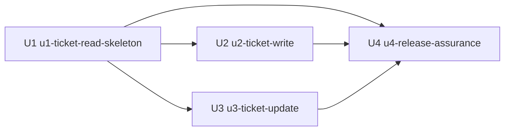

# ITSM 티켓 도구 Unit Dependency DAG

## Sources

- `inception/units-generation/unit-of-work.md`
- `inception/units-generation/units-generation-questions.md`
- `inception/domain-design/components.md`
- `inception/domain-design/decisions.md`
- `inception/user-stories/stories.md`

## Dependency DAG



텍스트 대체: U2와 U3은 각각 U1에 직접 의존하며 서로 직접 의존하지 않는다. U4는 U1, U2, U3에 직접 의존한다. 그래프에는 순환이 없고 U2와 U3의 상대적 순서를 고정하지 않는다. 이 문서는 topology만 정의하며 단일 추천 구현 순서나 critical path를 정하지 않는다.

## Machine-Readable Dependency Graph

```yaml
units:
  - name: u1-ticket-read-skeleton
    kind: library
    depends_on: []
  - name: u2-ticket-write
    kind: library
    depends_on: [u1-ticket-read-skeleton]
  - name: u3-ticket-update
    kind: library
    depends_on: [u1-ticket-read-skeleton]
  - name: u4-release-assurance
    depends_on: [u1-ticket-read-skeleton, u2-ticket-write, u3-ticket-update]
```

## Dependency Rationale

| Dependent | Dependency | Why it is direct |
|---|---|---|
| U2 | U1 | 등록이 현재 사용자 capability, ITSM transport, 안전 오류, 공개 pending-review·`consume_once`, create/update discriminator를 갖춘 공통 confirmation repository, tool registry와 대화 표시 extension contract를 재사용한다. U2 create ledger는 U1 schema에 포함되지 않는다. |
| U3 | U1 | 수정이 상세 조회, ETag/version 보존, 현재 사용자 capability, ITSM transport, create/update discriminator를 갖춘 공통 confirmation-store schema·repository, tool registry와 대화 표시 extension contract를 재사용한다. |
| U4 | U1 | 최종 조립·회귀가 조회 경로와 공통 안전 경계를 포함해야 한다. |
| U4 | U2 | 최종 검증·README가 등록 확인·멱등성과 create ledger를 포함해야 한다. |
| U4 | U3 | 최종 검증·README가 수정 확인·`If-Match`와 충돌 복구를 포함해야 한다. |

U2와 U3 사이에는 공유 상태의 직접 소유권 의존이 없다. U1이 `PendingTicketMutation` 공통 schema와 명시적 create/update variant, 공개 pending-review·`consume_once`, repository·invalidation API, server-owned cursor repository, presentation-history repository, tool registry와 presentation envelope를 완성해 제공한다. U2는 별도 create ledger와 confirmation evidence·CAS 복구를, U3는 update binding을 소유하므로 서로의 migration이나 구현 파일을 필요로 하지 않는다. U4는 이미 정의된 extension들을 조립하고 cross-tool lifecycle을 검증한다.

U1의 논리 저장 계약 `ticket_tools_common_v1`은 DB별 물리 migration으로 분리된다. Server Session SQLite의 `ticket_tools_state_v1`은 `pending_ticket_mutations`와 `ticket_cursor_bindings`를, Agents SDK history SQLite의 `ticket_tools_history_v1`은 `ticket_message_presentations`를 소유한다. U2의 durable ledger는 Server Session SQLite의 별도 `ticket_tools_create_v1.ticket_create_attempts`이며, U3는 migration을 추가하지 않는다. U2와 U3는 U1의 두 namespace를 수정하지 않는다.

## Integration Points

| Producer | Consumer | Mechanism | Data and failure contract |
|---|---|---|---|
| U1 `IdentitySession` | U1·U2·U3 operations | 동기 내부 Python capability | current user와 갱신 가능한 delegated credential을 캡슐화하며 비밀을 직렬화하지 않는다. |
| U1 `ItsmGateway` | U1 read, U2 create, U3 update | 공유 AsyncClient를 쓰는 typed adapter | endpoint별 request/response DTO, ETag·request ID·Retry-After allowlist와 safe error만 전달한다. |
| U1 `TicketOperations` 기반 | U2·U3 extension | 동기 내부 Python interface | normalized input, safe result, retry/confirmation policy를 operation별로 분리한다. |
| U1 confirmation store | U2·U3·ApplicationLifecycle·U4 | 완성된 범용 SQLite schema와 typed repository·idempotent invalidation API | user/session/conversation/operation/payload hash와 선택적 ticket/base version을 저장한다. revocable state만 lifecycle 사건에 폐기한다. |
| U1 cursor repository | U1 read·ApplicationLifecycle·U4 | `ticket_tools_state_v1.ticket_cursor_bindings`와 typed issue/resolve/invalidate API | 사용자·session·conversation, serialization version, canonical query JSON·hash와 upstream cursor를 결합하고 모델에는 continuation reference만 노출한다. |
| U1 presentation-history repository | AgentConversation·ApplicationLifecycle·U4·기존 browser | `ticket_tools_history_v1.ticket_message_presentations`와 message sequence+text hash correlation API | 기존 SDK history DB에서 재시작 복원·text fallback·대화 수명주기 cleanup을 제공한다. |
| U1 confirmation contract | U2 | 공개 pending-review·`consume_once` typed port | U1은 revocable mutation을 소유하며 mutation ID·확인 시각을 반환한다. U2는 공개 반환값만 자기 ledger에 결합하고 U1 schema나 cross-owner transaction을 추가하지 않는다. |
| U2 create binding·ledger | U4 | U1 confirmation create variant + U2-owned `ticket_tools_create_v1.ticket_create_attempts` | pending 게시 전 `prepared` exact bytes·key를 저장하고 confirmation evidence, immutable actor binding, 전역 최대 2회 POST 예산, claim identity·deadline과 결과를 최소 24시간 보존한다. |
| U3 update binding | U4 | U1 confirmation extension; 새 공통 migration 없음 | ticket ID·field/value·base version이 바뀌면 확인을 폐기한다. |
| U1 tool/presentation registries | U2·U3·U4·기존 browser | 이름별 tool factory와 kind별 mapper의 typed extension interface | U2·U3가 공통 registry 파일을 수정하지 않고 별도 모듈을 기여하며 외부 text는 data로 escape한다. |
| U1~U3 tests | U4 full validation | pytest fixture, FakeModel, MockTransport | 실제 OpenAI·ITSM network를 차단하고 Unit별 계층·통합 검증을 전체 suite에 합친다. |

공유 SQLite record는 Unit 간 임의 공유 mutable data가 아니다. `TicketOperations`가 Server Session DB의 state schema와 operation을, `AgentConversation`이 Agents SDK history DB의 presentation companion schema와 operation을 U1 안에서 각각 소유하고, ApplicationLifecycle은 공개 invalidation·clear API만 호출한다.

## Parallel Development Opportunities

- U2와 U3은 모두 U1에만 기능 의존하며 서로 직접 edge가 없으므로 U1이 제공하는 공통 confirmation·registry·presentation contract가 안정된 뒤 독립 작업 집합을 이룬다.
- U1은 `ticket_tools_state_v1`과 `ticket_tools_history_v1`, cursor·presentation repository, tool registry implementation과 presentation envelope/version의 유일한 소유자다. 이 contract는 U2·U3 작업 중 변경하지 않는다.
- U2는 create DTO·binding·별도 `ticket_tools_create_v1` migration, ledger-first `prepared` 생성, confirmation evidence 결합, 전역 attempt budget·CAS 복구, `ticket_write` factory·create mapper·POST 경계를 소유한다.
- U3는 patch DTO·version binding·`ticket_update` factory·update mapper·PATCH 경계를 소유하며 U2의 table이나 모듈을 import하지 않는다.
- U4는 extension 목록과 migration 적용 결과를 소비해 최종 정확히 세 도구를 조립·검증하지만 공유 contract의 누락을 새로 설계하는 단계는 아니다.
- U4는 U1~U3의 결과를 모두 필요로 하므로 이들과 독립 작업 집합이 아니다.

## Integrated Slice

U1은 첫 번째 resolved DAG Unit이자 walking skeleton이다. U2·U3 없이도 기존 로그인 session에서 `ticket_read`를 호출해 사용자 위임 token으로 목록 또는 상세 HTTP를 수행하고, 정제된 결과를 기존 대화 화면에 반환하며 FakeModel/MockTransport 통합 check를 실행할 수 있다. 동시에 후속 Unit이 독립적으로 사용할 공통 confirmation store와 tool/presentation extension contract의 contract test도 통과한다. 실제 데이터는 배포 환경이 아니라 테스트의 생성형 fixture로 검증하며 특정 티켓 ID를 코드나 지침에 넣지 않는다.

U1은 새 서비스나 격리된 설계 문서가 아니라 기존 application route, Agent·Runner, server session, HTTP client와 browser 표시까지 관통하는 실행 가능한 조각이다. U1 checkpoint의 목적은 공통 보안·transport 경계를 실제로 증명하는 것이며, 최종 제품의 정확히 세 도구 구성은 U2·U3 통합 뒤 U4에서 검증한다.

## Assumptions & Open Questions

None.
